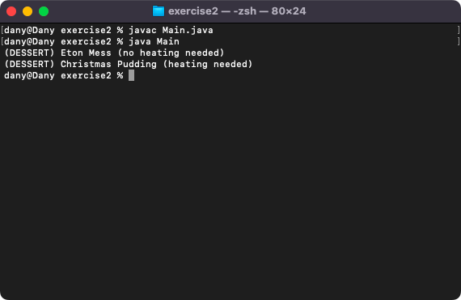
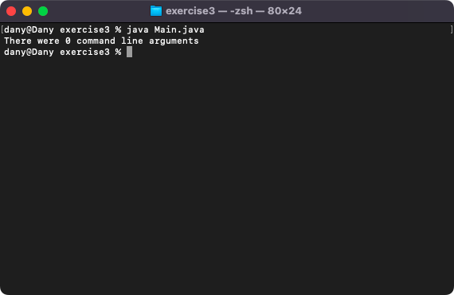
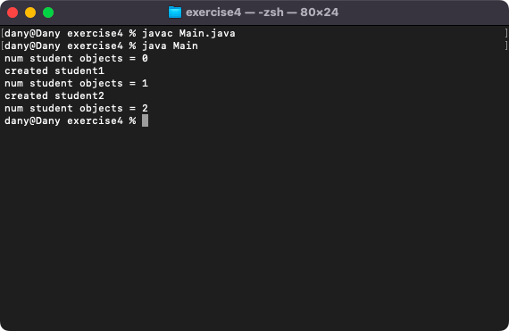

# Week 03 — Lab 3: constants, booleans, command line arguments and static

**Module:** Object Oriented Analysis and Design (`COMP H2031`)  
**Semester:** 3 (Year 2), folder `sem03`

[Module README](../README.md)

## What this week is for

Lecture 3 was constants, booleans, command line arguments and static. Lab 3 has four exercises: a FamilyTicket class with a constant MAX_PEOPLE = 4 that its setter uses to reject more travellers (exercise 1); a Dessert class whose toString() picks (heating needed) or (no heating needed) from a boolean through a helper method (exercise 2); a Main that loops through the command line arguments (exercise 3); and a Student class with a static counter of the objects created (exercise 4). The screenshot of exercise 3 shows a run without arguments.

## Files

| File | What it contains | Screenshot |
|---|---|---|
| [`README.md`](README.md) | This README. | — |
| [`lab/object_oriented_analysis_and_design_week03_lab.pdf`](lab/object_oriented_analysis_and_design_week03_lab.pdf) | The lab sheet (7 pages): four exercises (constants, a boolean helper method, command line arguments, a static counter). | — |
| [`lab/solution/exercise1/FamilyTicket.java`](lab/solution/exercise1/FamilyTicket.java) | Exercise 1: class FamilyTicket with the constant MAX_PEOPLE = 4, a family name and the number travelling; the setter rejects more than the constant. | — |
| [`lab/solution/exercise1/Main.java`](lab/solution/exercise1/Main.java) | Exercise 1: two tickets, with 3 and 6 travellers, and the value of the constant. |  *Exercise 1: the second family's six travellers are rejected.* |
| [`lab/solution/exercise2/Dessert.java`](lab/solution/exercise2/Dessert.java) | Exercise 2: class Dessert with a name and a needsHeating boolean and a toString() that uses a helper method. | — |
| [`lab/solution/exercise2/Main.java`](lab/solution/exercise2/Main.java) | Exercise 2: creates and prints two desserts. |  *Exercise 2: two desserts.* |
| [`lab/solution/exercise3/Main.java`](lab/solution/exercise3/Main.java) | Exercise 3: prints the number of command line arguments and each argument. |  *Exercise 3: a run without command line arguments.* |
| [`lab/solution/exercise4/Main.java`](lab/solution/exercise4/Main.java) | Exercise 4: prints the static count before and after creating two students. |  *Exercise 4: the count of student objects goes from 0 to 2.* |
| [`lab/solution/exercise4/Student.java`](lab/solution/exercise4/Student.java) | Exercise 4: class Student with a name, a year and a static counter that its constructor increases. | — |
