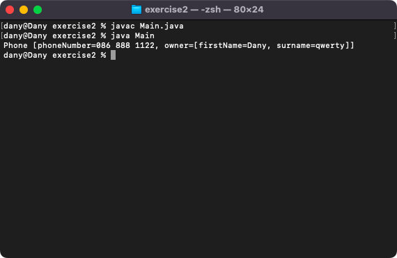
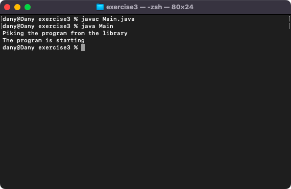

# Week 04 — Lab 4: inheritance, composition and super

**Module:** Object Oriented Analysis and Design (`COMP H2031`)  
**Semester:** 3 (Year 2), folder `sem03`

[Module README](../README.md)

## What this week is for

Lecture 4 was inheritance, composition and associations. Lab 4 has three exercises: generalise the common parts of the Galaxy and Iphone classes into a superclass Phone and make them subclasses (exercise 1); associate a Person with a Phone as its owner (exercise 2); and use the keyword super to call a superclass method from a subclass (exercise 3).

## Files

| File | What it contains | Screenshot |
|---|---|---|
| [`README.md`](README.md) | This README. | — |
| [`lab/object_oriented_analysis_and_design_week04_lab.pdf`](lab/object_oriented_analysis_and_design_week04_lab.pdf) | The lab sheet (3 pages): exercise 1 (generalising to a superclass), exercise 2 (composition) and exercise 3 (super). | — |
| [`lab/solution/exercise1/Phone.java`](lab/solution/exercise1/Phone.java) | Exercise 1: the superclass Phone with the common properties and toString(). | — |
| [`lab/solution/exercise1/Galaxy.java`](lab/solution/exercise1/Galaxy.java) | Exercise 1: class Galaxy, a subclass of Phone. | — |
| [`lab/solution/exercise1/Iphone.java`](lab/solution/exercise1/Iphone.java) | Exercise 1: class Iphone, a subclass of Phone. | — |
| [`lab/solution/exercise1/Main.java`](lab/solution/exercise1/Main.java) | Exercise 1: creates an iPhone and a Galaxy Note as Phone variables and prints them. |  *Exercise 1: the details of an iPhone and a Galaxy.* |
| [`lab/solution/exercise2/Person.java`](lab/solution/exercise2/Person.java) | Exercise 2: class Person with a first name and a surname. | — |
| [`lab/solution/exercise2/Phone.java`](lab/solution/exercise2/Phone.java) | Exercise 2: class Phone with a phone number and an owner, a reference to a Person. | — |
| [`lab/solution/exercise2/Main.java`](lab/solution/exercise2/Main.java) | Exercise 2: creates a person and a phone owned by that person and prints the phone. |  *Exercise 2: a phone with its owner.* |
| [`lab/solution/exercise3/ProgramsLibrary.java`](lab/solution/exercise3/ProgramsLibrary.java) | Exercise 3: the superclass with a method startTheProgram(). | — |
| [`lab/solution/exercise3/VeryImportantProgram.java`](lab/solution/exercise3/VeryImportantProgram.java) | Exercise 3: the subclass that overrides startTheProgram() and calls super.startTheProgram() first. | — |
| [`lab/solution/exercise3/Main.java`](lab/solution/exercise3/Main.java) | Exercise 3: creates the subclass object and calls startTheProgram(). |  *Exercise 3: the subclass method calls the superclass method.* |
