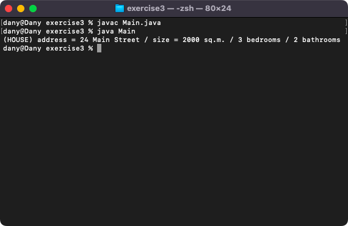
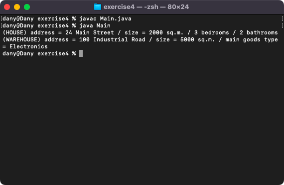
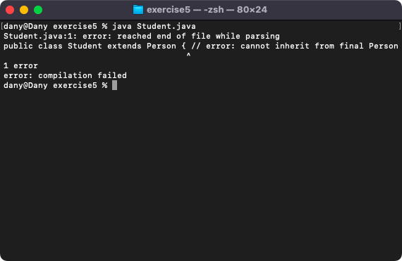
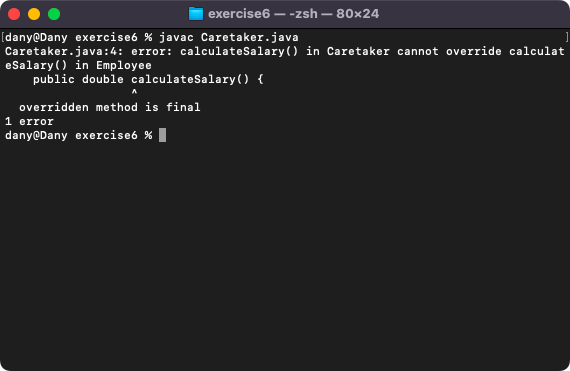
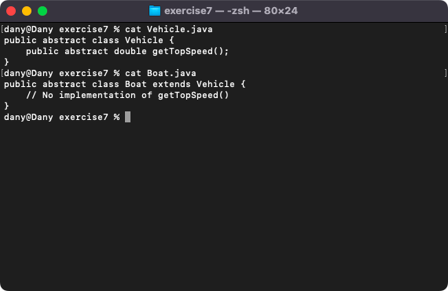

# Week 05 — Lab 5: enumerations, protected, abstract and final

**Module:** Object Oriented Analysis and Design (`COMP H2031`)  
**Semester:** 3 (Year 2), folder `sem03`

[Module README](../README.md)

## What this week is for

Lecture 5 was protected, abstract and final. Lab 5 has seven exercises: an enumeration FreshType used by a Food class (exercise 1); an abstract class Building with a House subclass that uses the public accessors of the superclass (exercise 2); the same with protected variables that the subclass uses directly (exercise 3); an abstract Building with House and Warehouse subclasses, where creating a Building must not compile (exercise 4); a final class Person that cannot be extended (exercise 5); a final method that cannot be overridden (exercise 6); and an abstract method that a subclass must implement or be declared abstract (exercise 7). Exercises 5 to 7 demonstrate compile errors, so their solutions keep the failing line commented out or in a comment, and the screenshots show the errors.

## Files

| File | What it contains | Screenshot |
|---|---|---|
| [`README.md`](README.md) | This README. | — |
| [`lab/object_oriented_analysis_and_design_week05_lab.pdf`](lab/object_oriented_analysis_and_design_week05_lab.pdf) | The lab sheet (11 pages): seven exercises (enumeration, abstract classes, protected, final class, final method, abstract method). | — |
| [`lab/solution/exercise1/FreshType.java`](lab/solution/exercise1/FreshType.java) | Exercise 1: the enumeration FreshType (FRESH, SELL_TODAY and OUT_OF_DATE). | — |
| [`lab/solution/exercise1/Food.java`](lab/solution/exercise1/Food.java) | Exercise 1: class Food with a name and a FreshType. | — |
| [`lab/solution/exercise1/Main.java`](lab/solution/exercise1/Main.java) | Exercise 1: creates and prints two Food objects. |  *Exercise 1: two Food objects with their freshness.* |
| [`lab/solution/exercise2/Building.java`](lab/solution/exercise2/Building.java) | Exercise 2: abstract class Building with private address and size and public accessors. | — |
| [`lab/solution/exercise2/House.java`](lab/solution/exercise2/House.java) | Exercise 2: class House, a subclass of Building, with a toString() that uses the inherited getters. | — |
| [`lab/solution/exercise2/Main.java`](lab/solution/exercise2/Main.java) | Exercise 2: creates and prints a House. |  *Exercise 2: the House.* |
| [`lab/solution/exercise3/Building.java`](lab/solution/exercise3/Building.java) | Exercise 3: Building with protected address and size. | — |
| [`lab/solution/exercise3/House.java`](lab/solution/exercise3/House.java) | Exercise 3: House with a toString() that uses the inherited protected variables directly. | — |
| [`lab/solution/exercise3/Main.java`](lab/solution/exercise3/Main.java) | Exercise 3: creates and prints a House. |  *Exercise 3: the House with protected variables.* |
| [`lab/solution/exercise4/Building.java`](lab/solution/exercise4/Building.java) | Exercise 4: abstract class Building. | — |
| [`lab/solution/exercise4/House.java`](lab/solution/exercise4/House.java) | Exercise 4: subclass House. | — |
| [`lab/solution/exercise4/Warehouse.java`](lab/solution/exercise4/Warehouse.java) | Exercise 4: subclass Warehouse with a main goods type. | — |
| [`lab/solution/exercise4/Main.java`](lab/solution/exercise4/Main.java) | Exercise 4: creates a House and a Warehouse; the line that creates a Building is commented out because it does not compile. |  *Exercise 4: a House and a Warehouse.* |
| [`lab/solution/exercise5/Person.java`](lab/solution/exercise5/Person.java) | Exercise 5: the final class Person. | — |
| [`lab/solution/exercise5/Student.java`](lab/solution/exercise5/Student.java) | Exercise 5: class Student, with the line that extends the final Person in a comment (the compile error). |  *Exercise 5: the compile error when extending the final class Person.* |
| [`lab/solution/exercise6/Employee.java`](lab/solution/exercise6/Employee.java) | Exercise 6: class Employee with a final method calculateSalary() that returns 20.0. | — |
| [`lab/solution/exercise6/Caretaker.java`](lab/solution/exercise6/Caretaker.java) | Exercise 6: class Caretaker, with the overriding calculateSalary() in a comment (the compile error). |  *Exercise 6: the compile error when overriding the final method.* |
| [`lab/solution/exercise7/Vehicle.java`](lab/solution/exercise7/Vehicle.java) | Exercise 7: abstract class Vehicle with the abstract method getTopSpeed(). |  *Exercise 7: the abstract Vehicle and the abstract Boat.* |
| [`lab/solution/exercise7/Boat.java`](lab/solution/exercise7/Boat.java) | Exercise 7: abstract class Boat, a subclass of Vehicle without getTopSpeed(). | — |
