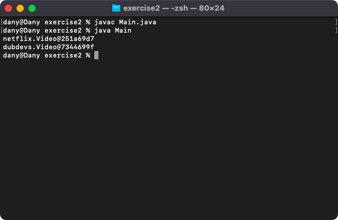
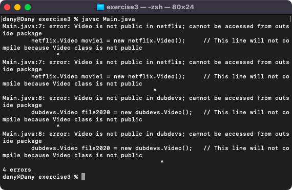

# Week 06 — Lab 6: packages

**Module:** Object Oriented Analysis and Design (`COMP H2031`)  
**Semester:** 3 (Year 2), folder `sem03`

[Module README](../README.md)

## What this week is for

Lecture 6 was packages, constructors and super. Lab 6 has three exercises: classes Programme and Student in a package tudublin, used from a Main outside the package, with custom toString() methods (exercise 1); two classes named Video in the packages netflix and dubdevs, used together in one Main (exercise 2); and removing the public keyword from the Video classes to see that a class outside the package can no longer create them (exercise 3). In exercise 3 the lines that fail to compile are commented out in Main. The mini-project was handed out this week.

## Files

| File | What it contains | Screenshot |
|---|---|---|
| [`README.md`](README.md) | This README. | — |
| [`lab/object_oriented_analysis_and_design_week06_lab.pdf`](lab/object_oriented_analysis_and_design_week06_lab.pdf) | The lab sheet (6 pages): three exercises on packages. | — |
| [`lab/solution/exercise1/Main.java`](lab/solution/exercise1/Main.java) | Exercise 1: creates a Programme (HCert Computing, level 6) and a Student linked to it and prints them. |  *Exercise 1: the Programme and the Student printed with their toString() methods.* |
| [`lab/solution/exercise1/tudublin/Programme.java`](lab/solution/exercise1/tudublin/Programme.java) | Exercise 1: class Programme in the package tudublin, with a name and a level. | — |
| [`lab/solution/exercise1/tudublin/Student.java`](lab/solution/exercise1/tudublin/Student.java) | Exercise 1: class Student in the package tudublin, with a name and a Programme. | — |
| [`lab/solution/exercise2/Main.java`](lab/solution/exercise2/Main.java) | Exercise 2: creates a netflix Video and a dubdevs Video and prints them. |  *Exercise 2: the two Video objects with their package names.* |
| [`lab/solution/exercise2/netflix/Video.java`](lab/solution/exercise2/netflix/Video.java) | Exercise 2: class Video in the package netflix (a Netflix id and a content category). | — |
| [`lab/solution/exercise2/dubdevs/Video.java`](lab/solution/exercise2/dubdevs/Video.java) | Exercise 2: class Video in the package dubdevs (a format and a size in megabytes). | — |
| [`lab/solution/exercise3/Main.java`](lab/solution/exercise3/Main.java) | Exercise 3: the same Main, with the lines that cannot compile commented out. |  *Exercise 3: the compile errors for the non-public Video classes.* |
| [`lab/solution/exercise3/netflix/Video.java`](lab/solution/exercise3/netflix/Video.java) | Exercise 3: the netflix Video class without the public keyword. | — |
| [`lab/solution/exercise3/dubdevs/Video.java`](lab/solution/exercise3/dubdevs/Video.java) | Exercise 3: the dubdevs Video class without the public keyword. | — |
