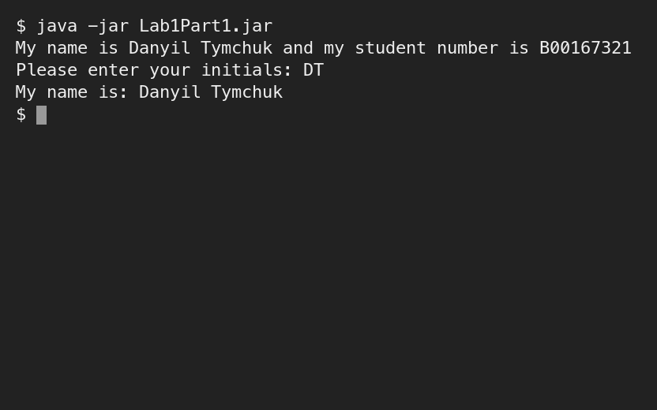
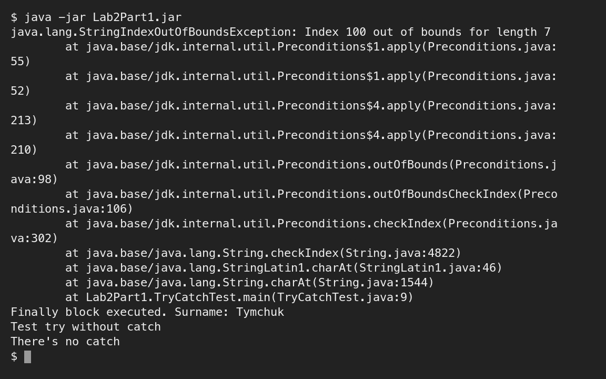
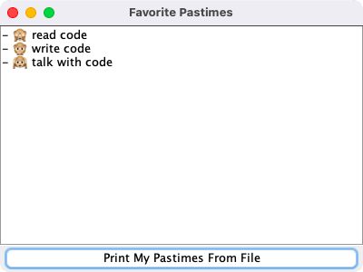
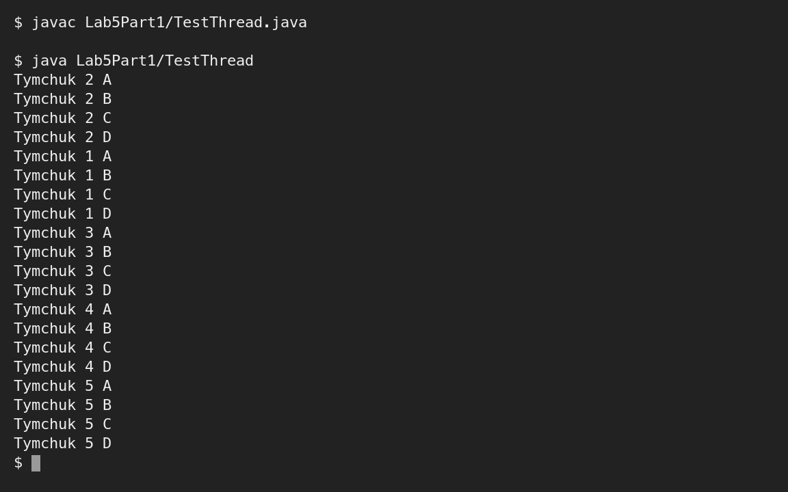
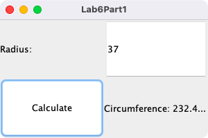

# Advanced Programming

**Module:** Advanced Programming (`COMP H2030`)  
**Semester:** 4 (Year 2), folder `sem04`  
**Lecturer:** Dr Luke Raeside  
**Date:** January - May 2025  
**Credits:** 5 ECTS  

## What this module is for

Advanced Programming is a Java module on advanced APIs and the core aspects of object-oriented programming (the aims and the syllabus are in the module descriptor below). The weekly topics are the IDE, jar files, packages, Javadoc and recursion (week 1), exception handling with try, catch and finally (week 2), applied exceptions and JDBC (week 3), internationalisation, sound and debugging (week 4), threads, enums and varargs (week 5), classes, reflection, generics and lambdas (week 6), classes and OOP (week 7) and polymorphism and interfaces (week 8). Weeks 1 to 6 each have a lab sheet with four parts, worth 5% of the grade, and the solutions are Java programs, mostly Swing GUIs, with their jar files and the generated Javadoc. Week 7 has the written in-class test (30%) and, like week 8, only a lecture code listing in its folder. The final assessment (40%, week 10) was a one-day assignment of 3 April 2025, version 5: a Musical Instruments GUI that shows an image of at least three instruments and plays a sound for each, takes the instrument name from an input field, switches between two languages with resource bundles (the screenshots show English and Irish), delays the image with a thread, rejects unknown instruments with a custom exception, uses a class hierarchy of instruments and calls the supplied logging class AssignmentLogger. The brief with the marking guideline and the self-assessment is in [`assessment/01/`](assessment/01/), and the Java project is on the matching branch linked above. The week folders are numbered by the week of the lecture.

## Grades Breakdown

| Assessment Type | Weighting |
|---|---|
| Weekly labs 1 to 6 (5% each) | 30% |
| Written in-class test (week 7, in the second hour of the lecture) | 30% |
| Final assessment (week 10, a one-day assessment) | 40% |

### Verified self-assessment

The labs are self-assessed and then checked with the lab tutor. The steps of the weekly labwork assessment process:

1. Fill in the self-assessment when the work is complete (the claim section of the [individual lab assessment sheet](resources/advanced_programming_individual_lab_assessment_sheet.pdf)).
2. Upload the work and the self-assessment sheet.
3. Meet the lab tutor and have the work assessed before the assessment deadline.

## Assessments

| File | What it contains |
|---|---|
| [`assessment/01/README.md`](assessment/01/README.md) | The README of Assessment 1: the final assessment (40%), the Musical Instruments GUI, the Java project and how to run it. |
| [`assessment/01/advanced_programming_assessment.pdf`](assessment/01/advanced_programming_assessment.pdf) | The brief of the final assessment (7 pages, 40% of the grade, a one-day assessment dated 3 April 2025): version 5, the Musical Instruments GUI. It requires an international GUI (a JFrame) that shows an image of at least three musical instruments with a translated description, takes the instrument name in an input field and plays a sample sound, works in two languages (one of them English) with ResourceBundle, delays the image with a thread (at least 500 milliseconds), uses a custom exception and a class hierarchy of instruments, and calls the AssignmentLogger class in all constructors and methods. The code is split into the packages exceptions, gui, instruments, internationalization and logging, with the folders images and sounds. The marking guideline has 400 marks: exceptions and exception handling 40, the GUI and general program success 170, internationalization 80, the musical instruments (object oriented) 70, and comments, naming and logger 40. The brief also gives the rules (generative AI is not permitted, late-submission penalties) and the optional self-assessment. |
| [`assessment/01/resources/logging.zip`](assessment/01/resources/logging.zip) | The logging package of the assignment (a zip) with the AssignmentLogger class that the brief requires. |
| [`assessment/01/submission/advanced_programming_assessment_self_assessment.pdf`](assessment/01/submission/advanced_programming_assessment_self_assessment.pdf) | The completed self-assessment sheet that went with the submission (1 page). |
| [`assessment/01/submission/src/`](assessment/01/submission/src/) | The Java project of the final assessment, in the packages exceptions, gui, instruments, internationalization and logging: [`MainFrame.java`](assessment/01/submission/src/gui/MainFrame.java) (the GUI), [`Instrument.java`](assessment/01/submission/src/instruments/Instrument.java) with its subclasses [`Drums.java`](assessment/01/submission/src/instruments/Drums.java), [`Guitar.java`](assessment/01/submission/src/instruments/Guitar.java) and [`Piano.java`](assessment/01/submission/src/instruments/Piano.java), [`InstrumentNotFoundException.java`](assessment/01/submission/src/exceptions/InstrumentNotFoundException.java), [`ResourceManager.java`](assessment/01/submission/src/internationalization/ResourceManager.java), [`AssignmentLogger.java`](assessment/01/submission/src/logging/AssignmentLogger.java) and the jar [`Logger.jar`](assessment/01/submission/src/logging/Logger.jar). |
| [`assessment/01/submission/resources/`](assessment/01/submission/resources/) | The resource bundles of the two languages: [`MessagesBundle_en.properties`](assessment/01/submission/resources/MessagesBundle_en.properties) (English) and [`MessagesBundle_ga.properties`](assessment/01/submission/resources/MessagesBundle_ga.properties) (Irish). |
| [`assessment/01/submission/images/`](assessment/01/submission/images/) | The images of the three instruments ([`drums.jpg`](assessment/01/submission/images/drums.jpg), [`guitar.jpg`](assessment/01/submission/images/guitar.jpg) and [`piano.jpg`](assessment/01/submission/images/piano.jpg)) and the image that is shown before an instrument is chosen ([`instrument.jpg`](assessment/01/submission/images/instrument.jpg)). |
| [`assessment/01/submission/sounds/`](assessment/01/submission/sounds/) | The nine sample sounds, three for each instrument: [`Drum1.wav`](assessment/01/submission/sounds/Drum1.wav) to [`Drum3.wav`](assessment/01/submission/sounds/Drum3.wav), [`Guitar1.wav`](assessment/01/submission/sounds/Guitar1.wav) to [`Guitar3.wav`](assessment/01/submission/sounds/Guitar3.wav) and [`Piano1.wav`](assessment/01/submission/sounds/Piano1.wav) to [`Piano3.wav`](assessment/01/submission/sounds/Piano3.wav). |
| [`assessment/01/submission/sketches/`](assessment/01/submission/sketches/) | The sketch of the class diagram: [`musical_instruments_class_diagram_sketch.png`](assessment/01/submission/sketches/musical_instruments_class_diagram_sketch.png). |

The Java project of the final assessment is in [`assessment/01/submission/`](assessment/01/submission/); how to compile and run it is in the [assessment README](assessment/01/README.md#how-to-run). The module descriptor below lists the recommended texts and the internet resources.

## All weeks

| Week | Title | Files | Screenshot |
|---|---|---|---|
| [Week 1](week01/) | Introduction: IDEs, jar files, packages, Javadoc and recursion | [`lab/advanced_programming_week01_lab.pdf`](week01/lab/advanced_programming_week01_lab.pdf) [`lab/solution/`](week01/lab/solution/) |  |
| [Week 2](week02/) | try, catch and finally | [`lab/advanced_programming_week02_lab.pdf`](week02/lab/advanced_programming_week02_lab.pdf) [`lab/solution/`](week02/lab/solution/) |  |
| [Week 3](week03/) | Applied exceptions and JDBC | [`lab/advanced_programming_week03_lab.pdf`](week03/lab/advanced_programming_week03_lab.pdf) [`lab/solution/`](week03/lab/solution/) |  |
| [Week 4](week04/) | Internationalisation, sound and debugging | [`lab/advanced_programming_week04_lab.pdf`](week04/lab/advanced_programming_week04_lab.pdf) [`lab/solution/`](week04/lab/solution/) [`resources/`](week04/resources/) |  |
| [Week 5](week05/) | Threads, enums and varargs | [`lab/advanced_programming_week05_lab.pdf`](week05/lab/advanced_programming_week05_lab.pdf) [`lab/solution/`](week05/lab/solution/) [`resources/lecture_5_code_listing.zip`](week05/resources/lecture_5_code_listing.zip) |  |
| [Week 6](week06/) | Classes, reflection, generics and lambdas | [`lab/advanced_programming_week06_lab.pdf`](week06/lab/advanced_programming_week06_lab.pdf) [`lab/solution/`](week06/lab/solution/) [`resources/lecture_6_code_examples.zip`](week06/resources/lecture_6_code_examples.zip) |  |
| [Week 7](week07/) | Classes and OOP | [`resources/lecture_7_code_listing.zip`](week07/resources/lecture_7_code_listing.zip) | — |
| [Week 8](week08/) | Polymorphism and interfaces | [`resources/lecture_8_code_listing.zip`](week08/resources/lecture_8_code_listing.zip) | — |
| Week 10 | Final assessment (40%, a one-day assessment) | None. The assessment is in [`assessment/01/`](assessment/01/). | — |

## Resources

| File | What it contains |
|---|---|
| [`resources/advanced_programming_individual_lab_assessment_sheet.pdf`](resources/advanced_programming_individual_lab_assessment_sheet.pdf) | The individual lab assessment sheet filled in (1 page, PDF): for the four parts of each of labs 1 to 6 the marks available, the claim and the lecturer's final mark (300 of 300), and the result of the in-class test (26 of 30, 86.67%). |

### Schedule

The assessment breakdown and schedule of the module for 2024-25. The weeks are the calendar weeks of the semester and the week folders. The sheet prints "Sun 24th Feb" for submission deadline 1; 24 February 2025 was a Monday.

| Week | Session | Week Date |
|---|---|---|
| [Week 1](week01/) | Labwork 1 out (5%) | 27 January 2025 |
| [Week 2](week02/) | Labwork 2 out (5%) | 3 February 2025 |
| [Week 3](week03/) | Labwork 3 out (5%) | 10 February 2025 |
| [Week 4](week04/) | Labwork 4 out (5%) Submission deadline 1 for labs 1 to 3, Sunday at 23:59 | 17 February 2025 |
| [Week 5](week05/) | Labwork 5 out (5%) Assessment deadline 1 for labs 1 to 3 (date to be confirmed) | 24 February 2025 |
| [Week 6](week06/) | Labwork 6 out (5%) | 3 March 2025 |
| [Week 7](week07/) | Written in-class test during the second hour of the lecture (30%) | 10 March 2025 |
| [Week 8](week08/) | Submission deadline 2 for labs 4 to 6, Sunday 23 March at 23:59 | 17 March 2025 |
| Week 9 | Assessment deadline 2 for labs 4 to 6, in the last lab session of the week | 24 March 2025 |
| Week 10 | Final assessment day, Thursday 3 April from 9:00 to 23:59 (40%): [the brief](assessment/01/advanced_programming_assessment.pdf) | 31 March 2025 |
| Week 11 | — | 7 April 2025 |
| No week | Spring break | 14 and 21 April 2025 |
| Week 12 | — | 28 April 2025 |
| Week 13 | Review and revision week | 5 May 2025 |

### Module descriptor

**Module aims.**

- To develop competence in software development.
- To advance the ability to deliver software with enhanced capabilities using appropriate industrial development tools.
- To introduce a range of advanced Java APIs and apply them to solve problems.
- To further develop programming and problem solving skills and capabilities in a broad range of Java technologies.
- To comprehensively cover the core aspects of object-oriented programming.

**Indicative syllabus.**

- Software development using an IDE (Integrated Development Environment)
- Exception handling
- The class structure
- Advanced GUI programming
- Introducing emerging programming technologies
- Object-oriented programming

**Recommended text.**

- Horstmann, Cay S. and Cornell, Gary (2004), Core Java Volume 1 - Fundamentals, Sun Microsystems Press.
- Horstmann, Cay S. and Cornell, Gary (2004), Core Java Volume 2 - Advanced Features, Sun Microsystems Press.

**Supplementary materials.**

- Stelting, Stephen (2004), Robust Java - Exception Handling, Testing and Debugging, Sun Microsystems Press.
