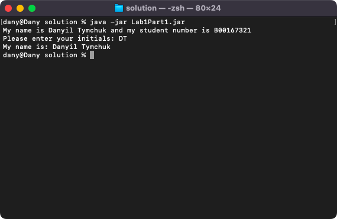
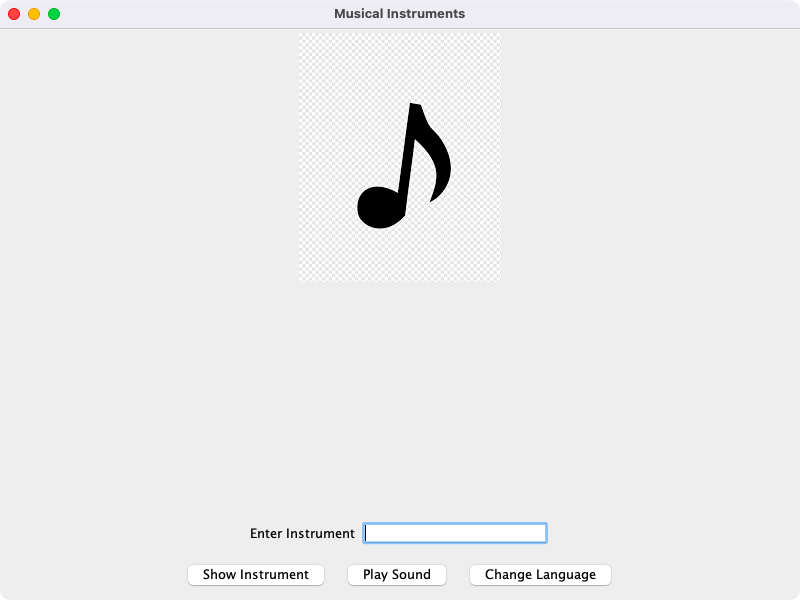
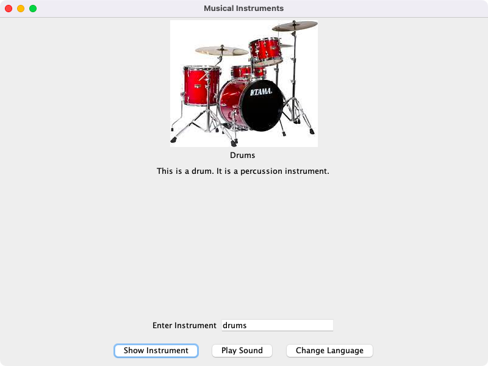
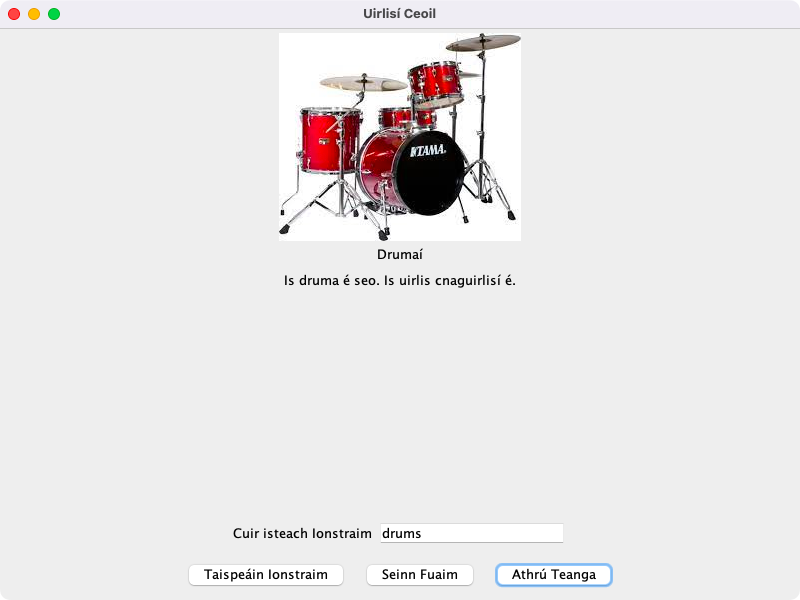

# Advanced Programming

**Module:** Advanced Programming (`COMP H2030`)  
**Semester:** 4 (Year 2), folder `sem04`  
**Lecturer:** Dr Luke Raeside  
**Date:** January - May 2025  
**Credits:** 5 ECTS  
**Matching project branch:** [`assessment/year02/module-advanced_programming/musical-instruments-gui`](https://github.com/DanyilT/projects-in-university/tree/assessment/year02/module-advanced_programming/musical-instruments-gui)

## What this module is for

Advanced Programming is a Java module on advanced APIs and the core aspects of object-oriented programming (the aims and the syllabus are in the module descriptor below). The weekly topics are the IDE, jar files, packages, Javadoc and recursion (week 1), exception handling with try, catch and finally (week 2), applied exceptions and JDBC (week 3), internationalisation, sound and debugging (week 4), threads, enums and varargs (week 5), classes, reflection, generics and lambdas (week 6), classes and OOP (week 7) and polymorphism and interfaces (week 8). Weeks 1 to 6 each have a lab sheet with four parts, worth 5% of the grade, and the solutions are Java programs, mostly Swing GUIs, with their jar files and the generated Javadoc. Week 7 has the written in-class test (30%) and, like week 8, only a lecture code listing in its folder. The final assessment (40%, week 10) was a one-day assignment of 3 April 2025, version 5: a Musical Instruments GUI that shows an image of at least three instruments and plays a sound for each, takes the instrument name from an input field, switches between two languages with resource bundles (the screenshots show English and Irish), delays the image with a thread, rejects unknown instruments with a custom exception, uses a class hierarchy of instruments and calls the supplied logging class AssignmentLogger. The brief with the marking guideline and the self-assessment is in [`assessment/01/`](assessment/01/), and the Java project is on the matching branch linked above. The week folders are numbered by the week of the lecture.

## Grades Breakdown

| Assessment Type | Weighting |
|---|---|
| Weekly labs 1 to 6 (5% each) | 30% |
| Written in-class test (week 7, in the second hour of the lecture) | 30% |
| Final assessment (week 10, a one-day assessment) | 40% |

## All weeks

| Week | Title | Files | Screenshot |
|---|---|---|---|
| [Week 1](week01/) | Introduction: IDEs, jar files, packages, Javadoc and recursion | [`lab/advanced_programming_week01_lab.pdf`](week01/lab/advanced_programming_week01_lab.pdf) [`lab/solution/`](week01/lab/solution/) |  |
| [Week 2](week02/) | try, catch and finally | [`lab/advanced_programming_week02_lab.pdf`](week02/lab/advanced_programming_week02_lab.pdf) [`lab/solution/`](week02/lab/solution/) |  |
| [Week 3](week03/) | Applied exceptions and JDBC | [`lab/advanced_programming_week03_lab.pdf`](week03/lab/advanced_programming_week03_lab.pdf) [`lab/solution/`](week03/lab/solution/) |  |
| [Week 4](week04/) | Internationalisation, sound and debugging | [`lab/advanced_programming_week04_lab.pdf`](week04/lab/advanced_programming_week04_lab.pdf) [`lab/solution/`](week04/lab/solution/) [`resources/`](week04/resources/) |  |
| [Week 5](week05/) | Threads, enums and varargs | [`lab/advanced_programming_week05_lab.pdf`](week05/lab/advanced_programming_week05_lab.pdf) [`lab/solution/`](week05/lab/solution/) [`resources/lecture_5_code_listing.zip`](week05/resources/lecture_5_code_listing.zip) |  |
| [Week 6](week06/) | Classes, reflection, generics and lambdas | [`lab/advanced_programming_week06_lab.pdf`](week06/lab/advanced_programming_week06_lab.pdf) [`lab/solution/`](week06/lab/solution/) [`resources/lecture_6_code_examples.zip`](week06/resources/lecture_6_code_examples.zip) |  |
| [Week 7](week07/) | Classes and OOP | [`resources/lecture_7_code_listing.zip`](week07/resources/lecture_7_code_listing.zip) | — |
| [Week 8](week08/) | Polymorphism and interfaces | [`resources/lecture_8_code_listing.zip`](week08/resources/lecture_8_code_listing.zip) | — |
| Week 10 | Final assessment (40%, a one-day assessment) | None. The assessment is in [`assessment/01/`](assessment/01/). | — |

## Assessments and other files

| File | What it contains |
|---|---|
| [`assessment/01/advanced_programming_assessment.pdf`](assessment/01/advanced_programming_assessment.pdf) | The brief of the final assessment (7 pages, 40% of the grade, a one-day assessment dated 3 April 2025): version 5, the Musical Instruments GUI. It requires an international GUI (a JFrame) that shows an image of at least three musical instruments with a translated description, takes the instrument name in an input field and plays a sample sound, works in two languages (one of them English) with ResourceBundle, delays the image with a thread (at least 500 milliseconds), uses a custom exception and a class hierarchy of instruments, and calls the AssignmentLogger class in all constructors and methods. The code is split into the packages exceptions, gui, instruments, internationalization and logging, with the folders images and sounds. The marking guideline has 400 marks: exceptions and exception handling 40, the GUI and general program success 170, internationalization 80, the musical instruments (object oriented) 70, and comments, naming and logger 40. The brief also gives the rules (generative AI is not permitted, late-submission penalties) and the optional self-assessment. |
| [`assessment/01/resources/Final_Assignment_Version5_MusicalInstruments_Self_Assess.xlsx`](assessment/01/resources/Final_Assignment_Version5_MusicalInstruments_Self_Assess.xlsx) | The self-assessment sheet of version 5 (an Excel file) with the detailed marking guideline. |
| [`assessment/01/resources/advanced_programming_assessment.docx`](assessment/01/resources/advanced_programming_assessment.docx) | The brief as a Word document. |
| [`assessment/01/resources/advanced_programming_assessment_cover_sheet.pdf`](assessment/01/resources/advanced_programming_assessment_cover_sheet.pdf) | The cover sheet of the assessment (2 pages). |
| [`assessment/01/resources/logging.zip`](assessment/01/resources/logging.zip) | The logging package of the assignment (a zip) with the AssignmentLogger class that the brief requires. |
| [`assessment/01/submission/advanced_programming_assessment_self_assessment.pdf`](assessment/01/submission/advanced_programming_assessment_self_assessment.pdf) | The completed self-assessment sheet that went with the submission (1 page). |
| [`assessment/01/submission/project_link.txt`](assessment/01/submission/project_link.txt) | The link to the project of the final assessment on GitHub. |
| [`resources/advanced_programming_assessment_schedule.pdf`](resources/advanced_programming_assessment_schedule.pdf) | The assessment breakdown and schedule of the module for 2024-25 (1 page): labwork 1 to 6 handed out in weeks 1 to 6 (5% each), the submission and assessment deadlines of labs 1 to 3 and 4 to 6, the written in-class test in week 7 (30%) and the final assessment day, Thursday 3 April from 9:00 to 23:59 (week 10, 40%). |
| [`resources/advanced_programming_assessment_schedule_filled.pdf`](resources/advanced_programming_assessment_schedule_filled.pdf) | A filled-in copy of the schedule (1 page). |
| [`resources/advanced_programming_individual_lab_assessment_sheet.xlsx`](resources/advanced_programming_individual_lab_assessment_sheet.xlsx) | The individual lab assessment sheet (an Excel file). |
| [`resources/verified_self_assessment.png`](resources/verified_self_assessment.png) | An image of the verified self-assessment. |

The Java project of the final assessment is on the matching branch linked at the top: its src folder has the packages exceptions, gui, instruments, internationalization and logging, and it has the folders images, sounds, resources (the resource bundles of the two languages) and sketches. The module descriptor below lists the recommended texts and the internet resources.

### Screenshots

*The Musical Instruments GUI at the start, before an instrument is entered.*

*The GUI in English with the drums displayed.*

*The GUI in Irish with the drums displayed (Drumaí).*

---

## Module descriptor

Module Title: Advanced Programming (mandatory), module code COMP H2030, 5 credits, lecturer Dr Luke Raeside.

**Module aims.**

- To develop competence in software development.
- To advance the ability to deliver software with enhanced capabilities using appropriate industrial development tools.
- To introduce a range of advanced Java APIs and apply them to solve problems.
- To further develop programming and problem solving skills and capabilities in a broad range of Java technologies.
- To comprehensively cover the core aspects of object-oriented programming.

**Indicative syllabus.**

- Software development using an IDE (Integrated Development Environment)
- Exception handling
- The class structure
- Advanced GUI programming
- Introducing emerging programming technologies
- Object-oriented programming

**Assessment.** The descriptor gives continuous assessment 100%, and the repeat assessment is continuous assessment 100%. The 2024-25 overview divides the continuous assessment into 30% weekly labwork, 30% written test and 40% final assessment.

**Recommended text.**

- Horstmann, Cay S. and Cornell, Gary (2004), Core Java Volume 1 - Fundamentals, Sun Microsystems Press.
- Horstmann, Cay S. and Cornell, Gary (2004), Core Java Volume 2 - Advanced Features, Sun Microsystems Press.

**Supplementary materials.**

- Stelting, Stephen (2004), Robust Java - Exception Handling, Testing and Debugging, Sun Microsystems Press.

**Internet based resources.**

- http://www.java.sun.com
- http://www.eclipse.org
