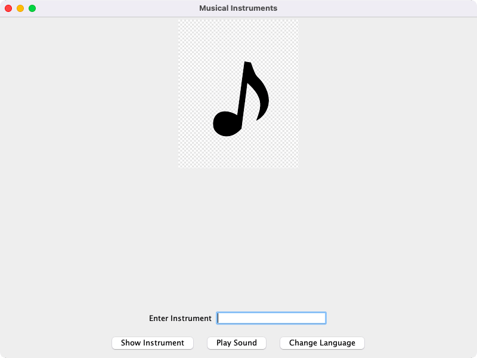
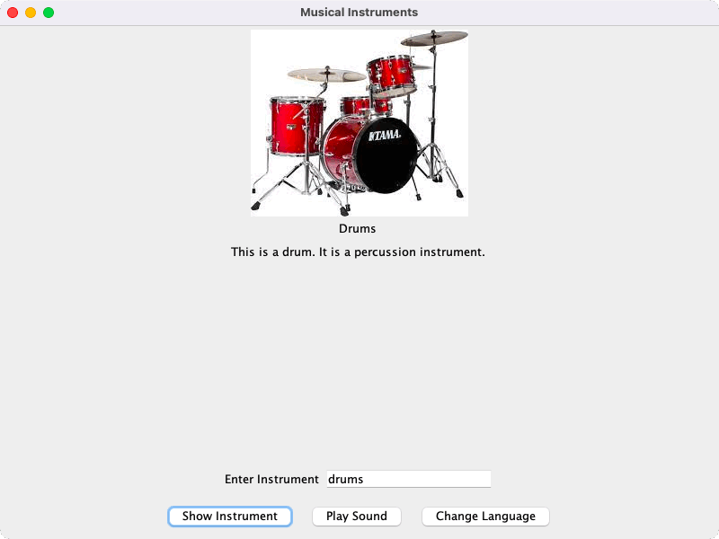
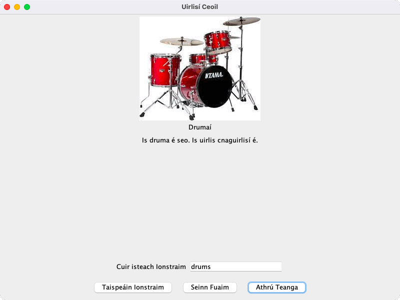

# Assessment 1: Musical Instruments GUI

**Module:** Advanced Programming (`COMP H2030`)  
**Semester:** 4 (Year 2), folder `sem04`  
**Type:** assessment, individual  
**Weight:** 40%  
**Deadline:** 3 April 2025 (a one-day assessment)  
**Result:** —  
**On main:** [`sem04/advanced_programming/assessment/01/`](https://github.com/DanyilT/projects-in-university/tree/main/sem04/advanced_programming/assessment/01) (the brief, the given files, the Java project, the self-assessment sheet and this README)  
**Branch:** —  
**Repository:** —

[Module README](../../README.md)

## What this assessment is for

The brief (7 pages) is version 5 of the final assessment, the Musical Instruments GUI. It requires an international GUI (a `JFrame`) that shows an image of at least three musical instruments with a translated description, takes the instrument name in an input field and plays a sample sound, works in two languages (one of them English) with `ResourceBundle`, delays the image with a thread (at least 500 milliseconds), uses a custom exception and a class hierarchy of instruments, and calls the `AssignmentLogger` class in all constructors and methods. The code is split into the packages exceptions, gui, instruments, internationalization and logging, with the folders images and sounds. The marking guideline has 400 marks: exceptions and exception handling 40, the GUI and general program success 170, internationalization 80, the musical instruments (object oriented) 70, and comments, naming and logger 40. The brief also gives the rules (generative AI is not permitted, late-submission penalties) and the optional self-assessment.

The submission is the Java project (the instruments Drums, Guitar and Piano, the languages English and Irish, four images and nine sounds) and the completed self-assessment sheet.

<table>
  <tr valign="top">
    <td width="33%"><br><i>The Musical Instruments GUI at the start, before an instrument is entered.</i></td>
    <td width="33%"><br><i>The GUI in English with the drums displayed.</i></td>
    <td width="33%"><br><i>The GUI in Irish with the drums displayed (Drumaí).</i></td>
  </tr>
</table>

## Files

| File | What it contains |
|---|---|
| [`README.md`](README.md) | This README. |
| [`advanced_programming_assessment.pdf`](advanced_programming_assessment.pdf) | The brief of the final assessment (7 pages, 40% of the grade, a one-day assessment dated 3 April 2025): version 5, the Musical Instruments GUI. It requires an international GUI (a JFrame) that shows an image of at least three musical instruments with a translated description, takes the instrument name in an input field and plays a sample sound, works in two languages (one of them English) with ResourceBundle, delays the image with a thread (at least 500 milliseconds), uses a custom exception and a class hierarchy of instruments, and calls the AssignmentLogger class in all constructors and methods. The code is split into the packages exceptions, gui, instruments, internationalization and logging, with the folders images and sounds. The marking guideline has 400 marks: exceptions and exception handling 40, the GUI and general program success 170, internationalization 80, the musical instruments (object oriented) 70, and comments, naming and logger 40. The brief also gives the rules (generative AI is not permitted, late-submission penalties) and the optional self-assessment. |
| [`resources/logging.zip`](resources/logging.zip) | The logging package of the assignment (a zip) with the AssignmentLogger class that the brief requires. |
| [`submission/advanced_programming_assessment_self_assessment.pdf`](submission/advanced_programming_assessment_self_assessment.pdf) | The completed self-assessment sheet that went with the submission (1 page). |
| [`submission/src/gui/MainFrame.java`](submission/src/gui/MainFrame.java) | The GUI (a `JFrame`): an input field for the instrument name, the Show, Play and language buttons, the image and the description of the instrument, and the delay of 500 milliseconds before the image is shown. |
| [`submission/src/instruments/Instrument.java`](submission/src/instruments/Instrument.java)<br>[`submission/src/instruments/Drums.java`](submission/src/instruments/Drums.java)<br>[`submission/src/instruments/Guitar.java`](submission/src/instruments/Guitar.java)<br>[`submission/src/instruments/Piano.java`](submission/src/instruments/Piano.java) | The abstract class `Instrument` and its subclasses `Drums`, `Guitar` and `Piano`: the name, the image, the sounds and the description of each instrument. |
| [`submission/src/exceptions/InstrumentNotFoundException.java`](submission/src/exceptions/InstrumentNotFoundException.java) | The custom exception for an empty or unknown instrument name. |
| [`submission/src/internationalization/ResourceManager.java`](submission/src/internationalization/ResourceManager.java) | Loads the resource bundle of the current language and switches between English and Irish. |
| [`submission/src/logging/AssignmentLogger.java`](submission/src/logging/AssignmentLogger.java) | The logger class of the assignment (from `logging.zip`), called in every constructor and method. |
| [`submission/src/logging/Logger.jar`](submission/src/logging/Logger.jar) | The jar of the logging package. |
| [`submission/resources/MessagesBundle_en.properties`](submission/resources/MessagesBundle_en.properties) | The texts of the GUI in English. |
| [`submission/resources/MessagesBundle_ga.properties`](submission/resources/MessagesBundle_ga.properties) | The texts of the GUI in Irish. |
| [`submission/images/drums.jpg`](submission/images/drums.jpg)<br>[`submission/images/guitar.jpg`](submission/images/guitar.jpg)<br>[`submission/images/piano.jpg`](submission/images/piano.jpg)<br>[`submission/images/instrument.jpg`](submission/images/instrument.jpg) | The images of the three instruments and the image that is shown before an instrument is chosen. |
| [`submission/sounds/Drum1.wav`](submission/sounds/Drum1.wav)<br>[`submission/sounds/Drum2.wav`](submission/sounds/Drum2.wav)<br>[`submission/sounds/Drum3.wav`](submission/sounds/Drum3.wav)<br>[`submission/sounds/Guitar1.wav`](submission/sounds/Guitar1.wav)<br>[`submission/sounds/Guitar2.wav`](submission/sounds/Guitar2.wav)<br>[`submission/sounds/Guitar3.wav`](submission/sounds/Guitar3.wav)<br>[`submission/sounds/Piano1.wav`](submission/sounds/Piano1.wav)<br>[`submission/sounds/Piano2.wav`](submission/sounds/Piano2.wav)<br>[`submission/sounds/Piano3.wav`](submission/sounds/Piano3.wav) | The nine sample sounds, three for each instrument. |
| [`submission/sketches/musical_instruments_class_diagram_sketch.png`](submission/sketches/musical_instruments_class_diagram_sketch.png) | The sketch of the class diagram. |

## How to run

The project needs a JDK. The resource bundles are loaded from the folder `resources/`, and the images and sounds through relative paths, so the program runs from the project folder; the logger writes its `logDetails` file there:

```sh
cd submission
mkdir out
javac -d out -cp src/logging/Logger.jar $(find src -name '*.java')
java -cp out:resources:src/logging/Logger.jar gui.MainFrame
```
