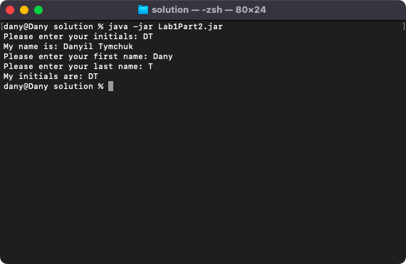
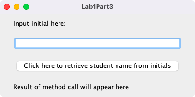
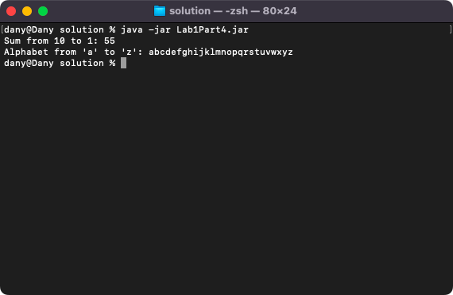

# Week 01 — Introduction: IDEs, jar files, packages, Javadoc and recursion

**Module:** Advanced Programming (`COMP H2030`)  
**Semester:** 4 (Year 2), folder `sem04`

[Module README](../README.md)

## What this week is for

Week 1 introduces software development in an IDE: projects, packages, jar files, Javadoc and recursion. The lab sheet has four parts: a first project in the IDE exported as a jar file, a program with several classes in one project, a GUI that imports a jar file, and recursion. Each part has its own package, its jar file and the Javadoc generated for it. The screenshots show the programs running.

## Files

| File | What it contains | Screenshot |
|---|---|---|
| [`README.md`](README.md) | This README. | — |
| [`lab/advanced_programming_week01_lab.pdf`](lab/advanced_programming_week01_lab.pdf) | The lab sheet: four parts (a first project and a jar file, several classes in one project, a GUI with an imported jar file, recursion). | — |
| [`lab/solution/Lab1Part1.jar`](lab/solution/Lab1Part1.jar) | The jar file exported from the Part 1 project. |  *Part 1: the first project run from its jar file.* |
| [`lab/solution/Lab1Part2.jar`](lab/solution/Lab1Part2.jar) | The jar file exported from the Part 2 project. | — |
| [`lab/solution/Lab1Part3.jar`](lab/solution/Lab1Part3.jar) | The jar file exported from the Part 3 project. | — |
| [`lab/solution/Lab1Part4.jar`](lab/solution/Lab1Part4.jar) | The jar file exported from the Part 4 project. | — |
| [`lab/solution/firstPackage/Lab1Par1.java`](lab/solution/firstPackage/Lab1Par1.java) | Part 1: the first Java program, in the package firstPackage. | — |
| [`lab/solution/secondPackage/Lab1Part2.java`](lab/solution/secondPackage/Lab1Part2.java) | Part 2: the Java program of the second part, in the package secondPackage. |  *Part 2: the output of the program with several classes, which shows initials.* |
| [`lab/solution/thirdPackage/Lab1Part3.java`](lab/solution/thirdPackage/Lab1Part3.java) | Part 3: a JFrame with a label, a text field and a button in a GridBagLayout, in the package thirdPackage. |  *Part 3: the GUI, which imports a jar file.* |
| [`lab/solution/recursive/Lab1Part4.java`](lab/solution/recursive/Lab1Part4.java) | Part 4: recursive methods in the package recursive, for example the sum of the numbers from a given number down to 1. |  *Part 4: the output of the recursion: the sum of the numbers from 10 to 1 (55) and the letters of the alphabet from a to z.* |
| [`lab/solution/javadocPart1/`](lab/solution/javadocPart1/) | The Javadoc (HTML, open index.html) generated for the Part 1 package. | — |
| [`lab/solution/javadocPart2/`](lab/solution/javadocPart2/) | The Javadoc (HTML, open index.html) generated for the Part 2 package. | — |
| [`lab/solution/javadocPart3/`](lab/solution/javadocPart3/) | The Javadoc (HTML, open index.html) generated for the Part 3 package. | — |
| [`lab/solution/javadocPart4/`](lab/solution/javadocPart4/) | The Javadoc (HTML, open index.html) generated for the Part 4 package. | — |
