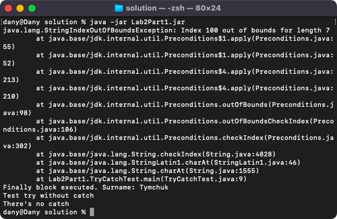
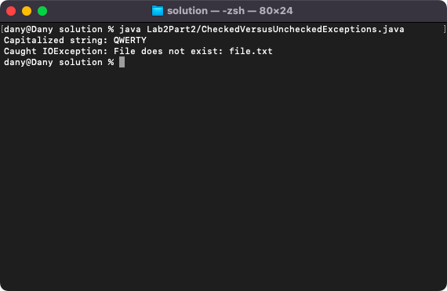
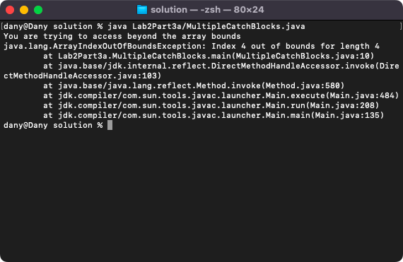
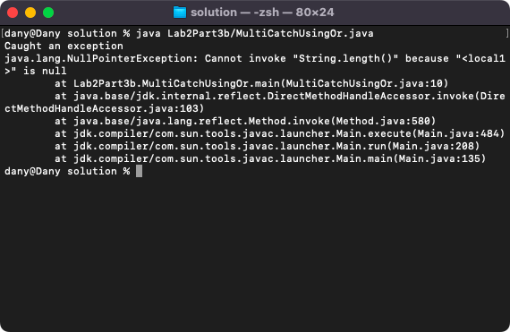
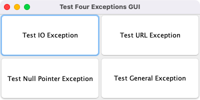
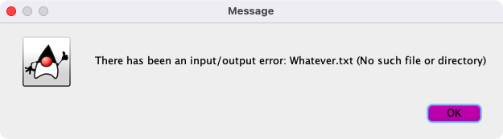
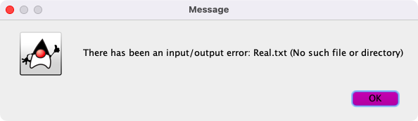
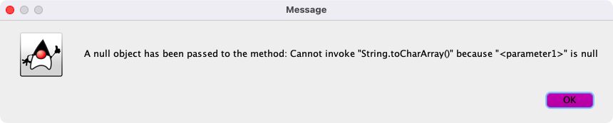

# Week 02 — try, catch and finally

**Module:** Advanced Programming (`COMP H2030`)  
**Semester:** 4 (Year 2), folder `sem04`

[Module README](../README.md)

## What this week is for

Week 2 is about exception handling: the try-catch-finally block, checked and unchecked exceptions, several catch blocks and the multi-catch with the | operator. The lab sheet has four parts: a try-catch-finally program, checked versus unchecked exceptions, multiple catch blocks (3a with separate catch blocks, 3b with one multi-catch) and a GUI that tests four exceptions. The test lines in Parts 3a and 3b are switched by uncommenting one line at a time.

## Files

| File | What it contains | Screenshot |
|---|---|---|
| [`README.md`](README.md) | This README. | — |
| [`lab/advanced_programming_week02_lab.pdf`](lab/advanced_programming_week02_lab.pdf) | The lab sheet: four parts (try-catch-finally, checked versus unchecked exceptions, multiple catch blocks, a GUI with four exceptions). | — |
| [`lab/solution/Lab2Part1.jar`](lab/solution/Lab2Part1.jar) | The jar file exported from the Part 1 project. | — |
| [`lab/solution/Lab2Part1/TryCatchTest.java`](lab/solution/Lab2Part1/TryCatchTest.java) | Part 1: a program with try-catch-finally blocks. |  *Part 1: the output of the try-catch-finally program.* |
| [`lab/solution/Lab2Part2/CheckedVersusUncheckedExceptions.java`](lab/solution/Lab2Part2/CheckedVersusUncheckedExceptions.java) | Part 2: checked versus unchecked exceptions, with a capitalizeString method called from main. |  *Part 2: the output of the checked versus unchecked exceptions program.* |
| [`lab/solution/Lab2Part3a/MultipleCatchBlocks.java`](lab/solution/Lab2Part3a/MultipleCatchBlocks.java) | Part 3a: one try block with separate catch blocks for different exceptions; one test line is uncommented at a time. |  *Part 3a: the output of the multiple catch blocks program.* |
| [`lab/solution/Lab2Part3b/MultiCatchUsingOr.java`](lab/solution/Lab2Part3b/MultiCatchUsingOr.java) | Part 3b: one catch block for several exception types, joined with the \| operator. |  *Part 3b: the output of the multi-catch program (a NullPointerException).* |
| [`lab/solution/Lab2Part4/TestFourExceptionsGUI.java`](lab/solution/Lab2Part4/TestFourExceptionsGUI.java) | Part 4: a JFrame (Test Four Exceptions GUI) with four buttons: Test IO Exception, Test URL Exception, Test Null Pointer Exception and Test General Exception. Each button calls one test method, which catches the exception and shows it in a message dialog, followed by a dialog from the finally block. The screenshots after the window show the error dialog after a click on each test button. Test URL Exception and Test General Exception both read the file Real.txt, which did not exist when the screenshots were taken, so they open the same I/O error dialog; their two screenshots were identical and only one is kept. |  *Part 4: the Test Four Exceptions GUI.*  *Part 4: the dialog after a click on Test IO Exception (the missing file Whatever.txt).*  *Part 4: the dialog after a click on Test URL Exception (the missing file Real.txt); Test General Exception opens the same dialog.*  *Part 4: the dialog after a click on Test Null Pointer Exception (a null object passed to the method).* |
| [`lab/solution/Lab2Part4/Real.txt`](lab/solution/Lab2Part4/Real.txt) | An empty text file in the folder of the Part 4 GUI; the tests for the URL and for the general exception open a file with this name. | — |
| [`lab/solution/javadocPart4/`](lab/solution/javadocPart4/) | The Javadoc (HTML, open index.html) generated for the Part 4 package. | — |
