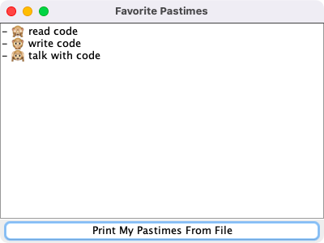
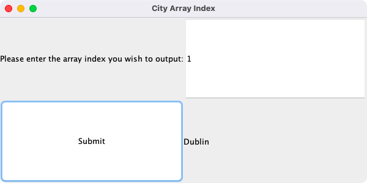
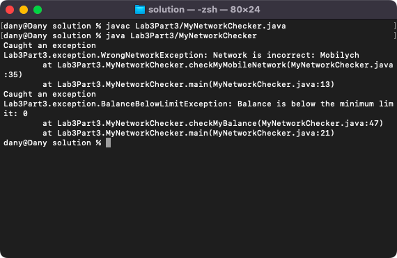
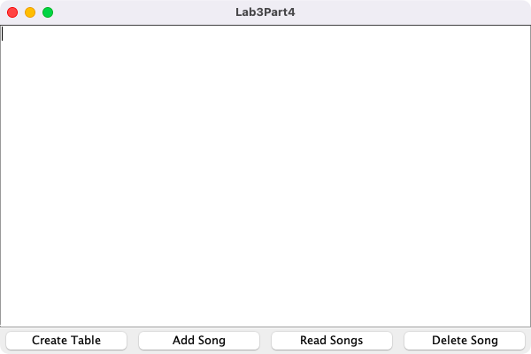

# Week 03 — Applied exceptions and JDBC

**Module:** Advanced Programming (`COMP H2030`)  
**Semester:** 4 (Year 2), folder `sem04`

[Module README](../README.md)

## What this week is for

Week 3 applies exceptions in GUIs and with a database. The lab sheet has four parts: a GUI that reads a text file with try-with-resources (Favorite Pastimes), a GUI that retries in the catch block with an option pane (City Array Index), custom exceptions (WrongNetworkException and BalanceBelowLimitException, tested in MyNetworkChecker) and a JDBC GUI that creates a table and adds, reads and deletes songs.

## Files

| File | What it contains | Screenshot |
|---|---|---|
| [`README.md`](README.md) | This README. | — |
| [`lab/advanced_programming_week03_lab.pdf`](lab/advanced_programming_week03_lab.pdf) | The lab sheet: four parts (try-with-resources in a GUI, retrying in the catch block, custom exceptions, a JDBC GUI). | — |
| [`lab/solution/Lab3Part1/Lab3Part1.java`](lab/solution/Lab3Part1/Lab3Part1.java) | Part 1: the Favorite Pastimes GUI, a JFrame with a text area in a scroll pane and a button. |  *Part 1: the Favorite Pastimes GUI.* |
| [`lab/solution/Lab3Part1/myFavPastimes.txt`](lab/solution/Lab3Part1/myFavPastimes.txt) | The text file of favourite pastimes used by Part 1. | — |
| [`lab/solution/Lab3Part2.jar`](lab/solution/Lab3Part2.jar) | The jar file exported from the Part 2 project. | — |
| [`lab/solution/Lab3Part2/Lab3Part2.java`](lab/solution/Lab3Part2/Lab3Part2.java) | Part 2: the City Array Index GUI: a text field takes an index and the GUI shows the matching city of the array, with the error handling in the catch block. |  *Part 2: the City Array Index GUI.* |
| [`lab/solution/Lab3Part3.jar`](lab/solution/Lab3Part3.jar) | The jar file exported from the Part 3 project. | — |
| [`lab/solution/Lab3Part3/MyNetworkChecker.java`](lab/solution/Lab3Part3/MyNetworkChecker.java) | Part 3: the program that tests the checkMyMobileNetwork method with the custom exceptions. |  *Part 3: the output of MyNetworkChecker with the custom exceptions.* |
| [`lab/solution/Lab3Part3/exception/BalanceBelowLimitException.java`](lab/solution/Lab3Part3/exception/BalanceBelowLimitException.java) | Part 3: the custom exception (it extends Exception) thrown when the balance is below the limit. | — |
| [`lab/solution/Lab3Part3/exception/WrongNetworkException.java`](lab/solution/Lab3Part3/exception/WrongNetworkException.java) | Part 3: the custom exception (it extends Exception) thrown when the network is not the expected one. | — |
| [`lab/solution/Lab3Part4/Lab3Part4.java`](lab/solution/Lab3Part4/Lab3Part4.java) | Part 4: the JDBC GUI, a JFrame with a text area and buttons for the database actions. |  *Part 4: the JDBC GUI with the buttons Create Table, Add Song, Read Songs and Delete Song.* |
| [`lab/solution/javadocPart2/`](lab/solution/javadocPart2/) | The Javadoc (HTML, open index.html) generated for the Part 2 package. | — |
| [`lab/solution/javadocPart3/`](lab/solution/javadocPart3/) | The Javadoc (HTML, open index.html) generated for the Part 3 package. | — |
| [`lab/solution/javadocPart4/`](lab/solution/javadocPart4/) | The Javadoc (HTML, open index.html) generated for the Part 4 package. | — |
