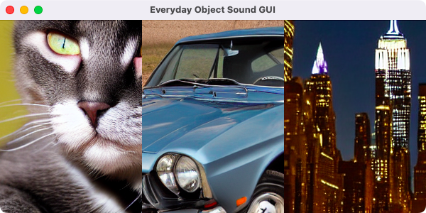
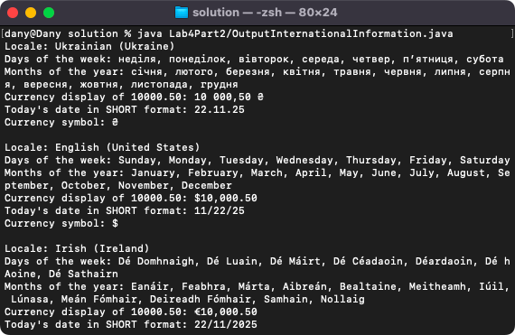
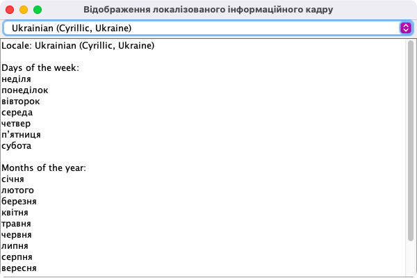
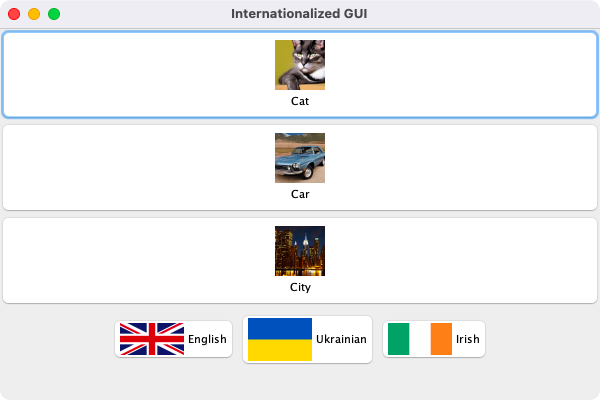

# Week 04 — Internationalisation, sound and debugging

**Module:** Advanced Programming (`COMP H2030`)  
**Semester:** 4 (Year 2), folder `sem04`

[Module README](../README.md)

## What this week is for

Week 4 covers sound, locales and internationalisation. The lab sheet has four parts: a GUI that plays sounds with the Clip class (Everyday Object Sound GUI, with an image and a WAV file for a car, a cat and a city), a program that prints locale-dependent information, a GUI with a combo box for selecting a locale, and an internationalised GUI that switches the language with flag buttons using resource bundles for English, Irish (ga) and Ukrainian (uk).

## Files

| File | What it contains | Screenshot |
|---|---|---|
| [`README.md`](README.md) | This README. | — |
| [`lab/advanced_programming_week04_lab.pdf`](lab/advanced_programming_week04_lab.pdf) | The lab sheet: four parts (sound with Clip, locale information, a GUI to select locales, an internationalised GUI with flags). | — |
| [`lab/solution/Lab4Part1/EverydayObjectSoundGUI.java`](lab/solution/Lab4Part1/EverydayObjectSoundGUI.java) | Part 1: the Everyday Object Sound GUI, a JFrame with buttons that show an object and play its sound. |  *Part 1: the Everyday Object Sound GUI.* |
| [`lab/solution/Lab4Part1/img/`](lab/solution/Lab4Part1/img/) | The three images of Part 1 (a car, a cat and a city), PNG files. | — |
| [`lab/solution/Lab4Part1/sound/`](lab/solution/Lab4Part1/sound/) | The three sounds of Part 1 (a car, a cat and a city), WAV files. | — |
| [`lab/solution/Lab4Part2/OutputInternationalInformation.java`](lab/solution/Lab4Part2/OutputInternationalInformation.java) | Part 2: a console program that prints locale-dependent information, for example the days of the week. |  *Part 2: the console output with the locale information.* |
| [`lab/solution/Lab4Part3/Lab4Part3.java`](lab/solution/Lab4Part3/Lab4Part3.java) | Part 3: a JFrame with a combo box of locales and a text area, which loads a resource bundle. |  *Part 3: the GUI with the combo box of locales, with Ukrainian selected.* |
| [`lab/solution/Lab4Part3/messages.properties`](lab/solution/Lab4Part3/messages.properties) | Part 3: the base resource bundle. | — |
| [`lab/solution/Lab4Part3/messages_ga.properties`](lab/solution/Lab4Part3/messages_ga.properties) | Part 3: the resource bundle for Irish (ga). | — |
| [`lab/solution/Lab4Part3/messages_uk.properties`](lab/solution/Lab4Part3/messages_uk.properties) | Part 3: the resource bundle for Ukrainian (uk). | — |
| [`lab/solution/Lab4Part4/Lab4Part4.java`](lab/solution/Lab4Part4/Lab4Part4.java) | Part 4: the internationalised GUI, a JFrame with buttons that switch the language, which loads a resource bundle. |  *Part 4: the internationalised GUI with the flag buttons for English, Ukrainian and Irish.* |
| [`lab/solution/Lab4Part4/flags/`](lab/solution/Lab4Part4/flags/) | The flag images of Part 4 (en, ga and uk), PNG files. | — |
| [`lab/solution/Lab4Part4/messages.properties`](lab/solution/Lab4Part4/messages.properties) | Part 4: the base resource bundle. | — |
| [`lab/solution/Lab4Part4/messages_ga.properties`](lab/solution/Lab4Part4/messages_ga.properties) | Part 4: the resource bundle for Irish (ga). | — |
| [`lab/solution/Lab4Part4/messages_uk.properties`](lab/solution/Lab4Part4/messages_uk.properties) | Part 4: the resource bundle for Ukrainian (uk). | — |
| [`resources/1-welcome.wav`](resources/1-welcome.wav) | A sample sound file (WAV) for the sound exercises. | — |
| [`resources/bottle-open.wav`](resources/bottle-open.wav) | A sample sound file (WAV) for the sound exercises. | — |
| [`resources/lecture_4_code_listing.zip`](resources/lecture_4_code_listing.zip) | The code listing of lecture 4 (a zip), the lecture on internationalisation, sound and debugging. | — |
