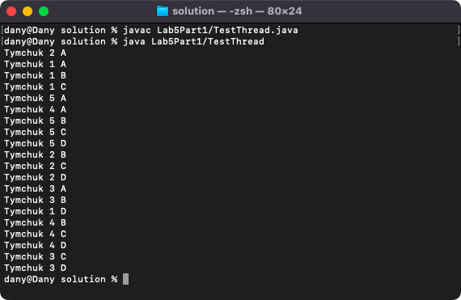
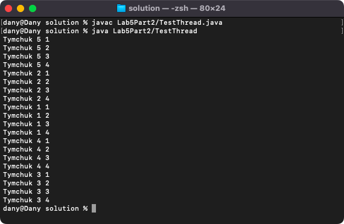
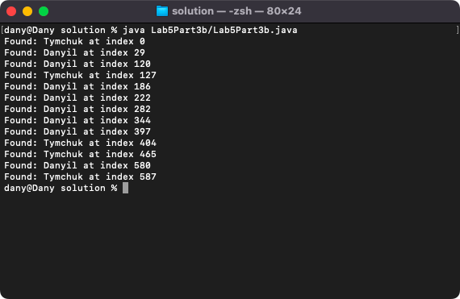
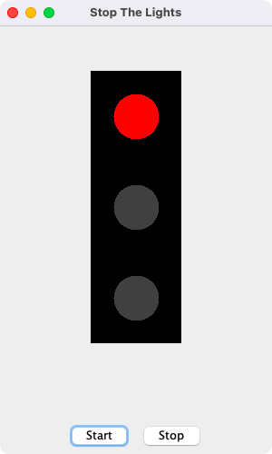

# Week 05 — Threads, enums and varargs

**Module:** Advanced Programming (`COMP H2030`)  
**Semester:** 4 (Year 2), folder `sem04`

[Module README](../README.md)

## What this week is for

Week 5 is about threads. The lab sheet has four parts: a thread by extending Thread, a thread by implementing Runnable (both started five times from a TestThread class), synchronized threads (Part 3a, with the threads A, B, C and D) and a regular expression search (Part 3b), and the Stop The Lights GUI, a traffic light controlled by a thread.

## Files

| File | What it contains | Screenshot |
|---|---|---|
| [`README.md`](README.md) | This README. | — |
| [`lab/advanced_programming_week05_lab.pdf`](lab/advanced_programming_week05_lab.pdf) | The lab sheet: four parts (extends Thread, implements Runnable, synchronized threads and regular expressions, a thread GUI). | — |
| [`lab/solution/Lab5Part1/ThreadUsingExtends.java`](lab/solution/Lab5Part1/ThreadUsingExtends.java) | Part 1: a class that extends Thread. | — |
| [`lab/solution/Lab5Part1/TestThread.java`](lab/solution/Lab5Part1/TestThread.java) | Part 1: creates and starts at least five instances of ThreadUsingExtends. |  *Part 1: the output of the threads created by extending Thread.* |
| [`lab/solution/Lab5Part2/ThreadUsingRunnable.java`](lab/solution/Lab5Part2/ThreadUsingRunnable.java) | Part 2: a class that implements Runnable. | — |
| [`lab/solution/Lab5Part2/TestThread.java`](lab/solution/Lab5Part2/TestThread.java) | Part 2: creates and starts at least five threads of ThreadUsingRunnable. |  *Part 2: the output of the threads created by implementing Runnable.* |
| [`lab/solution/Lab5Part3a/ThreadUsingExtends.java`](lab/solution/Lab5Part3a/ThreadUsingExtends.java) | Part 3a: the thread class with synchronized output. | — |
| [`lab/solution/Lab5Part3a/TestThread.java`](lab/solution/Lab5Part3a/TestThread.java) | Part 3a: creates and starts the threads. |  *Part 3a: the output of the synchronized threads A, B, C and D.* |
| [`lab/solution/Lab5Part3b/Lab5Part3b.java`](lab/solution/Lab5Part3b/Lab5Part3b.java) | Part 3b: a regular expression search. |  *Part 3b: the output of the regular expression search (Found: ... at index ...).* |
| [`lab/solution/Lab5Part4/StopTheLights.java`](lab/solution/Lab5Part4/StopTheLights.java) | Part 4: the Stop The Lights GUI, a JFrame with a traffic light panel (TrafficLightPanel) and buttons, driven by a thread. |  *Part 4: the Stop The Lights GUI.* |
| [`resources/lecture_5_code_listing.zip`](resources/lecture_5_code_listing.zip) | The code listing of lecture 5 (a zip), the lecture on threads, enums and varargs. | — |
