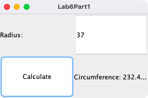
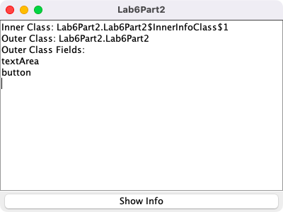
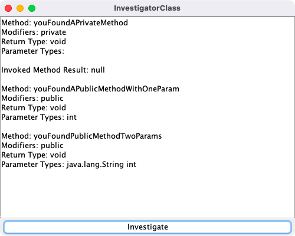
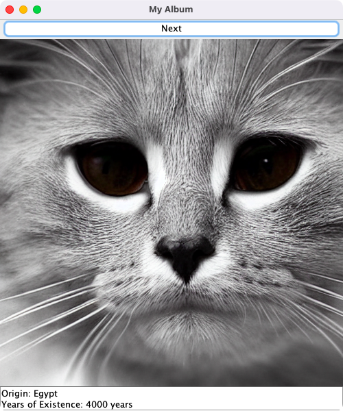

# Week 06 — Classes, reflection, generics and lambdas

**Module:** Advanced Programming (`COMP H2030`)  
**Semester:** 4 (Year 2), folder `sem04`

[Module README](../README.md)

## What this week is for

Week 6 covers classes, reflection, generics and lambdas. The lab sheet has four parts: a utility class used from a GUI with a lambda listener (a radius and a circumference), inner and anonymous classes, reflection that investigates the classes in MysteryJar.jar, and polymorphism in the My Album GUI, where the items of an album are FavouriteAnimal and FavouriteSport objects.

## Files

| File | What it contains | Screenshot |
|---|---|---|
| [`README.md`](README.md) | This README. | — |
| [`lab/advanced_programming_week06_lab.pdf`](lab/advanced_programming_week06_lab.pdf) | The lab sheet: four parts (a utility class and a lambda listener, inner and anonymous classes, reflection with MysteryJar.jar, polymorphism with an album GUI). | — |
| [`lab/solution/Lab6Part1/Lab6Part1.java`](lab/solution/Lab6Part1/Lab6Part1.java) | Part 1: a JFrame with text fields and a button, which uses the Utility class. |  *Part 1: the GUI with the radius and the circumference.* |
| [`lab/solution/Lab6Part1/Utility.java`](lab/solution/Lab6Part1/Utility.java) | Part 1: the utility class for the mathematical calculations. | — |
| [`lab/solution/Lab6Part2/Lab6Part2.java`](lab/solution/Lab6Part2/Lab6Part2.java) | Part 2: a JFrame with an inner class (InnerInfoClass) whose information is shown in a text area. |  *Part 2: the GUI that shows the information from the inner class.* |
| [`lab/solution/Lab6Part3/InvestigatorClass.java`](lab/solution/Lab6Part3/InvestigatorClass.java) | Part 3: a JFrame that uses reflection and shows the result in a text area. |  *Part 3: the reflection output of InvestigatorClass for MysteryJar.jar.* |
| [`lab/solution/Lab6Part3/MysteryJar.jar`](lab/solution/Lab6Part3/MysteryJar.jar) | The jar file that Part 3 investigates. | — |
| [`lab/solution/Lab6Part4/AlbumItem.java`](lab/solution/Lab6Part4/AlbumItem.java) | Part 4: the base class of the album items. | — |
| [`lab/solution/Lab6Part4/FavouriteAnimal.java`](lab/solution/Lab6Part4/FavouriteAnimal.java) | Part 4: an album item for an animal (it extends AlbumItem). | — |
| [`lab/solution/Lab6Part4/FavouriteSport.java`](lab/solution/Lab6Part4/FavouriteSport.java) | Part 4: an album item for a sport (it extends AlbumItem). | — |
| [`lab/solution/Lab6Part4/MyAlbum.java`](lab/solution/Lab6Part4/MyAlbum.java) | Part 4: the My Album GUI, a JFrame that adds the album items and shows them. |  *Part 4: the My Album GUI, showing a cat with the origin Egypt and 4000 years of existence.* |
| [`lab/solution/Lab6Part4/img/`](lab/solution/Lab6Part4/img/) | The ten images of Part 4 (animals and sports), PNG files. | — |
| [`resources/lecture_6_code_examples.zip`](resources/lecture_6_code_examples.zip) | The code examples of lecture 6 (a zip), the lecture on classes, reflection, generics and lambdas. | — |
