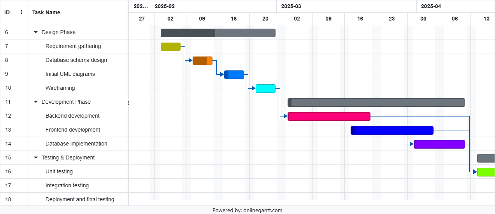
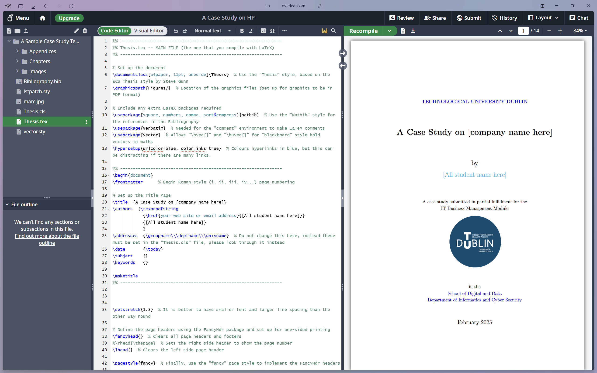
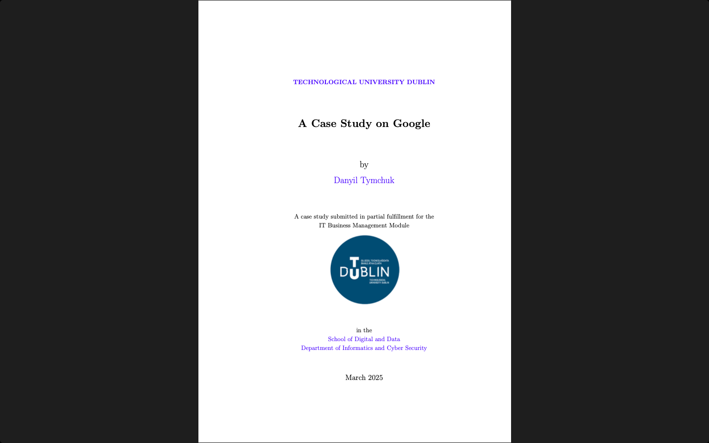

# IT Business Management

**Module:** IT Business Management (`COMP H2034`)  
**Semester:** 4 (Year 2), folder `sem04`  
**Lecturer:** Dr Marie Brennan  
**Date:** January - May 2025  
**Credits:** 5 ECTS  
**Matching project branch:** none

## What this module is for

IT Business Management is an introduction to management for IT: the basic functions and skills of a manager, planning and decision making, organising and organisational change, leadership, and control. The practical work is project management for the team project that is shared with Web Development Server-Side and Software Engineering and Testing: a project diary on Trello, a Gantt chart, a SWOT analysis and Overleaf, and the minutes of team meetings. Each week has a lecture and, from week 2, an MCQ; labs 1 to 4 are in this folder, and the labs of weeks 5 and 6 were team meetings. The grade is the MCQs and lab work (30%), an individual case study (40%) and a group research report and reflection (30%). This folder has the lab sheets, the team's lab work (the Trello board, the Gantt chart, the Overleaf screenshot and the meeting minutes), the reading and reference sheets of week 4, the two assignment briefs with their templates, and the submitted case study and report. The MCQs are not in the repository.

> [!NOTE]
> Basically, this module is bullshit... it is about nothing with nothing on top. The basic, stupid things... We basically did nothing in that module, just filling in some pages and answering some theory tests...
> By the way, the worst Brightspace (VLE) page... it is unreadable... the structure is awful... there is no structure... it is really bad...
> "The professional" module was not even close to professional...

## Grades Breakdown

| Assessment Type | Weighting |
|---|---|
| MCQs and lab work | 30% |
| Assignment 1: case study (individual) | 40% |
| Assignment 2: research report and reflection (group) | 30% |

## All weeks

| Week | Title | Files | Screenshot |
|---|---|---|---|
| [Week 1](week01/) | Lab 1: Trello basics (a project diary) | [`lab/it_business_management_week01_lab.pdf`](week01/lab/it_business_management_week01_lab.pdf) [`lab/solution/qwerty_trello.pdf`](week01/lab/solution/qwerty_trello.pdf) [`lab/solution/qwerty_trello_screenshot.png`](week01/lab/solution/qwerty_trello_screenshot.png) |  |
| [Week 2](week02/) | Lab 2: Gantt chart practical | [`lab/it_business_management_week02_lab.pdf`](week02/lab/it_business_management_week02_lab.pdf) [`lab/solution/gantt_charts.gantt`](week02/lab/solution/gantt_charts.gantt) [`lab/solution/gantt_charts.pdf`](week02/lab/solution/gantt_charts.pdf) [`lab/solution/gantt_charts.png`](week02/lab/solution/gantt_charts.png) |  |
| [Week 3](week03/) | Lab 3: SWOT analysis and Overleaf | [`lab/solution/overleaf_screenshot.png`](week03/lab/solution/overleaf_screenshot.png) [`resources/swot_analysis_template.doc`](week03/resources/swot_analysis_template.doc) |  |
| [Week 4](week04/) | Lab 4: meeting management | [`lab/meeting.pdf`](week04/lab/meeting.pdf) [`lab/resources/meeting_template.xlsx`](week04/lab/resources/meeting_template.xlsx) [`lab/solution/meeting#1.pdf`](week04/lab/solution/meeting%231.pdf) [`lab/solution/meeting#1.xlsx`](week04/lab/solution/meeting%231.xlsx) [`resources/big_5.pdf`](week04/resources/big_5.pdf) [`resources/competency_framework.pdf`](week04/resources/competency_framework.pdf) [`resources/team_handout_belbin_team_role_descriptions.pdf`](week04/resources/team_handout_belbin_team_role_descriptions.pdf) | — |
| Week 5 | Management roles and responsibilities (MCQ 4) | None. Lab work: a team meeting on the project status of the web server and the software engineering and testing projects, with the minutes uploaded to Trello and the shared OneDrive folder, and a check of the citations of the case study. | — |
| Week 6 | Leadership (MCQ 5) | None. Lab work: a team meeting about the web server and software testing projects, with the minutes saved to Trello (the date at the top) and the shared OneDrive folder. | — |
| Week 7 | Planning and strategy: decisions and decision theory (MCQ 6) | None. | — |
| Week 8 | Coordination, control, motivation and training (MCQ 7: decisions, planning and strategy) | None. | — |
| Week 9 | Organisational change (MCQ 8: control) | None. | — |
| Week 10 | Organisational culture (MCQ 9: organisational change) | None. | — |

## Assessments and other files

| File | What it contains |
|---|---|
| [`assessment/01/it_business_management_assessment.pdf`](assessment/01/it_business_management_assessment.pdf) | The brief of Assignment 1, the case study (5 pages, 40%): a problem-based learning assignment, researching an ICT company and writing a case study of about 2000 words in LaTeX, submitted as a PDF, with the written work and referencing guidelines. Issued on 19 February 2025 and due on 14 March 2025 at 11pm, with no late submissions accepted. |
| [`assessment/01/resources/a_case_study_template.zip`](assessment/01/resources/a_case_study_template.zip) | The LaTeX template of the case study (a zip), a sample case study on HP. |
| [`assessment/01/submission/a_case_study_on_google.pdf`](assessment/01/submission/a_case_study_on_google.pdf) | The submitted case study, A Case Study on Google (18 pages, March 2025). |
| [`assessment/02/it_business_management_assessment.pdf`](assessment/02/it_business_management_assessment.pdf) | The brief of Assignment 2, the research report and reflection (4 pages, a group of 3, 30%): a 3000-word research document on working in teams, with a topic for each member (teamwork and conflict, leadership in teams, managing team workload, communication in teams) from peer-reviewed papers only, and a reflection of at least 500 words per member on the experience of working in the team on a piece of software, with the positive and negative experiences as sub-headings. Submitted as one PDF from Overleaf, with Harvard referencing, by 6 May at 10pm. |
| [`assessment/02/resources/research_report_and_reflection_template.zip`](assessment/02/resources/research_report_and_reflection_template.zip) | The LaTeX template of the report (a zip). |
| [`assessment/02/submission/research_report_and_reflection.pdf`](assessment/02/submission/research_report_and_reflection.pdf) | The submitted Teamwork Report and Reflection (28 pages, April 2025), written by a team of two. |

### Screenshots

*Assignment 1: the title page of the case study on Google.*

*Assignment 2: the title page of the teamwork report and reflection.*

---

## Weeks

- [Week 1 (Lab 1)](#week-1-lab-1-module-introduction-and-history-of-business-management): Module Introduction and History of Business Management
- [Week 2 (Lab 2)](#week-2-lab-2-time-management): Time Management
- [Week 3 (Lab 3)](#week-3-lab-3-swot-analysis-and-overleaf): SWOT Analysis and Overleaf
- [Assignment 1](#assignment-1-case-study-individual): Case Study (individual)
- [Week 4 (Lab 4)](#week-4-lab-4-meeting-management): Meeting Management
- [Week 5](#week-5-management-roles-and-responsibilities): Management Roles and Responsibilities
- [Week 6](#week-6-leadership): Leadership
- [Week 7](#week-7-planning-and-strategy-decisions-and-decision-theory): Planning and Strategy, Decisions and Decision Theory
- [Assignment 2](#assignment-2-report-and-reflections): Report and Reflections
- [Week 8](#week-8-coordination-control-motivation-training): Coordination, Control, Motivation, Training
- [Week 9](#week-9-organizational-change): Organizational Change
- [Week 10](#week-10-organisational-culture): Organisational Culture

### [Week 1 (Lab 1)](./week01/): Module Introduction and History of Business Management

Lab 1: Trello Basic tutorial

### [Week 2 (Lab 2)](./week02/): Time Management

MCQ 1

Lab 2: Gantt Chart Practical

### [Week 3 (Lab 3)](./week03/): SWOT Analysis and Overleaf

SWOT Analysis (Strengths, Weaknesses, Opportunities and Threats)

MCQ 2

Lab 3: Upload a screenshot of the Overleaf interface

### [Assignment 1](./assessment/01/): Case Study (individual)

Reading, writing and referencing.

### [Week 4 (Lab 4)](./week04/): Meeting Management

Some resources that the lecturer gave: [resources](./week04/resources/)

MCQ 3

> The lab assessment said that we had to hold a meeting, but we did not... because no one even cared.

### Week 5: Management Roles and Responsibilities

(P - Planning, O - Organising, D - Directing, S - Staffing, C - Coordinating-Control, R - Reporting, B - Budgeting)

Lab work this week:

1. Get into your teams and conduct a meeting on your project status (web server, and software engineering and testing), record this meeting and upload the minutes to Trello. Share the minutes to your OneDrive project folder.
2. Work on your case study and ensure that your citations are correct. Check with your class tutor if you are unsure.

MCQ 4

### Week 6: Leadership

This week get into your project teams and have a meeting about each of the modules web server and software testing. Conduct a meeting to discuss the web and software testing project and record the minutes of this. Save the minutes to Trello (with the date at the top). Save them in the shared OneDrive folder.

MCQ 5

### Week 7: Planning and Strategy, Decisions and Decision Theory

MCQ 6

### [Assignment 2](./assessment/02/): Report and Reflections

### Week 8: Coordination, Control, Motivation, Training

MCQ 7: Decisions, Planning and strategy

### Week 9: Organizational Change

MCQ 8: Control

### Week 10: Organisational Culture

MCQ 9: Organisational change

## Module descriptor

Module Title: IT Business Management (mandatory), module code COMP H2034, 5 credits, lecturer Dr Marie Brennan.

**Module learning outcomes.**

- Identify and explain the basic functions of management and describe the fundamental skills of a manager.
- Examine the planning process and discuss the benefits and limitations of planning.
- Describe the nature and complexity of organisational change and describe the steps in the change process.
- Describe the nature of leadership and evaluate the approaches to leadership and contemporary IT management practices.
- Communicate the processes of control and describe how control systems support the attainment of organisational objectives.

**Indicative syllabus.**

- Introduction to IT Management: the nature of management; basic management functions; management skills; management roles and responsibilities; the development of IT management thought; forces on organisations; new management competencies; managing crises and unexpected events.
- IT Management Planning: organisational goals and plans; components of strategy; using SWOT analysis to formulate plans; types of plans; planning in turbulent times; the planning process; traditional and high-performance approaches to planning; perspectives on decision making; the decision-making process; behavioural aspects of decision making; group decision making.
- IT Management Organising: basic elements of organising; basic forms of organisation design; emerging issues in organisation design; factors shaping structure; planned organisational change; implementing change; types of change; areas of organisational change; organisational innovation.
- Leading in an IT environment: the nature of leadership; leadership versus management; approaches to leadership; leading change; power and influence; leadership for turbulent times; styles of leadership; leadership behaviours.
- IT Management Controlling: the nature of control; operations control; methods and types of control; managing control; the control process; effective control; resistance to control.

**Assessment.** Course work assessment, 100% continuous assessment. The repeat assessment is coursework only: the module is reassessed solely on the basis of re-submitted coursework.
