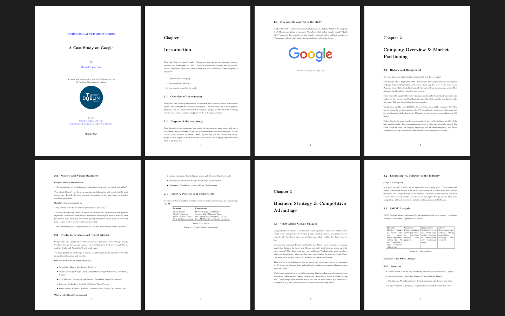

# Assessment 1: Case study: a company in the ICT sector

**Module:** IT Business Management (`COMP H2034`)  
**Semester:** 4 (Year 2), folder `sem04`  
**Type:** report, individual  
**Weight:** 40%  
**Deadline:** 14 March 2025 at 11pm (issued on 19 February 2025; no late submissions)  
**Result:** —  
**On main:** [`sem04/it_business_management/assessment/01/`](https://github.com/DanyilT/projects-in-university/tree/main/sem04/it_business_management/assessment/01) (the brief, the template, the submitted case study and this README)  
**Branch:** —  
**Repository:** —

[Module README](../../README.md)

## What this assessment is for

The brief (5 pages) is a problem-based learning assignment: research an ICT company and write a case study of about 2000 words in LaTeX, submitted as a PDF, with the written work and referencing guidelines. A template with a sample case study on HP is given.

The submission is the case study A Case Study on Google (18 pages, March 2025).

*The case study on Google: page 1 (the title page) and pages 4 to 10 of 18; the declaration and the contents are skipped.*

## Files

| File | What it contains |
|---|---|
| [`README.md`](README.md) | This README. |
| [`it_business_management_assessment.pdf`](it_business_management_assessment.pdf) | The brief of Assignment 1, the case study (5 pages, 40%): a problem-based learning assignment, researching an ICT company and writing a case study of about 2000 words in LaTeX, submitted as a PDF, with the written work and referencing guidelines. Issued on 19 February 2025 and due on 14 March 2025 at 11pm, with no late submissions accepted. |
| [`resources/a_case_study_template.zip`](resources/a_case_study_template.zip) | The LaTeX template of the case study (a zip), a sample case study on HP. |
| [`submission/a_case_study_on_google.pdf`](submission/a_case_study_on_google.pdf) | The submitted case study, A Case Study on Google (18 pages, March 2025). |
