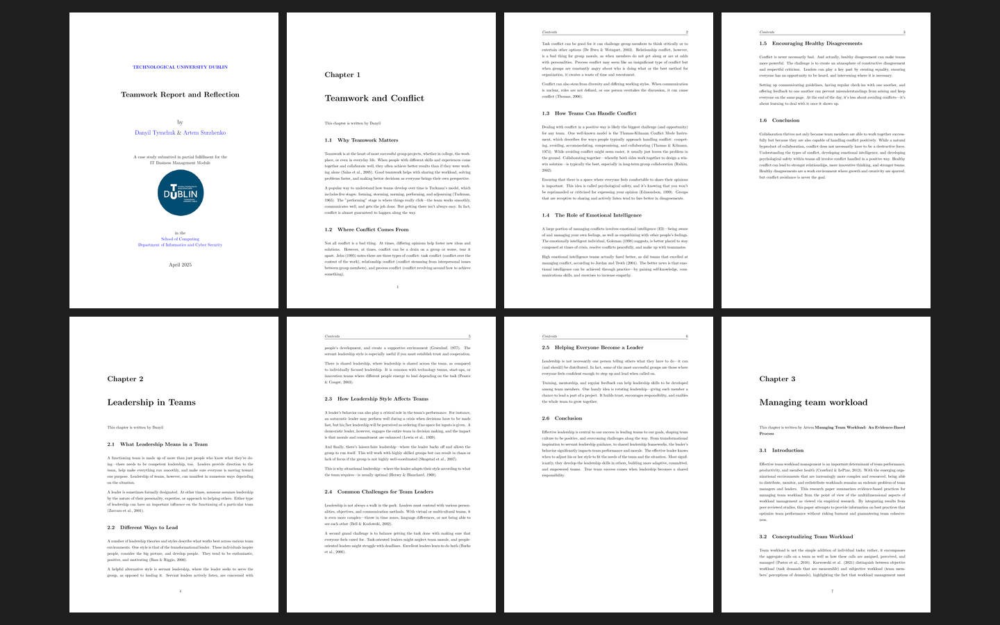

# Assessment 2: Research report and reflection on working in teams

**Module:** IT Business Management (`COMP H2034`)  
**Semester:** 4 (Year 2), folder `sem04`  
**Type:** report, group of 3  
**Weight:** 30%  
**Deadline:** 6 May 2025 at 10pm  
**Result:** —  
**On main:** [`sem04/it_business_management/assessment/02/`](https://github.com/DanyilT/projects-in-university/tree/main/sem04/it_business_management/assessment/02) (the brief, the template, the submitted report and this README)  
**Branch:** —  
**Repository:** —

[Module README](../../README.md)

## What this assessment is for

The brief (4 pages) asks a group of 3 for a 3000-word research document on working in teams, with a topic for each member (teamwork and conflict, leadership in teams, managing team workload, communication in teams) from peer-reviewed papers only, and a reflection of at least 500 words per member on the experience of working in the team on a piece of software, with the positive and negative experiences as sub-headings. It is submitted as one PDF from Overleaf, with Harvard referencing. A LaTeX template is given.

The submission is the Teamwork Report and Reflection (28 pages, April 2025), written by a team of two.

*The teamwork report and reflection: page 1 (the title page) and pages 5 to 11 of 28; the declaration and the contents are skipped.*

## Files

| File | What it contains |
|---|---|
| [`README.md`](README.md) | This README. |
| [`it_business_management_assessment.pdf`](it_business_management_assessment.pdf) | The brief of Assignment 2, the research report and reflection (4 pages, a group of 3, 30%): a 3000-word research document on working in teams, with a topic for each member (teamwork and conflict, leadership in teams, managing team workload, communication in teams) from peer-reviewed papers only, and a reflection of at least 500 words per member on the experience of working in the team on a piece of software, with the positive and negative experiences as sub-headings. Submitted as one PDF from Overleaf, with Harvard referencing, by 6 May at 10pm. |
| [`resources/research_report_and_reflection_template.zip`](resources/research_report_and_reflection_template.zip) | The LaTeX template of the report (a zip). |
| [`submission/research_report_and_reflection.pdf`](submission/research_report_and_reflection.pdf) | The submitted Teamwork Report and Reflection (28 pages, April 2025), written by a team of two. |
