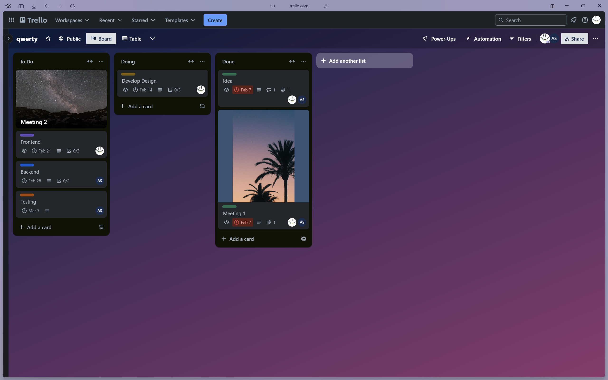

# Week 01 — Lab 1: Trello basics (a project diary)

**Module:** IT Business Management (`COMP H2034`)  
**Semester:** 4 (Year 2), folder `sem04`

[Module README](../README.md)

## What this week is for

Week 1 was the module introduction and the history of business management. Lab 1 is a Trello tutorial on creating a project diary: creating a Trello account, learning the basics (boards, lists, cards) and linking a team together. The solution is the team's Trello board for the project, called qwerty, as a PDF and as a screenshot: the lists To Do (a second meeting, front end, back end, testing), Doing (develop the design) and Done (the idea and the first meeting). The interface of the PDF print is in Ukrainian.

## Screenshots

*The Trello board qwerty with the lists To Do, Doing and Done.*

## Files

| File | What it contains |
|---|---|
| [`README.md`](README.md) | This README. |
| [`lab/it_business_management_week01_lab.pdf`](lab/it_business_management_week01_lab.pdf) | The lab sheet (11 pages): the Trello Basics tutorial (boards, lists, cards and linking a team). |
| [`lab/solution/qwerty_trello.pdf`](lab/solution/qwerty_trello.pdf) | A print of the team's Trello board (2 pages). |
| [`lab/solution/qwerty_trello_screenshot.png`](lab/solution/qwerty_trello_screenshot.png) | A screenshot of the team's Trello board. |
