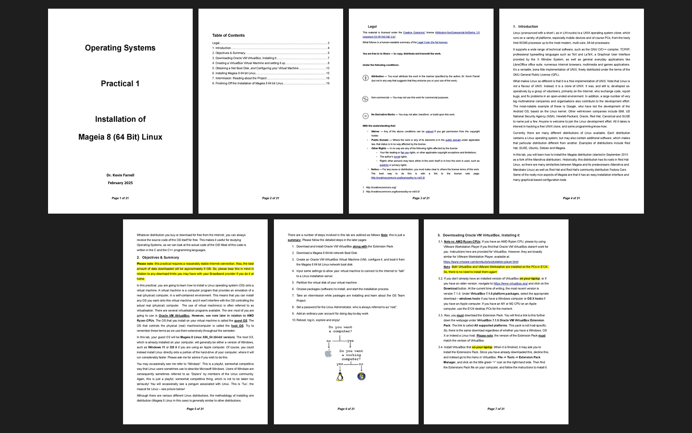
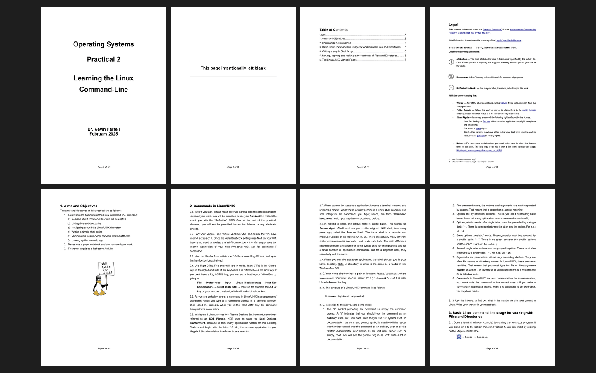
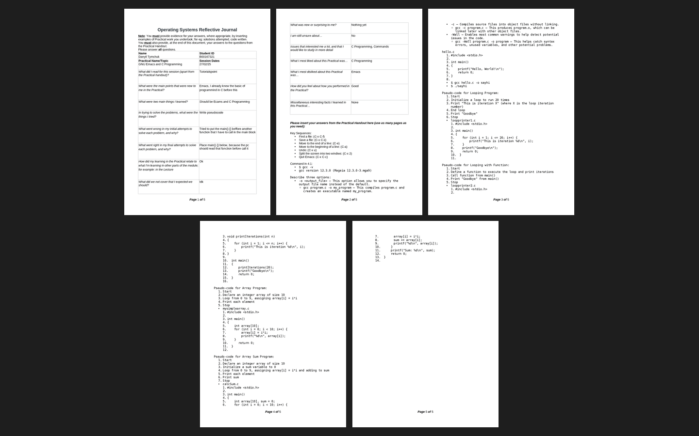
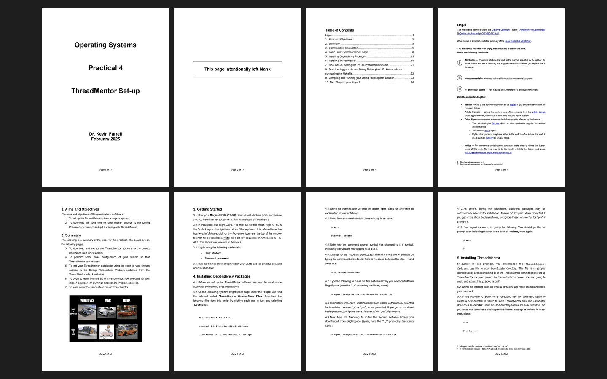
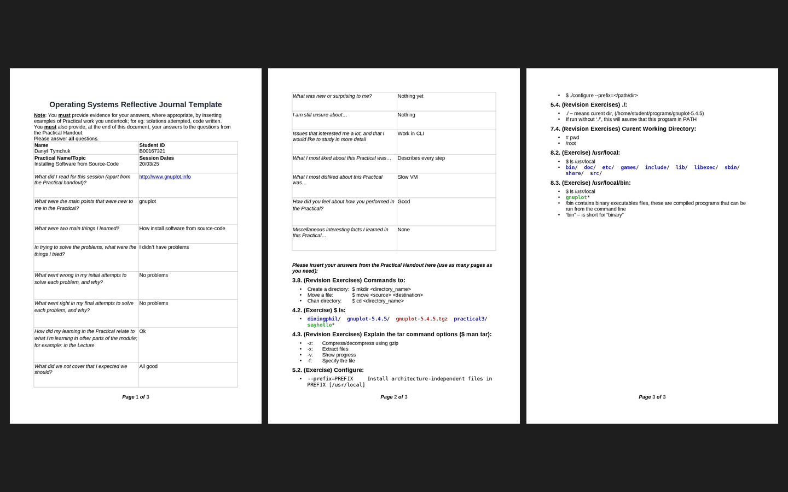
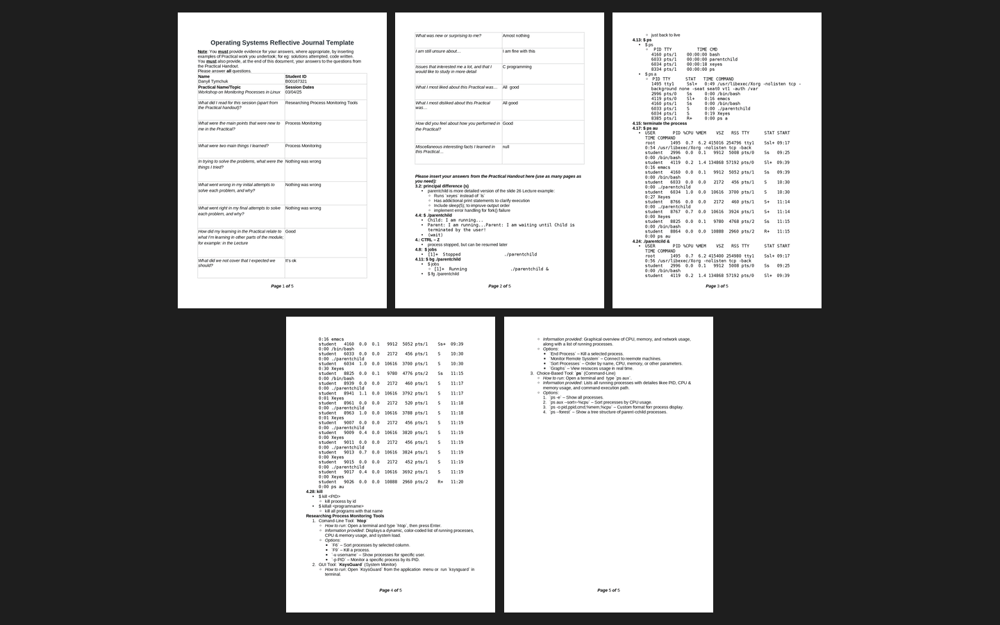

# Operating Systems

**Module:** Operating Systems (`COMP H2014`)  
**Semester:** 4 (Year 2), folder `sem04`  
**Lecturer:** Dr Kevin Farrell  
**Date:** January - May 2025  
**Credits:** 5 ECTS

## What this module is for

Operating Systems is a balance between the theory of how modern multi-user operating systems work and the practice of administering Linux. The lectures cover fundamental concepts, OS structures, processes, threads and concurrency, CPU scheduling, process synchronisation, deadlocks and memory management. The weekly practicals use a Mageia 8 Linux virtual machine in VirtualBox: installing Linux (practical 1), the Linux command line (2), GNU Emacs and C programming (3), setting up ThreadMentor for the project (4), installing software from source code (5) and monitoring processes with a parent and child program in C (6). Every practical has a reflective activity; practicals 3, 5 and 6 were done with a reflective journal. The module is 50% continuous assessment and a 50% written exam; the exam of 2025 is not in the repository, and seven past exam papers are. The continuous assessment is the practicals and their reflective activities (9%), the open notes taken in the lectures (10%), a multiple-choice test (6%) and a team project (25%): a study of the synchronisation and concurrency issues of the dining philosophers problem with the ThreadMentor visualisation tool, with a mid-semester progress presentation (5%) and a final presentation with a team report (20%). The week folders are numbered by practical, not by calendar week. This folder has the practical sheets, the C programs and reflective journals, the ThreadMentor, Gnuplot and library packages used by the practicals, the project description with its sample report structure, the team project (the mid-semester progress presentation with the Gantt chart, the team report and the final presentation), the learning plan, the module descriptor and the past exam papers.

## Grades Breakdown

| Assessment Type | Weighting |
|---|---|
| Practicals and reflective activities | 9% |
| Open notes in the lectures | 10% |
| CA MCQ test (week 11) | 6% |
| Team project: mid-semester progress presentation | 5% |
| Team project: final presentation and team report | 20% |
| End-of-semester written exam | 50% |

## Assessments

| File | What it contains |
|---|---|
| [`assessment/01/README.md`](assessment/01/README.md) | The README of Assessment 1: the team project on the dining philosophers problem (25%), its deliverables and the submitted presentations, report and Gantt chart. |
| [`assessment/01/operating_systems_assessment.pdf`](assessment/01/operating_systems_assessment.pdf) | The team project description (12 pages, 25%, January 2025, version 2): a study of the synchronisation and concurrency issues in the dining philosophers problem with ThreadMentor, in teams of four (three if needed) from one lab group. The deliverables are the mid-semester progress presentation (week beginning 3 March), the team report and the project presentation and demonstration (week beginning 28 April). The project has to study two categories of solutions on the ThreadMentor e-book site, mutual exclusion locks and semaphores, and to choose one solution to study. |
| [`assessment/01/resources/operating_systems_project_sample_report_structure.odt`](assessment/01/resources/operating_systems_project_sample_report_structure.odt) | The sample structure of the project report (an OpenDocument text file). |
| [`assessment/01/submission/operating_systems_dining_philosophers_problem_project_mid_semester_progress_presentation.pdf`](assessment/01/submission/operating_systems_dining_philosophers_problem_project_mid_semester_progress_presentation.pdf) | The mid-semester progress presentation (20 slides, 5%): the dining philosophers problem and ThreadMentor, the project goals, the mutex lock solution with a program run, the implementation details, the challenges (deadlock and starvation), possible solutions, the next steps and the conclusion. It is also a Google Slides file: [the presentation](https://docs.google.com/presentation/d/1gYD_pvve2Mc2rxLC_-CvhUJUvuDDrHsJXufeu8OwS8w) and [its published version](https://docs.google.com/presentation/d/e/2PACX-1vSJ1rDhxKW98_E9eE_LBv5u9y9A_8jq7jFMjYJ8ISuYlBiNdDowcA8KTZZghcDE_TsoPk7bhc0bDU9u/pub). |
| [`assessment/01/submission/operating_systems_dining_philosophers_problem_project_gantt_chart.pdf`](assessment/01/submission/operating_systems_dining_philosophers_problem_project_gantt_chart.pdf) | The Gantt chart of the project (1 page): the 13 tasks of the five workstreams (research, setup and implementation, analysis and testing, the mid-semester deliverable and the final deliverables) with the team member, the duration and the start and end dates, and the bars from 25 March to 30 April 2025. It is also a Google Sheet: [the spreadsheet](https://docs.google.com/spreadsheets/d/1DhzVf0yPlGDIgKuwHM3u3VI6FwiCGU4O). |
| [`assessment/01/submission/operating_systems_dining_philosophers_problem_project_team_report.pdf`](assessment/01/submission/operating_systems_dining_philosophers_problem_project_team_report.pdf) | The team report (45 pages): the introduction, the mutex lock solution, the results and analysis of the ThreadMentor run (the program execution and its window, the history graph and thread status, the code snippets, the behaviour of each philosopher thread, the deadlock and starvation risks), the conclusions, the references and two appendices (personal reflections, and project planning with the Gantt chart). The report is also a Google Doc: [the document](https://docs.google.com/document/d/1BAXlx8K26W0OViJsNZpMvl9AHuZDEe5OktCPd2cfQ00) and [its published version](https://docs.google.com/document/d/e/2PACX-1vT7aaVi8K453ob8alzEqcduayIWdSzPPFLuovtvh4zRalDJaut-CxxZxBKStjfEP9ldov6FYF18-f_7/pub). |
| [`assessment/01/submission/operating_systems_dining_philosophers_problem_project_team_report_final_presentation.pdf`](assessment/01/submission/operating_systems_dining_philosophers_problem_project_team_report_final_presentation.pdf) | The final presentation of the team report (55 slides), in the sections of the report. It is also a Google Slides file: [the presentation](https://docs.google.com/presentation/d/186Zx9ev4Qt2iTbpSgKluflNM1JgJpWphl4lUWX4_PHQ) and [its published version](https://docs.google.com/presentation/d/e/2PACX-1vSjztYPSsHN6tiIZT10jJB73_cX3maNGDsfrc57Q4tdu8N-kCl1gyN-tgH4hltIzn5xGEugS0uuzlF1/pub). |

## All weeks

| Week | Title | Files | Screenshot |
|---|---|---|---|
| [Week 1](week01/) | Practical 1: installing Mageia 8 Linux with VirtualBox | [`lab/operating_systems_week01_lab.pdf`](week01/lab/operating_systems_week01_lab.pdf) [`../resources/papers/generating_pseudo_random_numbers_by_kevin_farrell.pdf`](resources/papers/generating_pseudo_random_numbers_by_kevin_farrell.pdf) [`resources/glossary_of_terminology.pdf`](week01/resources/glossary_of_terminology.pdf) |  |
| [Week 2](week02/) | Practical 2: learning the Linux command line | [`lab/operating_systems_week02_lab.pdf`](week02/lab/operating_systems_week02_lab.pdf) [`resources/unix_linux_command_reference.pdf`](week02/resources/unix_linux_command_reference.pdf) |  |
| [Week 3](week03/) | Practical 3: GNU Emacs and C programming | [`lab/operating_systems_week03_lab.pdf`](week03/lab/operating_systems_week03_lab.pdf) [`lab/resources/operating_systems_reflective_journal_template.odt`](week03/lab/resources/operating_systems_reflective_journal_template.odt) [`lab/resources/operating_systems_week03_lab_fixing_missing_media_needed_to_install_emacs.pdf`](week03/lab/resources/operating_systems_week03_lab_fixing_missing_media_needed_to_install_emacs.pdf) [`lab/solution/operating_systems_week03_lab_reflective_journal.pdf`](week03/lab/solution/operating_systems_week03_lab_reflective_journal.pdf) [`lab/solution/practical3/hello.c`](week03/lab/solution/practical3/hello.c) [`lab/solution/practical3/sayhi`](week03/lab/solution/practical3/sayhi) [`lab/solution/practical3/loopprinter1.c`](week03/lab/solution/practical3/loopprinter1.c) [`lab/solution/practical3/loopprinter1`](week03/lab/solution/practical3/loopprinter1) [`lab/solution/practical3/loopprinter2.c`](week03/lab/solution/practical3/loopprinter2.c) [`lab/solution/practical3/loopprinter2`](week03/lab/solution/practical3/loopprinter2) [`lab/solution/practical3/mysimplearray.c`](week03/lab/solution/practical3/mysimplearray.c) [`lab/solution/practical3/mysimplearray`](week03/lab/solution/practical3/mysimplearray) [`lab/solution/practical3/calcSum.c`](week03/lab/solution/practical3/calcSum.c) [`lab/solution/practical3/calcSum`](week03/lab/solution/practical3/calcSum) [`resources/emacs_cheat_sheet.pdf`](week03/resources/emacs_cheat_sheet.pdf) |  |
| [Week 4](week04/) | Practical 4: ThreadMentor set-up for the project | [`lab/operating_systems_week04_lab.pdf`](week04/lab/operating_systems_week04_lab.pdf) [`lab/resources/ThreadMentor-fedora4.tgz`](week04/lab/resources/ThreadMentor-fedora4.tgz) [`lab/resources/libglib1.2-1.2.10-24mdv2011.0.i586.rpm`](week04/lab/resources/libglib1.2-1.2.10-24mdv2011.0.i586.rpm) [`lab/resources/libgtkPLUS1.2-1.2.10-51mdv2011.0.i586.rpm`](week04/lab/resources/libgtkPLUS1.2-1.2.10-51mdv2011.0.i586.rpm) [`lab/resources/diningphil/Makefile`](week04/lab/resources/diningphil/Makefile) [`lab/resources/diningphil/Philosopher.h`](week04/lab/resources/diningphil/Philosopher.h) [`lab/resources/diningphil/Philosopher.cpp`](week04/lab/resources/diningphil/Philosopher.cpp) [`lab/resources/diningphil/Philosopher-main.cpp`](week04/lab/resources/diningphil/Philosopher-main.cpp) |  |
| [Week 5](week05/) | Practical 5: installing software from source code | [`lab/operating_systems_week05_lab.pdf`](week05/lab/operating_systems_week05_lab.pdf) [`lab/resources/gnuplot-5.4.5.tgz`](week05/lab/resources/gnuplot-5.4.5.tgz) [`../week03/lab/resources/operating_systems_reflective_journal_template.odt`](week03/lab/resources/operating_systems_reflective_journal_template.odt) [`lab/solution/operating_systems_week05_lab_reflective_journal.pdf`](week05/lab/solution/operating_systems_week05_lab_reflective_journal.pdf) |  |
| [Week 6](week06/) | Practical 6: monitoring processes | [`lab/operating_systems_week06_lab.pdf`](week06/lab/operating_systems_week06_lab.pdf) [`../week03/lab/resources/operating_systems_reflective_journal_template.odt`](week03/lab/resources/operating_systems_reflective_journal_template.odt) [`lab/solution/operating_systems_week06_lab_reflective_journal.pdf`](week06/lab/solution/operating_systems_week06_lab_reflective_journal.pdf) [`lab/solution/practical6/parentchild.c`](week06/lab/solution/practical6/parentchild.c) [`lab/solution/practical6/parentchild`](week06/lab/solution/practical6/parentchild) |  |

## Resources

| File | What it contains |
|---|---|
| [`resources/operating_systems.pdf`](resources/operating_systems.pdf) | The module descriptor (4 pages): COMP H2014, 5 ECTS, NFQ level 6; the aims, the learning outcomes (design principles of operating systems, single-threaded and multi-threaded processes, installing and administering a multi-user operating system, process synchronisation problems), the indicative content and the assessment. |
| [`resources/operating_systems_learning_plan.pdf`](resources/operating_systems_learning_plan.pdf) | The learning plan 2025, version 4 (8 pages): the weekly schedule of lectures, readings, graded activities and practicals, the continuous assessment (50%), communication and expectations, the written exam (50%) and the required and supplementary reading. |
| [`resources/papers/generating_pseudo_random_numbers_by_kevin_farrell.pdf`](resources/papers/generating_pseudo_random_numbers_by_kevin_farrell.pdf) | Generating Pseudo-Random Numbers: Integers and Floats (9 pages, September 2024), a paper by the lecturer Dr. Kevin Farrell: why random numbers are pseudo, how to generate pseudo-random integers and floating-point numbers, and the properties of rand() and RAND_MAX. It is a resource of [week 1](week01/). |
| [`resources/sample_exams/operating_systems_exam_summer_2020.pdf`](resources/sample_exams/operating_systems_exam_summer_2020.pdf) | The summer 2020 exam paper (8 pages), academic term 2019-20, semester 2: a two-hour exam of 100 marks in which any four of the five questions are answered (25 marks each). |
| [`resources/sample_exams/operating_systems_exam_autumn_2020.pdf`](resources/sample_exams/operating_systems_exam_autumn_2020.pdf) | The autumn 2020 exam paper (7 pages), academic term 2019-20, semester 2: the same format as the summer 2020 paper. |
| [`resources/sample_exams/operating_systems_exam_summer_2022.pdf`](resources/sample_exams/operating_systems_exam_summer_2022.pdf) | The summer 2022 exam paper (8 pages), academic term 2021-22, semester 2: the same format as the 2020 papers. |
| [`resources/sample_exams/operating_systems_exam_autumn_2022.pdf`](resources/sample_exams/operating_systems_exam_autumn_2022.pdf) | The autumn 2022 exam paper (7 pages), academic term 2021-22, semester 2: the same format as the 2020 papers. |
| [`resources/sample_exams/operating_systems_exam_summer_2023.pdf`](resources/sample_exams/operating_systems_exam_summer_2023.pdf) | The summer 2023 exam paper (6 pages), academic term 2022-23, semester 2, May 2023: a two-hour exam of 100 marks. Section A is the compulsory question 1 (ten parts of 4 marks, 40 marks) and Section B has questions 2 to 4, of which two are answered (30 marks each). |
| [`resources/sample_exams/operating_systems_exam_autumn_2023.pdf`](resources/sample_exams/operating_systems_exam_autumn_2023.pdf) | The autumn 2023 exam paper (6 pages), academic term 2022-23, semester 2: the same format as the summer 2023 paper. |
| [`resources/sample_exams/operating_systems_exam_summer_2024.pdf`](resources/sample_exams/operating_systems_exam_summer_2024.pdf) | The summer 2024 exam paper (7 pages), examinations 2023/24, semester 2, 2 hours: the same format as the 2023 papers. |

### Schedule

The learning plan of the module, 2025, version 4 (13 teaching weeks), by week; the plan notes that the schedule is subject to change. The weeks are the calendar weeks of the semester, with the two weeks of the mid-semester study break. The week folders are numbered by practical, so the Week column is not linked and the practicals are linked by their number. The practicals of the two groups of labs run one week apart (the plan calls them Gerome's groups and Kevin's groups). The plan lists a reflective activity for each practical and an open note in each lecture; the weights are in the Grades Breakdown.

| Week | Session | Week Date |
|---|---|---|
| 1 | Lecture 0: module overview Lecture 1: fundamental concepts Reading: Silberschatz, chapter 1 ThreadMentor team project out (25%): the project description is on Brightspace The plan advises some practical time each week on the project | 27 January 2025 |
| 2 | Bank Holiday on Monday: no lecture and no Monday practicals [Practical 1](week01/): installing Mageia 8 Linux, reading about the project, exploring Mageia Linux Reflective activity for the practical; open note in the lecture | 3 February 2025 |
| 3 | Lecture 1: fundamental concepts, continued Reading: Silberschatz, chapter 2 (operating-system structures); supplementary: the Filesystem Hierarchy Standard 2.2 and Nemeth et al. [Practical 2](week02/): basic Linux command line revision Reflective activity for the practical; open note in the lecture | 10 February 2025 |
| 4 | Lecture 2: OS structures, continued Reading: Silberschatz, chapter 3 (processes) [Practical 3](week03/): introduction to Emacs and to C programming Reflective activity for the practical; open note in the lecture | 17 February 2025 |
| 5 | Lecture 2: OS structures, continued [Practical 3](week03/): introduction to Emacs and to C programming, continued Reflective activity for the practical; open note in the lecture | 24 February 2025 |
| 6 | Lecture 3: processes Reading: Silberschatz, chapter 4 (threads and concurrency) [Practical 4](week04/): ThreadMentor set-up for the project and reading about threads (Gerome's groups); [Practical 3](week03/) (Kevin's groups) Reflective activity for the practical; open note in the lecture | 3 March 2025 |
| 7 | Lecture 3: processes, continued Reading: Silberschatz, chapter 5 (CPU scheduling) [Practical 5](week05/): installing software from source code (Gerome's groups); [Practical 4](week04/) (Kevin's groups) Reflective activity for the practical; open note in the lecture | 10 March 2025 |
| 8 | Bank Holiday on Monday: no lecture and no Monday practicals Mid-semester progress presentations with questions from the lecturer (5%) for Gerome's groups, who have no practical that day [Practical 5](week05/) (Kevin's groups) | 17 March 2025 |
| 9 | Lecture 5: process scheduling Lecture 6: synchronisation Reading: Silberschatz, chapter 6 (synchronisation tools) Mid-semester progress presentations with questions from the lecturer (5%) for Kevin's groups, who have no practical that day [Practical 6](week06/): monitoring processes in Linux and programming parent and child processes in C (Gerome's groups) Open note in the lecture | 24 March 2025 |
| 10 | Lecture 6: synchronisation, continued [Practical 6](week06/), continued (Gerome's groups); [Practical 6](week06/) (Kevin's groups) Open note in the lecture | 31 March 2025 |
| 11 | Lecture 6: synchronisation, continued Lecture 7: deadlocks Reading: Silberschatz, chapter 6 and chapter 7 (deadlocks) CA MCQ test (6%) [Practical 6](week06/), continued (Kevin's groups) Open note in the lecture | 7 April 2025 |
| No week | Mid-semester study break (two weeks of study) | 14 April 2025 |
| No week | Mid-semester study break | 21 April 2025 |
| 12 | Lecture 8: memory management Reading: Silberschatz, chapters 8 and 9 (memory-management strategies and virtual-memory management) ThreadMentor project in (20%): the team project presentations and demonstrations with questions from the lecturer, and the submission of the team report Open note in the lecture; the last lecture must be attended to obtain the marks for all the open notes submitted | 28 April 2025 |
| 13 | Bank Holiday on Monday; review week | 5 May 2025 |

### Links

The learning plan lists these online resources for the C programming part: Operating Systems: Three Easy Pieces, a free book by Remzi Arpaci-Dusseau, Andrea Arpaci-Dusseau and Peter Reiher (https://pages.cs.wisc.edu/~remzi/OSTEP/), the C tutorials on tutorialspoint.com and cprogramming.com, Learn C Programming (https://www.learn-c.org/) and Learning GNU C (https://www.linuxtopia.org/online_books/programming_books/learning_gnu_c/index.htm). The practicals use VirtualBox (https://www.virtualbox.org/) or VMware Workstation Player (https://www.vmware.com/products/workstation-player.html) with the Mageia 8 installation image (https://www.mageia.org/en-gb/downloads/get/), a tour of GNU Emacs (https://www.gnu.org/software/emacs/tour), the C programming tutorial on tutorialspoint.com (https://www.tutorialspoint.com/cprogramming/index.htm) and gnuplot (http://www.gnuplot.info).

### Module descriptor

**Module aims.** This module is a balance between theoretical and practical aspects of modern operating systems. It gives learners an appreciation and understanding of the internal workings and designs of modern operating systems, and the basic knowledge, skills and understanding to install, configure and troubleshoot the Linux operating system. It aims to develop knowledge of operating systems by covering the theory of how modern, multi-user, network operating systems function, in particular the issues of concurrency and deadlock that arise in such systems on uni-processor and multi-processor or multicore platforms, and to enhance operating systems administration skills through the advanced configuration and troubleshooting of Linux in a multi-user networked environment.

**Indicative syllabus.**

- Operating Systems Structures
- Processes
- Processor Scheduling
- Threads
- Memory Management
- File Management
- I/O Management
- Process Synchronisation
- Deadlocks
- System Administration in Linux

**Required reading.**

- Abraham Silberschatz, Peter Baer Galvin and Greg Gagne (2018), Operating System Concepts, 10th edition, Wiley.
- William Stallings (2014), Operating Systems: Internals and Design Principles, international version, 8th edition, Pearson Education.

**Supplementary materials.**

- William S. Davis and T. M. Rajkumar (2005), Operating Systems, 6th edition, Pearson/Addison Wesley.
- Andrew S. Tanenbaum (2008), Modern Operating Systems, 3rd edition, Pearson Higher Education.
- Sobell, A Practical Guide to Linux.

**Internet based resources.**

- The Linux Documentation Project: www.tldp.org
- Multithreaded Programming with ThreadMentor (the e-book): http://www.cs.mtu.edu/~shene/NSF-3/e-Book/index.html
