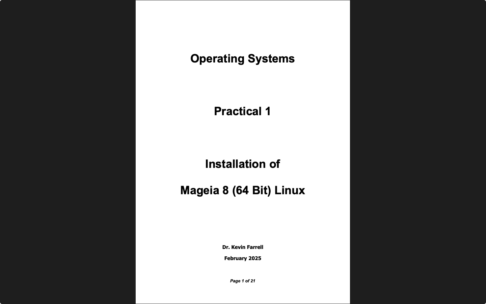
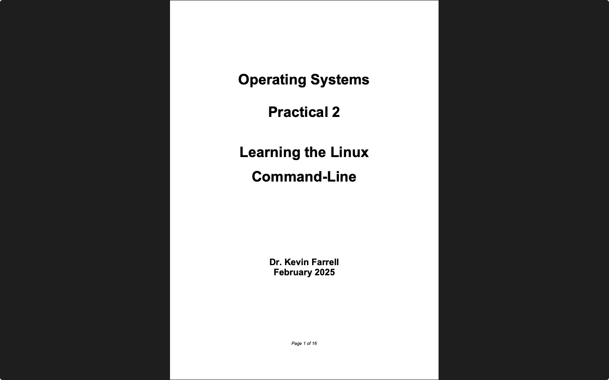
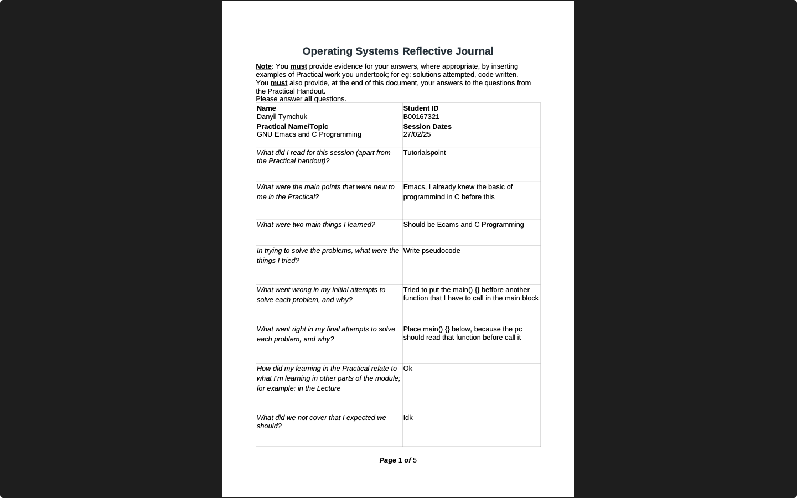
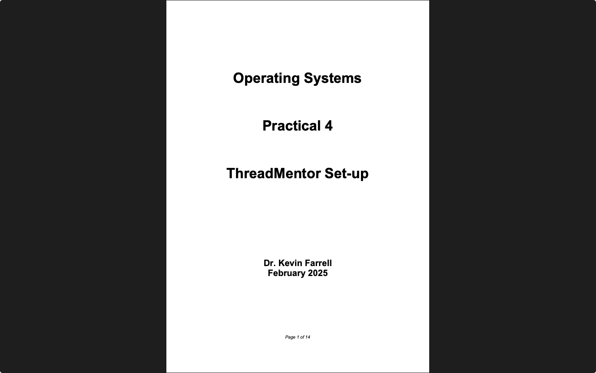
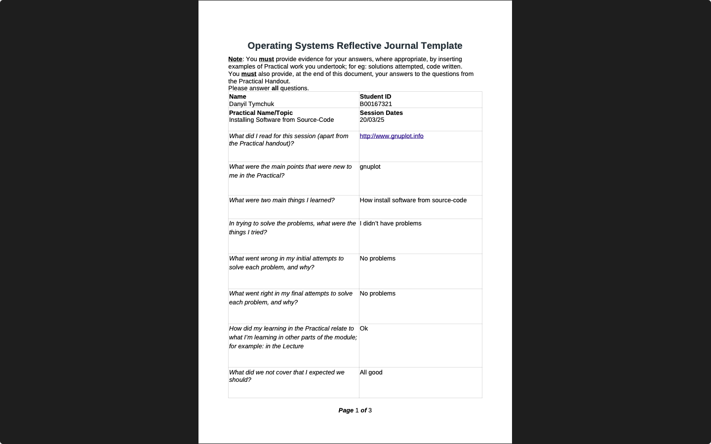
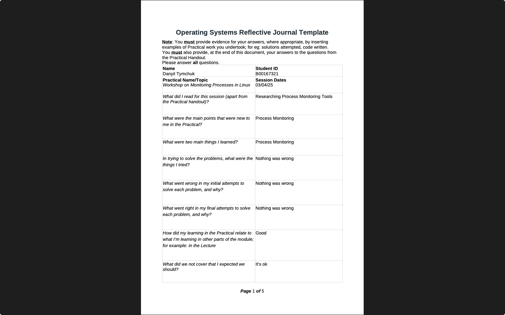
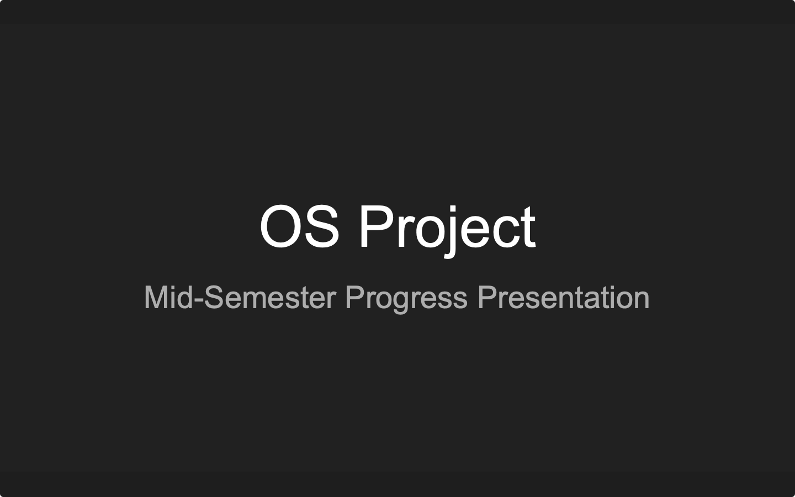
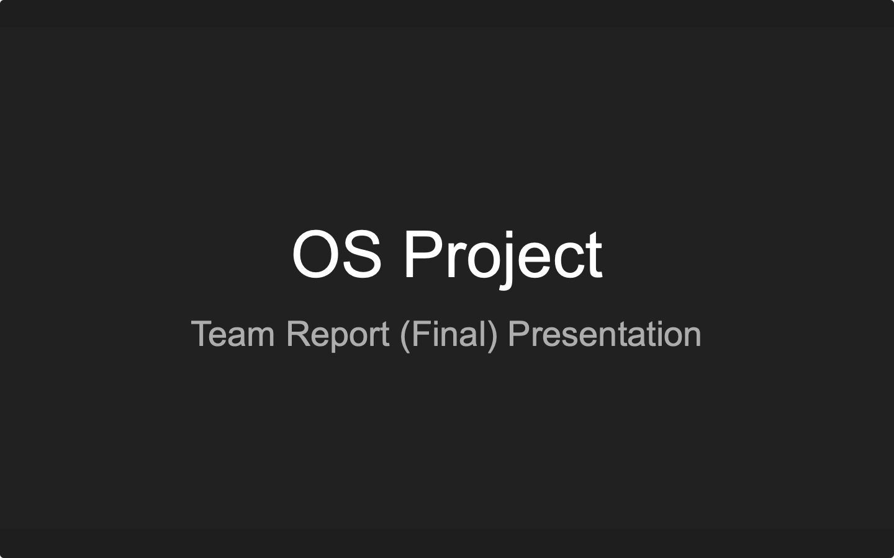

# Operating Systems

**Module:** Operating Systems (`COMP H2014`)  
**Semester:** 4 (Year 2), folder `sem04`  
**Lecturer:** Dr Kevin Farrell  
**Date:** January - May 2025  
**Credits:** 5 ECTS  
**Matching project branch:** [`report/year02/module-operating_systems/dining-philosophers-problem`](https://github.com/DanyilT/projects-in-university/tree/report/year02/module-operating_systems/dining-philosophers-problem) (the team project: the mid-semester presentation, the team report and the final presentation)

## What this module is for

Operating Systems is a balance between the theory of how modern multi-user operating systems work and the practice of administering Linux. The lectures cover fundamental concepts, OS structures, processes, threads and concurrency, CPU scheduling, process synchronisation, deadlocks and memory management. The weekly practicals use a Mageia 8 Linux virtual machine in VirtualBox: installing Linux (practical 1), the Linux command line (2), GNU Emacs and C programming (3), setting up ThreadMentor for the project (4), installing software from source code (5) and monitoring processes with a parent and child program in C (6). Every practical has a reflective activity; practicals 3, 5 and 6 were done with a reflective journal. The module is 50% continuous assessment and a 50% written exam, which is not in the repository. The continuous assessment is the practicals and their reflective activities (9%), the open notes taken in the lectures (10%), a multiple-choice test (6%) and a team project (25%): a study of the synchronisation and concurrency issues of the dining philosophers problem with the ThreadMentor visualisation tool, with a mid-semester progress presentation (5%) and a final presentation with a team report (20%). The week folders are numbered by practical, not by calendar week. The team project is on the branch linked above. This folder has the practical sheets, the C programs and reflective journals, the ThreadMentor, Gnuplot and library packages used by the practicals, the project description with its sample report structure, the learning plan and the module descriptor.

## Grades Breakdown

| Assessment Type | Weighting |
|---|---|
| Practicals and reflective activities | 9% |
| Open notes in the lectures | 10% |
| CA MCQ test (week 11) | 6% |
| Team project: mid-semester progress presentation | 5% |
| Team project: final presentation and team report | 20% |
| End-of-semester written exam | 50% |

## All weeks

| Week | Title | Files | Screenshot |
|---|---|---|---|
| [Week 1](week01/) | Practical 1: installing Mageia 8 Linux with VirtualBox | [`lab/operating_systems_week01_lab.pdf`](week01/lab/operating_systems_week01_lab.pdf) [`resources/generating_pseudo_random_numbers.pdf`](week01/resources/generating_pseudo_random_numbers.pdf) [`resources/glossary_of_terminology.pdf`](week01/resources/glossary_of_terminology.pdf) |  |
| [Week 2](week02/) | Practical 2: learning the Linux command line | [`lab/operating_systems_week02_lab.pdf`](week02/lab/operating_systems_week02_lab.pdf) [`resources/unix_linux_command_reference.pdf`](week02/resources/unix_linux_command_reference.pdf) |  |
| [Week 3](week03/) | Practical 3: GNU Emacs and C programming | [`lab/operating_systems_week03_lab.pdf`](week03/lab/operating_systems_week03_lab.pdf) [`lab/resources/operating_systems_reflective_journal_template.odt`](week03/lab/resources/operating_systems_reflective_journal_template.odt) [`lab/resources/operating_systems_week03_lab_fixing_missing_media_needed_to_install_emacs.pdf`](week03/lab/resources/operating_systems_week03_lab_fixing_missing_media_needed_to_install_emacs.pdf) [`lab/solution/operating_systems_week03_lab_reflective_journal.odt`](week03/lab/solution/operating_systems_week03_lab_reflective_journal.odt) [`lab/solution/operating_systems_week03_lab_reflective_journal.pdf`](week03/lab/solution/operating_systems_week03_lab_reflective_journal.pdf) [`lab/solution/practical3/hello.c`](week03/lab/solution/practical3/hello.c) [`lab/solution/practical3/sayhi`](week03/lab/solution/practical3/sayhi) [`lab/solution/practical3/loopprinter1.c`](week03/lab/solution/practical3/loopprinter1.c) [`lab/solution/practical3/loopprinter1`](week03/lab/solution/practical3/loopprinter1) [`lab/solution/practical3/loopprinter2.c`](week03/lab/solution/practical3/loopprinter2.c) [`lab/solution/practical3/loopprinter2`](week03/lab/solution/practical3/loopprinter2) [`lab/solution/practical3/mysimplearray.c`](week03/lab/solution/practical3/mysimplearray.c) [`lab/solution/practical3/mysimplearray`](week03/lab/solution/practical3/mysimplearray) [`lab/solution/practical3/calcSum.c`](week03/lab/solution/practical3/calcSum.c) [`lab/solution/practical3/calcSum`](week03/lab/solution/practical3/calcSum) [`resources/emacs_cheat_sheet.pdf`](week03/resources/emacs_cheat_sheet.pdf) |  |
| [Week 4](week04/) | Practical 4: ThreadMentor set-up for the project | [`lab/operating_systems_week04_lab.pdf`](week04/lab/operating_systems_week04_lab.pdf) [`lab/resources/ThreadMentor-fedora4.tgz`](week04/lab/resources/ThreadMentor-fedora4.tgz) [`lab/resources/libglib1.2-1.2.10-24mdv2011.0.i586.rpm`](week04/lab/resources/libglib1.2-1.2.10-24mdv2011.0.i586.rpm) [`lab/resources/libgtkPLUS1.2-1.2.10-51mdv2011.0.i586.rpm`](week04/lab/resources/libgtkPLUS1.2-1.2.10-51mdv2011.0.i586.rpm) [`lab/resources/diningphil/Makefile`](week04/lab/resources/diningphil/Makefile) [`lab/resources/diningphil/Philosopher.h`](week04/lab/resources/diningphil/Philosopher.h) [`lab/resources/diningphil/Philosopher.cpp`](week04/lab/resources/diningphil/Philosopher.cpp) [`lab/resources/diningphil/Philosopher-main.cpp`](week04/lab/resources/diningphil/Philosopher-main.cpp) |  |
| [Week 5](week05/) | Practical 5: installing software from source code | [`lab/operating_systems_week05_lab.pdf`](week05/lab/operating_systems_week05_lab.pdf) [`lab/resources/gnuplot-5.4.5.tgz`](week05/lab/resources/gnuplot-5.4.5.tgz) [`lab/resources/operating_systems_reflective_journal_template.odt`](week05/lab/resources/operating_systems_reflective_journal_template.odt) [`lab/solution/operating_systems_week05_lab_reflective_journal.odt`](week05/lab/solution/operating_systems_week05_lab_reflective_journal.odt) [`lab/solution/operating_systems_week05_lab_reflective_journal.pdf`](week05/lab/solution/operating_systems_week05_lab_reflective_journal.pdf) |  |
| [Week 6](week06/) | Practical 6: monitoring processes | [`lab/operating_systems_week06_lab.pdf`](week06/lab/operating_systems_week06_lab.pdf) [`lab/resources/operating_systems_reflective_journal_template.odt`](week06/lab/resources/operating_systems_reflective_journal_template.odt) [`lab/solution/operating_systems_week06_lab_reflective_journal.odt`](week06/lab/solution/operating_systems_week06_lab_reflective_journal.odt) [`lab/solution/operating_systems_week06_lab_reflective_journal.pdf`](week06/lab/solution/operating_systems_week06_lab_reflective_journal.pdf) [`lab/solution/practical6/parentchild.c`](week06/lab/solution/practical6/parentchild.c) [`lab/solution/practical6/parentchild`](week06/lab/solution/practical6/parentchild) |  |

## Assessments and other files

| File | What it contains |
|---|---|
| [`resources/operating_systems.pdf`](resources/operating_systems.pdf) | The module descriptor (4 pages): COMP H2014, 5 ECTS, NFQ level 6; the aims, the learning outcomes (design principles of operating systems, single-threaded and multi-threaded processes, installing and administering a multi-user operating system, process synchronisation problems), the indicative content and the assessment. |
| [`resources/operating_systems_learning_plan.pdf`](resources/operating_systems_learning_plan.pdf) | The learning plan 2025, version 4 (8 pages): the weekly schedule of lectures, readings, graded activities and practicals, the continuous assessment (50%), communication and expectations, the written exam (50%) and the required and supplementary reading. |
| [`assessment/01/operating_systems_assessment.pdf`](assessment/01/operating_systems_assessment.pdf) | The team project description (12 pages, 25%, January 2025, version 2): a study of the synchronisation and concurrency issues in the dining philosophers problem with ThreadMentor, in teams of four (three if needed) from one lab group. The deliverables are the mid-semester progress presentation (week beginning 3 March), the team report and the project presentation and demonstration (week beginning 28 April). The project has to study two categories of solutions on the ThreadMentor e-book site, mutual exclusion locks and semaphores, and to choose one solution to study. |
| [`assessment/01/resources/operating_systems_project_sample_report_structure.odt`](assessment/01/resources/operating_systems_project_sample_report_structure.odt) | The sample structure of the project report (an OpenDocument text file). |
| [`assessment/01/submission/project_link.txt`](assessment/01/submission/project_link.txt) | Two lines: the GitHub link to the team project on its branch and the branch name. The branch has the mid-semester presentation (slides and Gantt chart) and the team report with its final presentation. |

A third screenshot, [`screenshot_report.png`](.screenshots/assessment/01/screenshot_report.png), shows the title page of the team report with the names and student numbers of the team, so it is not embedded here.

The learning plan lists these online resources for the C programming part: Operating Systems: Three Easy Pieces, a free book by Remzi Arpaci-Dusseau, Andrea Arpaci-Dusseau and Peter Reiher (https://pages.cs.wisc.edu/~remzi/OSTEP/), the C tutorials on tutorialspoint.com and cprogramming.com, Learn C Programming (https://www.learn-c.org/) and Learning GNU C (https://www.linuxtopia.org/online_books/programming_books/learning_gnu_c/index.htm). The practicals use VirtualBox (https://www.virtualbox.org/) or VMware Workstation Player (https://www.vmware.com/products/workstation-player.html) with the Mageia 8 installation image (https://www.mageia.org/en-gb/downloads/get/), a tour of GNU Emacs (https://www.gnu.org/software/emacs/tour), the C programming tutorial on tutorialspoint.com (https://www.tutorialspoint.com/cprogramming/index.htm) and gnuplot (http://www.gnuplot.info).

### Screenshots

*The title slide of the mid-semester progress presentation.*

*The title slide of the final presentation.*

---

## Module descriptor

Module Title: Operating Systems (mandatory), module code COMP H2014, 5 credits, lecturer Dr Kevin Farrell.

**Module aims.** This module is a balance between theoretical and practical aspects of modern operating systems. It gives learners an appreciation and understanding of the internal workings and designs of modern operating systems, and the basic knowledge, skills and understanding to install, configure and troubleshoot the Linux operating system. It aims to develop knowledge of operating systems by covering the theory of how modern, multi-user, network operating systems function, in particular the issues of concurrency and deadlock that arise in such systems on uni-processor and multi-processor or multicore platforms, and to enhance operating systems administration skills through the advanced configuration and troubleshooting of Linux in a multi-user networked environment.

**Indicative syllabus.**

- Operating Systems Structures
- Processes
- Processor Scheduling
- Threads
- Memory Management
- File Management
- I/O Management
- Process Synchronisation
- Deadlocks
- System Administration in Linux

**Assessment.** Examination 50% and continuous assessment 50%. The repeat assessment is a 100% examination.

**Required reading.**

- Abraham Silberschatz, Peter Baer Galvin and Greg Gagne (2018), Operating System Concepts, 10th edition, Wiley.
- William Stallings (2014), Operating Systems: Internals and Design Principles, international version, 8th edition, Pearson Education.

**Supplementary materials.**

- William S. Davis and T. M. Rajkumar (2005), Operating Systems, 6th edition, Pearson/Addison Wesley.
- Andrew S. Tanenbaum (2008), Modern Operating Systems, 3rd edition, Pearson Higher Education.
- Sobell, A Practical Guide to Linux.

**Internet based resources.**

- The Linux Documentation Project: www.tldp.org
- Multithreaded Programming with ThreadMentor (the e-book): http://www.cs.mtu.edu/~shene/NSF-3/e-Book/index.html
