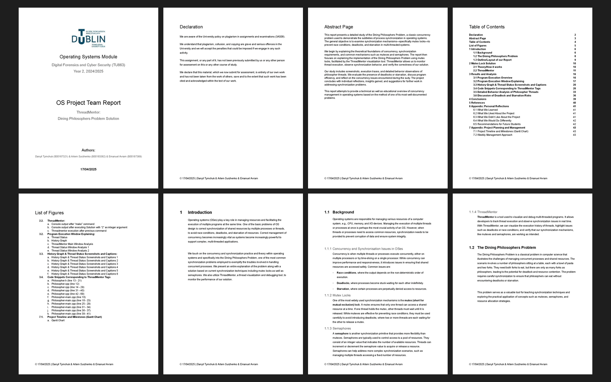
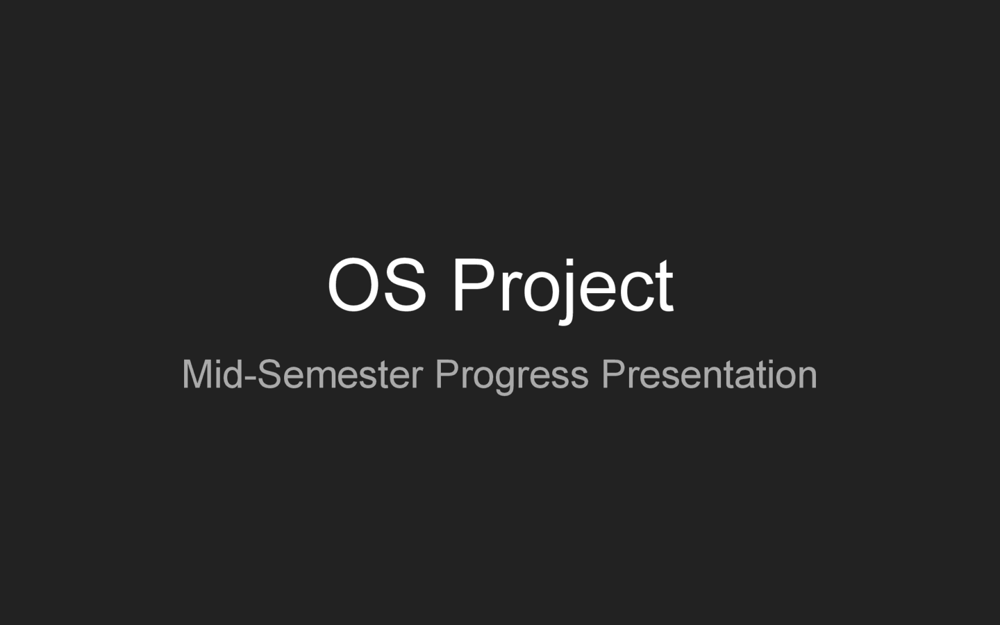
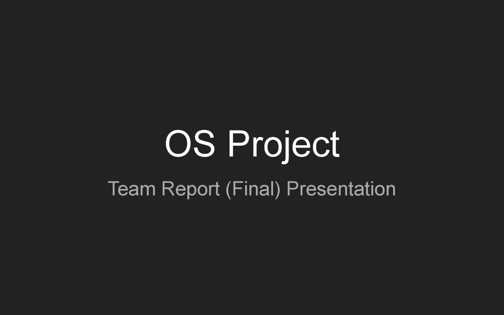

# Assessment 1: Team project: the dining philosophers problem

**Module:** Operating Systems (`COMP H2014`)  
**Semester:** 4 (Year 2), folder `sem04`  
**Type:** project, group of 4 (3 if needed)  
**Weight:** 25% (mid-semester progress presentation 5%, final presentation and team report 20%)  
**Deadline:** the mid-semester presentation in the week beginning 3 March 2025, the team report and the final presentation and demonstration in the week beginning 28 April 2025  
**Result:** —  
**On main:** [`sem04/operating_systems/assessment/01/`](https://github.com/DanyilT/projects-in-university/tree/main/sem04/operating_systems/assessment/01) (the brief, the sample report structure, the submitted presentations, report and Gantt chart, and this README)  
**Branch:** —  
**Repository:** —

[Module README](../../README.md)

## What this assessment is for

The project description (12 pages, January 2025, version 2) is a study of the synchronisation and concurrency issues in the dining philosophers problem with ThreadMentor, in teams of four (three if needed) from one lab group. The deliverables are the mid-semester progress presentation, the team report and the project presentation with a demonstration.

The submission is the mid-semester progress presentation (20 slides) with the Gantt chart, the team report (45 pages) and the final presentation (55 slides). The PowerPoint files of the two presentations and the Excel file of the Gantt chart are not kept: each presentation is a PDF here and a Google Slides file, and the Gantt chart is a PDF here and a Google Sheet, linked in their rows.

<table>
  <tr valign="top">
    <td colspan="2"> <i>The team report: pages 1 to 8 of 45 (the title page, the declaration, the abstract, the contents, the list of figures and the start of the introduction).</i></td>
  </tr>
  <tr valign="top">
    <td width="50%"> <i>The title slide of the mid-semester progress presentation.</i></td>
    <td width="50%"> <i>The title slide of the final presentation.</i></td>
  </tr>
</table>

## Files

| File | What it contains |
|---|---|
| [`README.md`](README.md) | This README. |
| [`operating_systems_assessment.pdf`](operating_systems_assessment.pdf) | The team project description (12 pages, 25%, January 2025, version 2): a study of the synchronisation and concurrency issues in the dining philosophers problem with ThreadMentor, in teams of four (three if needed) from one lab group. The deliverables are the mid-semester progress presentation (week beginning 3 March), the team report and the project presentation and demonstration (week beginning 28 April). The project has to study two categories of solutions on the ThreadMentor e-book site, mutual exclusion locks and semaphores, and to choose one solution to study. |
| [`resources/operating_systems_project_sample_report_structure.odt`](resources/operating_systems_project_sample_report_structure.odt) | The sample structure of the project report (an OpenDocument text file). |
| [`submission/operating_systems_dining_philosophers_problem_project_mid_semester_progress_presentation.pdf`](submission/operating_systems_dining_philosophers_problem_project_mid_semester_progress_presentation.pdf) | The mid-semester progress presentation (20 slides, 5%): the dining philosophers problem and ThreadMentor, the project goals, the mutex lock solution with a program run, the implementation details, the challenges (deadlock and starvation), possible solutions, the next steps and the conclusion. It is also a Google Slides file: [the presentation](https://docs.google.com/presentation/d/1gYD_pvve2Mc2rxLC_-CvhUJUvuDDrHsJXufeu8OwS8w) and [its published version](https://docs.google.com/presentation/d/e/2PACX-1vSJ1rDhxKW98_E9eE_LBv5u9y9A_8jq7jFMjYJ8ISuYlBiNdDowcA8KTZZghcDE_TsoPk7bhc0bDU9u/pub). |
| [`submission/operating_systems_dining_philosophers_problem_project_gantt_chart.pdf`](submission/operating_systems_dining_philosophers_problem_project_gantt_chart.pdf) | The Gantt chart of the project (1 page): the 13 tasks of the five workstreams (research, setup and implementation, analysis and testing, the mid-semester deliverable and the final deliverables) with the team member, the duration and the start and end dates, and the bars from 25 March to 30 April 2025. It is also a Google Sheet: [the spreadsheet](https://docs.google.com/spreadsheets/d/1DhzVf0yPlGDIgKuwHM3u3VI6FwiCGU4O). |
| [`submission/operating_systems_dining_philosophers_problem_project_team_report.pdf`](submission/operating_systems_dining_philosophers_problem_project_team_report.pdf) | The team report (45 pages): the introduction, the mutex lock solution, the results and analysis of the ThreadMentor run (the program execution and its window, the history graph and thread status, the code snippets, the behaviour of each philosopher thread, the deadlock and starvation risks), the conclusions, the references and two appendices (personal reflections, and project planning with the Gantt chart). The report is also a Google Doc: [the document](https://docs.google.com/document/d/1BAXlx8K26W0OViJsNZpMvl9AHuZDEe5OktCPd2cfQ00) and [its published version](https://docs.google.com/document/d/e/2PACX-1vT7aaVi8K453ob8alzEqcduayIWdSzPPFLuovtvh4zRalDJaut-CxxZxBKStjfEP9ldov6FYF18-f_7/pub). |
| [`submission/operating_systems_dining_philosophers_problem_project_team_report_final_presentation.pdf`](submission/operating_systems_dining_philosophers_problem_project_team_report_final_presentation.pdf) | The final presentation of the team report (55 slides), in the sections of the report. It is also a Google Slides file: [the presentation](https://docs.google.com/presentation/d/186Zx9ev4Qt2iTbpSgKluflNM1JgJpWphl4lUWX4_PHQ) and [its published version](https://docs.google.com/presentation/d/e/2PACX-1vSjztYPSsHN6tiIZT10jJB73_cX3maNGDsfrc57Q4tdu8N-kCl1gyN-tgH4hltIzn5xGEugS0uuzlF1/pub). |

## Online versions

- [Final presentation (Google Slides)](https://docs.google.com/presentation/d/186Zx9ev4Qt2iTbpSgKluflNM1JgJpWphl4lUWX4_PHQ): the final presentation as a Google Slides file, the online version of [`submission/operating_systems_dining_philosophers_problem_project_team_report_final_presentation.pdf`](submission/operating_systems_dining_philosophers_problem_project_team_report_final_presentation.pdf).
- [Final presentation, published version](https://docs.google.com/presentation/d/e/2PACX-1vSjztYPSsHN6tiIZT10jJB73_cX3maNGDsfrc57Q4tdu8N-kCl1gyN-tgH4hltIzn5xGEugS0uuzlF1/pub): the same presentation, published on the web.
- [Team report (Google Docs)](https://docs.google.com/document/d/1BAXlx8K26W0OViJsNZpMvl9AHuZDEe5OktCPd2cfQ00): the team report as a Google Doc, the online version of [`submission/operating_systems_dining_philosophers_problem_project_team_report.pdf`](submission/operating_systems_dining_philosophers_problem_project_team_report.pdf).
- [Team report, published version](https://docs.google.com/document/d/e/2PACX-1vT7aaVi8K453ob8alzEqcduayIWdSzPPFLuovtvh4zRalDJaut-CxxZxBKStjfEP9ldov6FYF18-f_7/pub): the same report, published on the web.
- [Mid-semester progress presentation (Google Slides)](https://docs.google.com/presentation/d/1gYD_pvve2Mc2rxLC_-CvhUJUvuDDrHsJXufeu8OwS8w): the mid-semester progress presentation as a Google Slides file, the online version of [`submission/operating_systems_dining_philosophers_problem_project_mid_semester_progress_presentation.pdf`](submission/operating_systems_dining_philosophers_problem_project_mid_semester_progress_presentation.pdf).
- [Mid-semester progress presentation, published version](https://docs.google.com/presentation/d/e/2PACX-1vSJ1rDhxKW98_E9eE_LBv5u9y9A_8jq7jFMjYJ8ISuYlBiNdDowcA8KTZZghcDE_TsoPk7bhc0bDU9u/pub): the same presentation, published on the web.
- [Gantt chart (Google Sheets)](https://docs.google.com/spreadsheets/d/1DhzVf0yPlGDIgKuwHM3u3VI6FwiCGU4O): the Gantt chart of the project as a Google Sheet, the online version of [`submission/operating_systems_dining_philosophers_problem_project_gantt_chart.pdf`](submission/operating_systems_dining_philosophers_problem_project_gantt_chart.pdf).
