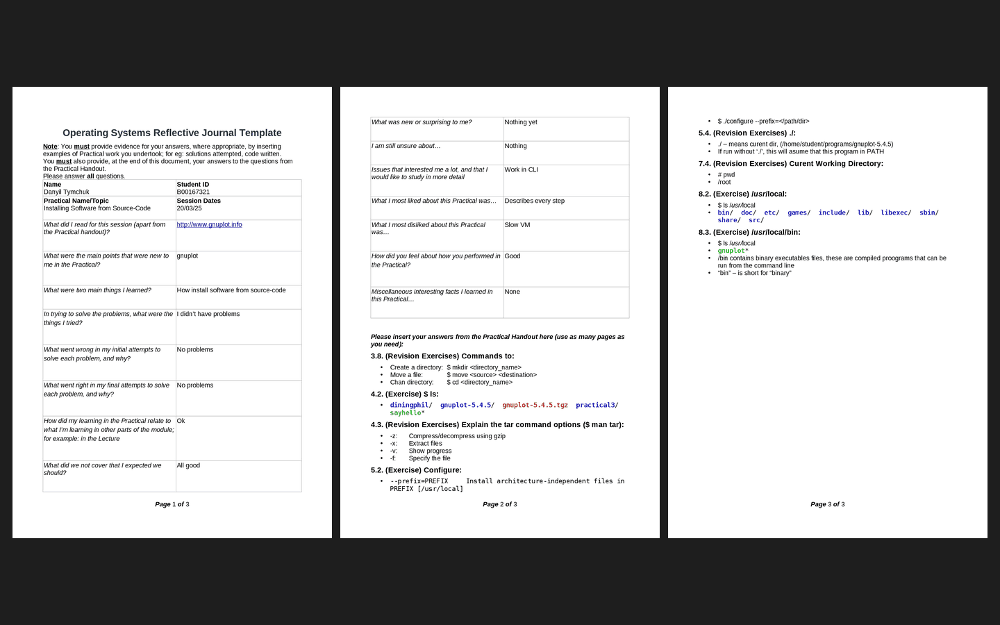

# Week 05 — Practical 5: installing software from source code

**Module:** Operating Systems (`COMP H2014`)  
**Semester:** 4 (Year 2), folder `sem04`

[Module README](../README.md)

## What this week is for

Practical 5 installs Gnuplot from its source code on Linux: install the X11 development libraries (libx11-devel) with the Mageia Control Centre, download the gnuplot-5.4.5 tarball, uncompress and extract it, configure the package, compile it, install the result and test it. The reflective journal is for the session of 20 March 2025.

*The reflective journal for Practical 5: all 3 pages.*

## Files

| File | What it contains |
|---|---|
| [`README.md`](README.md) | This README. |
| [`lab/operating_systems_week05_lab.pdf`](lab/operating_systems_week05_lab.pdf) | The practical sheet (16 pages): Installing Software from Source-Code on Linux (March 2025). |
| [`lab/resources/gnuplot-5.4.5.tgz`](lab/resources/gnuplot-5.4.5.tgz) | The Gnuplot 5.4.5 source code (a tarball). |
| [`../week03/lab/resources/operating_systems_reflective_journal_template.odt`](../week03/lab/resources/operating_systems_reflective_journal_template.odt) | The Reflective Journal template (an OpenDocument text file), given again for this practical; the file is only in week 3. |
| [`lab/solution/operating_systems_week05_lab_reflective_journal.pdf`](lab/solution/operating_systems_week05_lab_reflective_journal.pdf) | The completed reflective journal (3 pages). |
