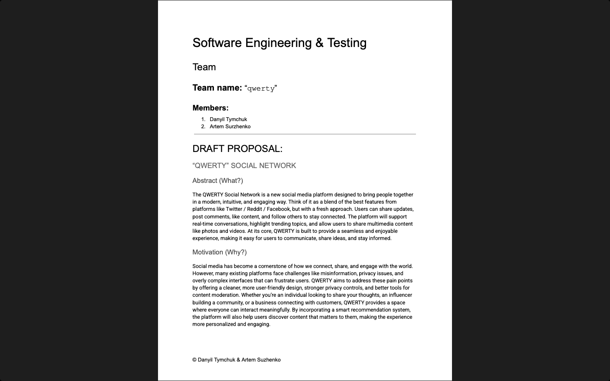
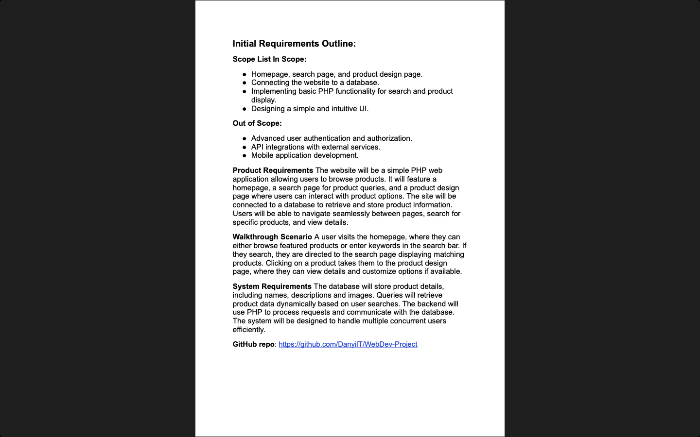
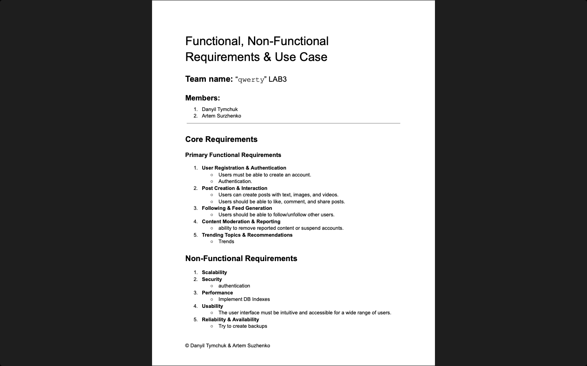
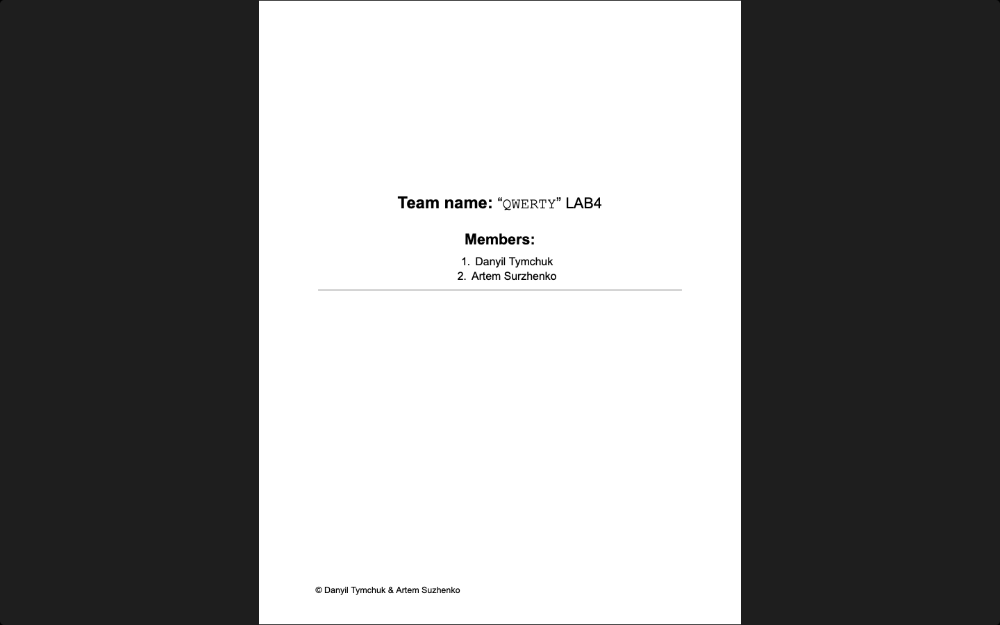
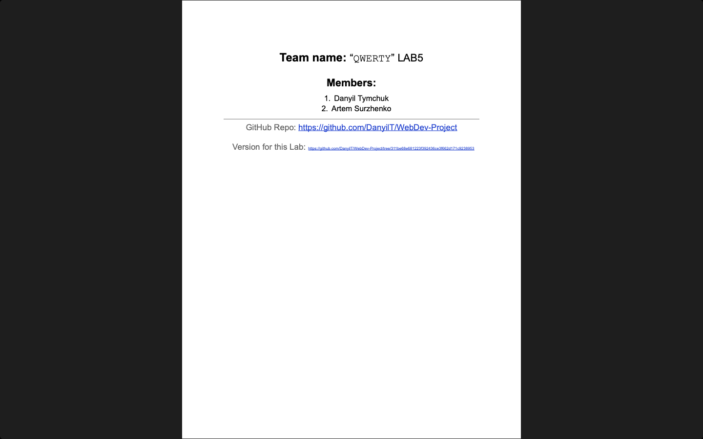
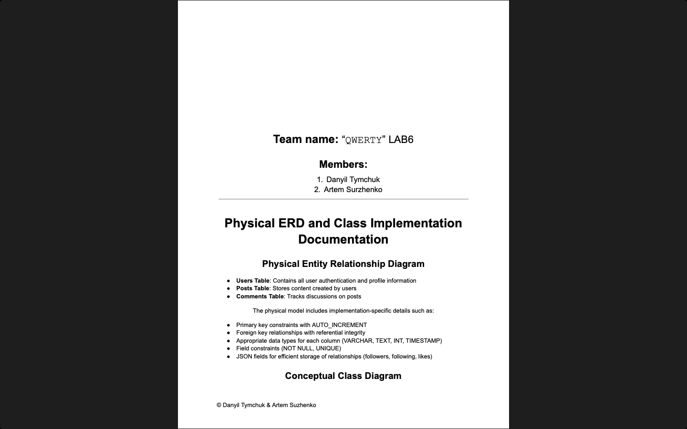
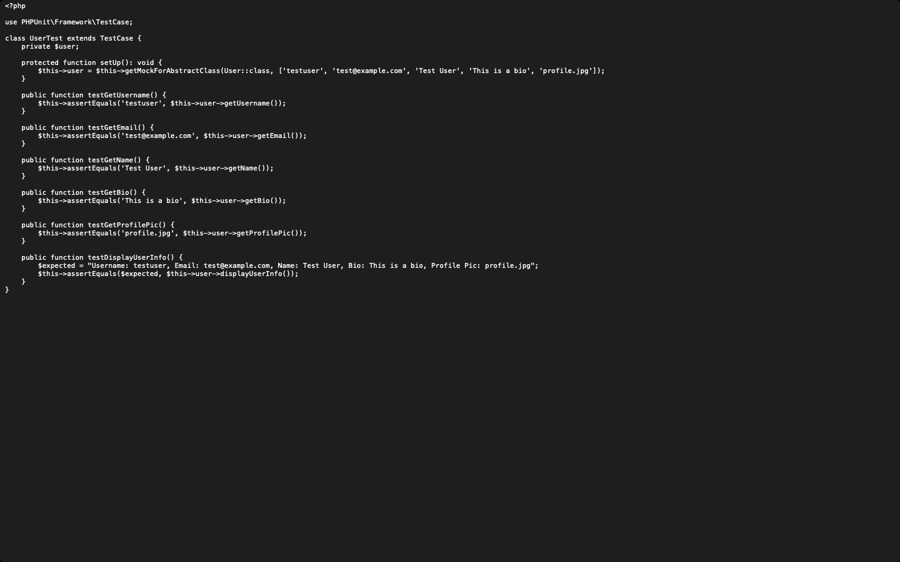
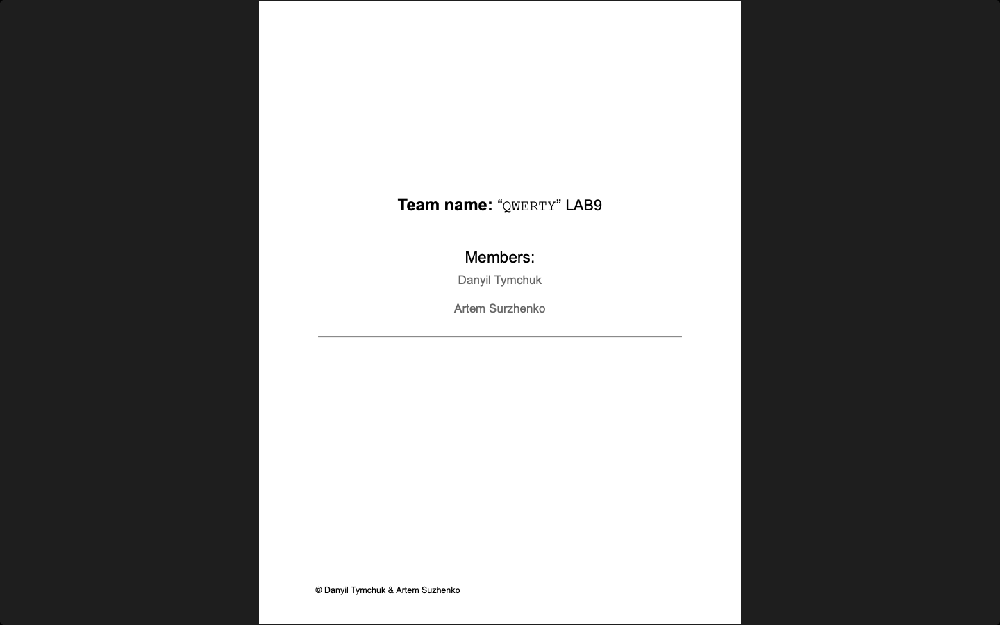

# Software Engineering and Testing

**Module:** Software Engineering and Testing (`COMP H2027`)  
**Semester:** 4 (Year 2), folder `sem04`  
**Lecturer:** Arnold Hensman  
**Date:** January - May 2025  
**Credits:** 5 ECTS  
**Matching project branch:** none

## What this module is for

Software Engineering and Testing is about the software development process more than the product: a project proposal, requirements and use cases, design with ERDs and class diagrams, a draft implementation in PHP with a MySQL database, and software testing (unit, user interface, validation, basis path, equivalence partition and requirements testing). Every week the team of the project has a lab with a daily scrum, a sprint and a diary entry, and the four assessments follow the stages of the project. The project is shared with Web Development Server-Side (the same brief, grading the PHP and database side) and IT Business Management (project management and the team meetings). The team of two built QWERTY, a social network website in PHP and MySQL; its code is in the WebDev-Project repository on GitHub, which the weekly sprint documents link to. The module is 100% continuous assessment: weekly lab work (20%), the proposal (5%), the requirements document and draft website (20%), the design and draft implementation (20% plus a 5% demo) and software testing (25% plus a 5% demo). This folder has the lab sheets, the project diary and sprint document of each lab, the four assessment briefs with their templates and grading rubrics, the submitted documents and the testing code, and the lecture code files of weeks 4, 6 and 7.

## Grades Breakdown

| Assessment Type | Weighting |
|---|---|
| Lab work (weekly) | 20% |
| CA 1: project proposal | 5% |
| CA 2: requirements and draft website | 20% |
| CA 3: design and draft implementation | 20% + 5% demo |
| CA 4: software testing | 25% + 5% demo |

## All weeks

| Week | Title | Files | Screenshot |
|---|---|---|---|
| [Week 1](week01/) | Lab 1: group formation, project theme and diary entry | [`lab/software_engineering_and_testing_week01_lab.pdf`](week01/lab/software_engineering_and_testing_week01_lab.pdf) [`lab/resources/project_diary_template.docx`](week01/lab/resources/project_diary_template.docx) [`lab/solution/draft_proposal.pdf`](week01/lab/solution/draft_proposal.pdf) [`lab/solution/project_diary.pdf`](week01/lab/solution/project_diary.pdf) |  |
| [Week 2](week02/) | Lab 2: daily scrum, version 1.0 of the website and initial requirements | [`lab/software_engineering_and_testing_week02_lab.pdf`](week02/lab/software_engineering_and_testing_week02_lab.pdf) [`lab/resources/project_diary_template.docx`](week02/lab/resources/project_diary_template.docx) [`lab/solution/project_diary.pdf`](week02/lab/solution/project_diary.pdf) [`lab/solution/sprint.pdf`](week02/lab/solution/sprint.pdf) |  |
| [Week 3](week03/) | Lab 3: requirements and use cases (version 2.0) | [`lab/software_engineering_and_testing_week03_lab.pdf`](week03/lab/software_engineering_and_testing_week03_lab.pdf) [`lab/resources/project_diary_template.docx`](week03/lab/resources/project_diary_template.docx) [`lab/solution/project_diary.pdf`](week03/lab/solution/project_diary.pdf) [`lab/solution/sprint.pdf`](week03/lab/solution/sprint.pdf) |  |
| [Week 4](week04/) | Lab 4: database connection and draft ERD | [`lab/software_engineering_and_testing_week04_lab.pdf`](week04/lab/software_engineering_and_testing_week04_lab.pdf) [`lab/resources/project_diary_template.docx`](week04/lab/resources/project_diary_template.docx) [`lab/solution/project_diary.pdf`](week04/lab/solution/project_diary.pdf) [`lab/solution/sprint.pdf`](week04/lab/solution/sprint.pdf) [`resources/lecture_code_files/databaseConfig.php`](week04/resources/lecture_code_files/databaseConfig.php) [`resources/lecture_code_files/Sample1_DBConnection.php`](week04/resources/lecture_code_files/Sample1_DBConnection.php) [`resources/lecture_code_files/Sample2_DBConnection_As_Include.php`](week04/resources/lecture_code_files/Sample2_DBConnection_As_Include.php) [`resources/lecture_code_files/Sample3_DBConnection_As_Include_Advanced.php`](week04/resources/lecture_code_files/Sample3_DBConnection_As_Include_Advanced.php) [`resources/lecture_code_files/Sample4_DBConnection_QueryExpensiveCars.php`](week04/resources/lecture_code_files/Sample4_DBConnection_QueryExpensiveCars.php) [`resources/lecture_code_files/Sample5_DBConnection_InsertCar.php`](week04/resources/lecture_code_files/Sample5_DBConnection_InsertCar.php) [`resources/lecture_code_files/Sample6_DBConnection_DeleteCar.php`](week04/resources/lecture_code_files/Sample6_DBConnection_DeleteCar.php) [`resources/lecture_code_files/Sample7_DBConnection_InsertRandomCar.php`](week04/resources/lecture_code_files/Sample7_DBConnection_InsertRandomCar.php) [`resources/lecture_code_files/DBConnection_UNAME_PWORD_FORM.php`](week04/resources/lecture_code_files/DBConnection_UNAME_PWORD_FORM.php) |  |
| [Week 5](week05/) | Lab 5: database connection and logical ERD | [`lab/software_engineering_and_testing_week05_lab.pdf`](week05/lab/software_engineering_and_testing_week05_lab.pdf) [`lab/resources/project_diary_template.docx`](week05/lab/resources/project_diary_template.docx) [`lab/solution/project_diary.pdf`](week05/lab/solution/project_diary.pdf) [`lab/solution/sprint.pdf`](week05/lab/solution/sprint.pdf) |  |
| [Week 6](week06/) | Lab 6: physical ERD and classes (version 5.0) | [`lab/software_engineering_and_testing_week06_lab.pdf`](week06/lab/software_engineering_and_testing_week06_lab.pdf) [`lab/resources/project_diary_template.docx`](week06/lab/resources/project_diary_template.docx) [`lab/solution/project_diary.pdf`](week06/lab/solution/project_diary.pdf) [`lab/solution/sprint.pdf`](week06/lab/solution/sprint.pdf) [`resources/lecture_code_files/databaseConfig.php`](week06/resources/lecture_code_files/databaseConfig.php) [`resources/lecture_code_files/Car.php`](week06/resources/lecture_code_files/Car.php) [`resources/lecture_code_files/PullCarsFromDB_viaObject.php`](week06/resources/lecture_code_files/PullCarsFromDB_viaObject.php) |  |
| [Week 7](week07/) | Lab 7: putting it all together (version 6.0) | [`lab/software_engineering_and_testing_week07_lab.pdf`](week07/lab/software_engineering_and_testing_week07_lab.pdf) [`lab/resources/project_diary_template.docx`](week07/lab/resources/project_diary_template.docx) [`lab/solution/project_diary.pdf`](week07/lab/solution/project_diary.pdf) [`lab/solution/sprint.pdf`](week07/lab/solution/sprint.pdf) [`resources/lecture_code_files/Version 5.0.zip`](week07/resources/lecture_code_files/Version%205.0.zip) [`resources/lecture_code_files/Version 6.0.zip`](week07/resources/lecture_code_files/Version%206.0.zip) |  |
| [Week 8](week08/) | Lab 8: unit test introduction | [`lab/software_engineering_and_testing_week08_lab.pdf`](week08/lab/software_engineering_and_testing_week08_lab.pdf) [`lab/solution/UserTest.php`](week08/lab/solution/UserTest.php) |  |
| [Week 9](week09/) | Lab 9: test planning | [`lab/software_engineering_and_testing_week09_lab.pdf`](week09/lab/software_engineering_and_testing_week09_lab.pdf) [`lab/solution/sprint.pdf`](week09/lab/solution/sprint.pdf) |  |
| [Week 10](week10/) | Lab 10: test execution | [`lab/software_engineering_and_testing_week10_lab.pdf`](week10/lab/software_engineering_and_testing_week10_lab.pdf) [`lab/solution/sprint.pdf`](week10/lab/solution/sprint.pdf) |  |

## Assessments and other files

| File | What it contains |
|---|---|
| [`assessment/01/software_engineering_and_testing_assessment.pdf`](assessment/01/software_engineering_and_testing_assessment.pdf) | Assignment 1, the project proposal (1 page, 5%, due 10 February 2025): fill in all the headings of the proposal template (expanding the abstract, motivation and justification from lab 1) in a PDF. |
| [`assessment/01/resources/project_proposal_template.docx`](assessment/01/resources/project_proposal_template.docx) | The project proposal template (a Word file). |
| [`assessment/01/submission/project_proposal.pdf`](assessment/01/submission/project_proposal.pdf) | The submitted proposal, Assessment 1: Project Proposal (5 pages). |
| [`assessment/02/software_engineering_and_testing_assessment.pdf`](assessment/02/software_engineering_and_testing_assessment.pdf) | Assignment 2, the requirements and draft website (1 page, 20%, due 24 February 2025 at 9am): a draft website with the basic PHP user interface and structure of the themed product (10%, demonstrated in the lab), and a requirements document (10%) with the problem definition, scope, walkthrough scenarios, user and system requirements, the use case diagram and specifications, a GUI outline, technical requirements and feasibility, and conclusions. |
| [`assessment/02/resources/requirements_document_template.docx`](assessment/02/resources/requirements_document_template.docx) | The requirements report template (a Word file). |
| [`assessment/02/resources/sample_feasibility_and_requirements.doc`](assessment/02/resources/sample_feasibility_and_requirements.doc) | A sample feasibility and requirements document by the lecturer (a Word file): a vending machine control software for a catering client, with its revisions and use cases. |
| [`assessment/02/resources/use_case_specification_example.docx`](assessment/02/resources/use_case_specification_example.docx) | An example of use case specifications (a Word file): a hotel booking system with the scenarios reserve room, check-in and check-out, login and cancel booking. |
| [`assessment/02/submission/requirements_document.pdf`](assessment/02/submission/requirements_document.pdf) | The submitted requirements document, Assessment 2 (9 pages). |
| [`assessment/03/software_engineering_and_testing_assessment.pdf`](assessment/03/software_engineering_and_testing_assessment.pdf) | Assignment 3, the design and draft implementation (3 pages, 20% and a 5% demo, due 24 March 2025 at 9am, with the marking scheme): a design document (10%) with the methodology, the class diagram and the ERD with the explanation of their creation, and an implementation (10%) of the classes and the database in PHP with an HTML and CSS front end, with the SQL database creation file and all the PHP files. |
| [`assessment/03/resources/design_and_draft_implementation_template.docx`](assessment/03/resources/design_and_draft_implementation_template.docx) | The checklist and template of the design document (a Word file). |
| [`assessment/03/resources/software_engineering_and_testing_assessment_grades.pdf`](assessment/03/resources/software_engineering_and_testing_assessment_grades.pdf) | The rubric of assessment 3 (8 pages). |
| [`assessment/03/resources/uml_class_diagram_annotation_list.pdf`](assessment/03/resources/uml_class_diagram_annotation_list.pdf) | The UML class diagram annotation list (1 page). |
| [`assessment/03/submission/design_and_draft_implementation.pdf`](assessment/03/submission/design_and_draft_implementation.pdf) | The submitted design and draft implementation, Assessment 3 (11 pages). |
| [`assessment/04/software_engineering_and_testing_assessment.pdf`](assessment/04/software_engineering_and_testing_assessment.pdf) | Assignment 4, software testing (2 pages, 25% and a 5% demo, due 28 April 2025 at 9am): five unit tests on five core classes (10 marks, five PHP files), user interface tests of five design principles (10 marks, a PDF with screenshots), validation tests (5 marks), and the demo of requirements testing (3 marks), equivalence partition testing (1 mark) and basis path testing (1 mark). |
| [`assessment/04/resources/software_engineering_and_testing_assessment_grades.pdf`](assessment/04/resources/software_engineering_and_testing_assessment_grades.pdf) | The rubric of assessment 4 (2 pages). |
| [`assessment/04/submission/software_testing.pdf`](assessment/04/submission/software_testing.pdf) | The submitted testing document, Assessment 4: Software Testing (8 pages). |
| [`assessment/04/submission/ui_testing_documentation.pdf`](assessment/04/submission/ui_testing_documentation.pdf) | The user interface testing documentation (17 pages): the five principles tested with screenshots. |
| [`assessment/04/submission/project_link.txt`](assessment/04/submission/project_link.txt) | One line: the GitHub link to the project repository, WebDev-Project. |
| [`assessment/04/submission/code/validation_tests.php`](assessment/04/submission/code/validation_tests.php) | Validation tests: five tests of data validation beyond HTML5 validation, such as the format of a username (it starts with @). |
| [`assessment/04/submission/code/AuthControllerTest.php`](assessment/04/submission/code/AuthControllerTest.php) | PHPUnit tests of the authentication controller (registration with valid data and with an invalid username, email and password). |
| [`assessment/04/submission/code/unit_testing/UserTest.php`](assessment/04/submission/code/unit_testing/UserTest.php) | PHPUnit tests of the User class: the getters. |
| [`assessment/04/submission/code/unit_testing/UserCreateTest.php`](assessment/04/submission/code/unit_testing/UserCreateTest.php) | PHPUnit tests of UserCreate: creating a user with valid data, checking that a user name exists, and an invalid username, email and password. |
| [`assessment/04/submission/code/unit_testing/UserReadTest.php`](assessment/04/submission/code/unit_testing/UserReadTest.php) | PHPUnit tests of UserRead (reading users). |
| [`assessment/04/submission/code/unit_testing/UserUpdateTest.php`](assessment/04/submission/code/unit_testing/UserUpdateTest.php) | PHPUnit tests of UserUpdate (updating users). |
| [`assessment/04/submission/code/unit_testing/UserDeleteTest.php`](assessment/04/submission/code/unit_testing/UserDeleteTest.php) | PHPUnit tests of UserDelete (deleting users). |

The title pages of the four submitted documents are in [`.screenshots/assessment/01`](.screenshots/assessment/01/), [`02`](.screenshots/assessment/02/), [`03`](.screenshots/assessment/03/) and [`04`](.screenshots/assessment/04/). They show the names and student numbers of the team, so they are not embedded here.

---

## Module descriptor

Module Title: Software Engineering and Testing (mandatory), module code COMP H2027, 5 credits, lecturer Arnold Hensman.

**Module aims.**

- To provide students with an appreciation and understanding of the software development lifecycle.
- To provide students with an understanding of structured analysis and design techniques.
- To provide students with an awareness of the different approaches to systems development.
- To provide students with an appreciation of software testing and its role in software quality assurance (SQA).
- To provide students with acute debugging skills through different debugging strategies.

**Indicative syllabus.**

- Beginning a Software Project
- Requirements Analysis
- System Design
- Software Implementation
- Software Testing
- Debugging

**Assessment.** Examination 0% and continuous assessment 100%. The repeat assessment is continuous assessment 100%, including an oral defence of all the project work.

**Recommended reading.**

- Sommerville (2004), Software Engineering, 7th edition, Addison Wesley.
- Hawiyszkiewycz (2000), Introduction to Systems Analysis and Design, Prentice Hall.
- G. J. Myers, C. Sandler, T. Badgett and T. M. Thomas (2004), The Art of Software Testing, 2nd edition, Wiley.
- Hunt and Thomas (2003), Pragmatic Unit Testing in Java with JUnit, Pragmatic Bookshelf.

**Supplementary materials.** R. S. Pressman (2000), Software Engineering, 2nd edition, Theory and Practice, Prentice Hall.

**Internet based resources.**

- Software Testing Forums: http://www.qaforums.com/
- British Computer Society Special Interest Group in Software Testing: http://www.sigist.org.uk/
- Information on various software standards: http://www.ieee.org/
