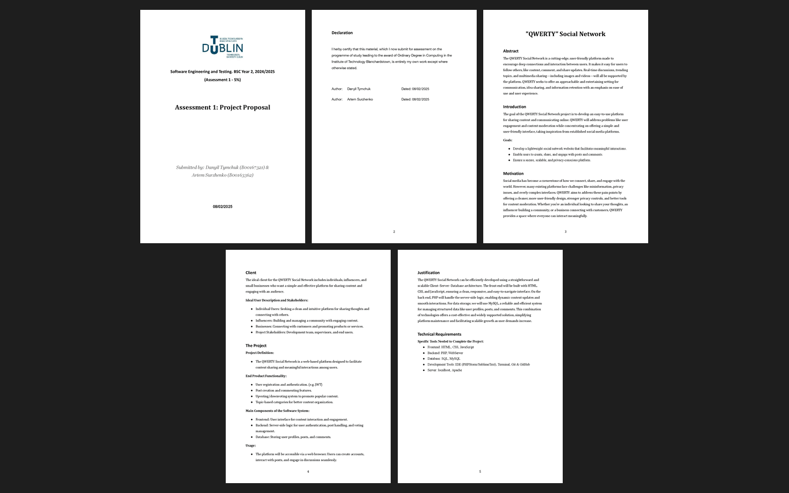

# Assessment 1: Project proposal

**Module:** Software Engineering and Testing (`COMP H2027`)  
**Semester:** 4 (Year 2), folder `sem04`  
**Type:** report, group  
**Weight:** 5%  
**Deadline:** 10 February 2025  
**Result:** —  
**On main:** [`sem04/software_engineering_and_testing/assessment/01/`](https://github.com/DanyilT/projects-in-university/tree/main/sem04/software_engineering_and_testing/assessment/01) (the brief, the template, the submitted proposal and this README)  
**Branch:** —  
**Repository:** —

[Module README](../../README.md)

## What this assessment is for

The brief (1 page) asks the team to fill in all the headings of the project proposal template for the team's project (expanding the abstract, motivation and justification from lab 1) and to hand it in as a PDF with the team name in the file name.

The submission is the proposal, Assessment 1: Project Proposal (5 pages), of the QWERTY Social Network project.

*The project proposal: all 5 pages.*

## Files

| File | What it contains |
|---|---|
| [`README.md`](README.md) | This README. |
| [`software_engineering_and_testing_assessment.pdf`](software_engineering_and_testing_assessment.pdf) | Assignment 1, the project proposal (1 page, 5%, due 10 February 2025): fill in all the headings of the proposal template (expanding the abstract, motivation and justification from lab 1) in a PDF. |
| [`resources/project_proposal_template.docx`](resources/project_proposal_template.docx) | The project proposal template (a Word file). |
| [`submission/project_proposal.pdf`](submission/project_proposal.pdf) | The submitted proposal, Assessment 1: Project Proposal (5 pages). |
