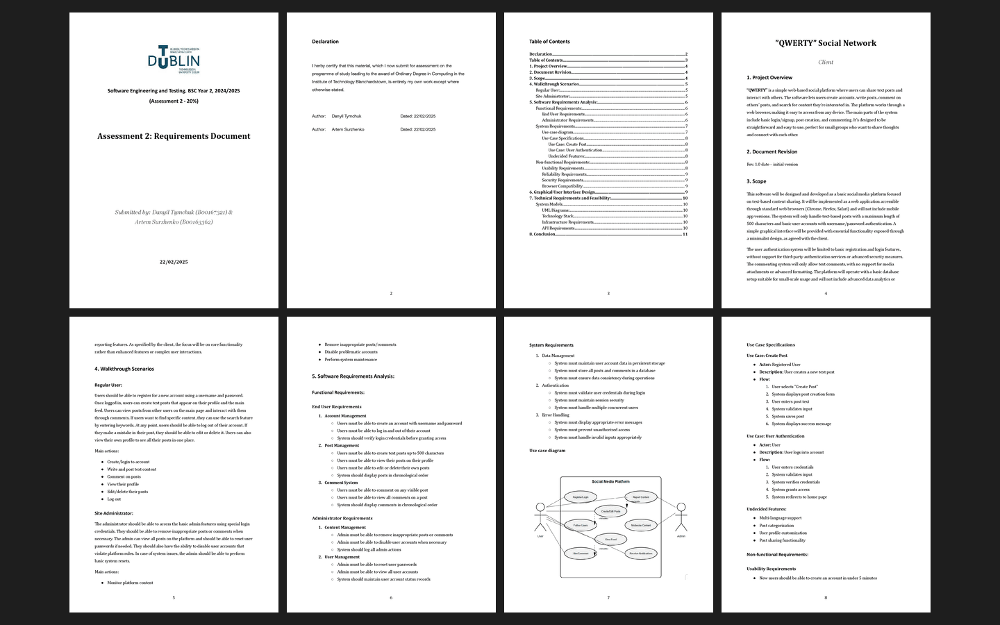

# Assessment 2: Requirements and draft website

**Module:** Software Engineering and Testing (`COMP H2027`)  
**Semester:** 4 (Year 2), folder `sem04`  
**Type:** report and demonstration, group  
**Weight:** 20%  
**Deadline:** 24 February 2025 at 9am  
**Result:** —  
**On main:** [`sem04/software_engineering_and_testing/assessment/02/`](https://github.com/DanyilT/projects-in-university/tree/main/sem04/software_engineering_and_testing/assessment/02) (the brief, the template, the given example, the submitted requirements document and this README)  
**Branch:** —  
**Repository:** —

[Module README](../../README.md)

## What this assessment is for

The brief (1 page) has two parts: a draft website with the basic PHP user interface and structure of the themed product (10%, demonstrated in the lab), and a requirements document (10%) with the problem definition, scope, walkthrough scenarios, user and system requirements, the use case diagram and specifications, and a GUI outline. The team name is in the file name.

The submission is the requirements document, Assessment 2 (11 pages), of the QWERTY Social Network project.

*The requirements document: pages 1 to 8 of 11.*

## Files

| File | What it contains |
|---|---|
| [`README.md`](README.md) | This README. |
| [`software_engineering_and_testing_assessment.pdf`](software_engineering_and_testing_assessment.pdf) | Assignment 2, the requirements and draft website (1 page, 20%, due 24 February 2025 at 9am): a draft website with the basic PHP user interface and structure of the themed product (10%, demonstrated in the lab), and a requirements document (10%) with the problem definition, scope, walkthrough scenarios, user and system requirements, the use case diagram and specifications, a GUI outline, technical requirements and feasibility, and conclusions. |
| [`resources/requirements_document_template.docx`](resources/requirements_document_template.docx) | The requirements report template (a Word file). |
| [`resources/use_case_specification_example.pdf`](resources/use_case_specification_example.pdf) | An example of use case specifications (1 page): a hotel booking system with the scenarios reserve room, check-in and check-out, login and cancel booking. |
| [`submission/requirements_document.pdf`](submission/requirements_document.pdf) | The submitted requirements document, Assessment 2 (11 pages). |
