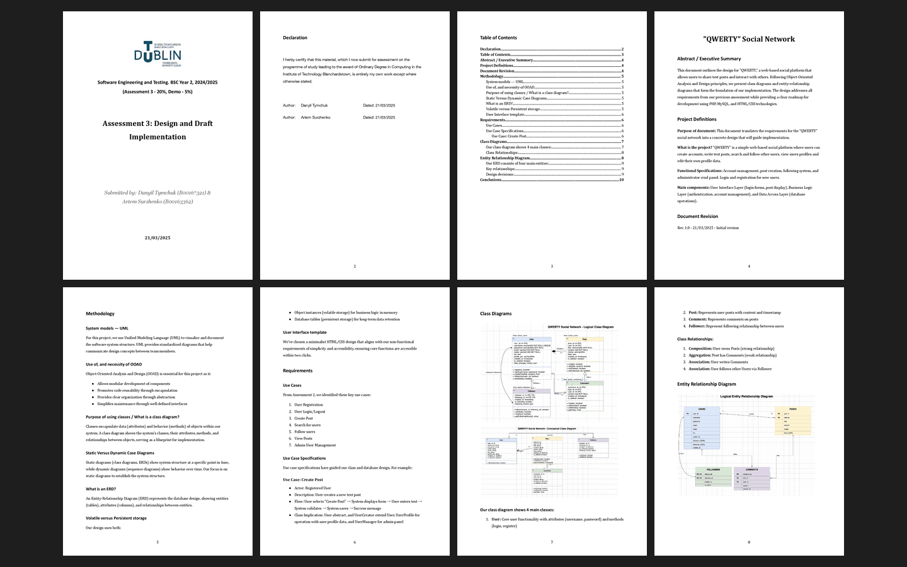

# Assessment 3: Design and draft implementation

**Module:** Software Engineering and Testing (`COMP H2027`)  
**Semester:** 4 (Year 2), folder `sem04`  
**Type:** report and implementation, group  
**Weight:** 20% and a 5% demo  
**Deadline:** 24 March 2025 at 9am  
**Result:** —  
**On main:** [`sem04/software_engineering_and_testing/assessment/03/`](https://github.com/DanyilT/projects-in-university/tree/main/sem04/software_engineering_and_testing/assessment/03) (the brief, the template, the rubric, the annotation list, the submitted design document and this README)  
**Branch:** —  
**Repository:** —

[Module README](../../README.md)

## What this assessment is for

The brief (3 pages, with the marking scheme) asks for a design document (10%) with the methodology, the class diagram and the ERD with the explanation of their creation, and an implementation (10%) of the classes and the database in PHP with an HTML and CSS front end, with the SQL database creation file, plus a 5% demo.

The submission is the design and draft implementation, Assessment 3 (11 pages), of the QWERTY Social Network project.

*The design and draft implementation: pages 1 to 8 of 11.*

## Files

| File | What it contains |
|---|---|
| [`README.md`](README.md) | This README. |
| [`software_engineering_and_testing_assessment.pdf`](software_engineering_and_testing_assessment.pdf) | Assignment 3, the design and draft implementation (3 pages, 20% and a 5% demo, due 24 March 2025 at 9am, with the marking scheme): a design document (10%) with the methodology, the class diagram and the ERD with the explanation of their creation, and an implementation (10%) of the classes and the database in PHP with an HTML and CSS front end, with the SQL database creation file and all the PHP files. |
| [`resources/design_and_draft_implementation_template.docx`](resources/design_and_draft_implementation_template.docx) | The checklist and template of the design document (a Word file). |
| [`resources/software_engineering_and_testing_assessment_grades.pdf`](resources/software_engineering_and_testing_assessment_grades.pdf) | The rubric of assessment 3 (8 pages). |
| [`resources/uml_class_diagram_annotation_list.pdf`](resources/uml_class_diagram_annotation_list.pdf) | The UML class diagram annotation list (1 page). |
| [`submission/design_and_draft_implementation.pdf`](submission/design_and_draft_implementation.pdf) | The submitted design and draft implementation, Assessment 3 (11 pages). |
