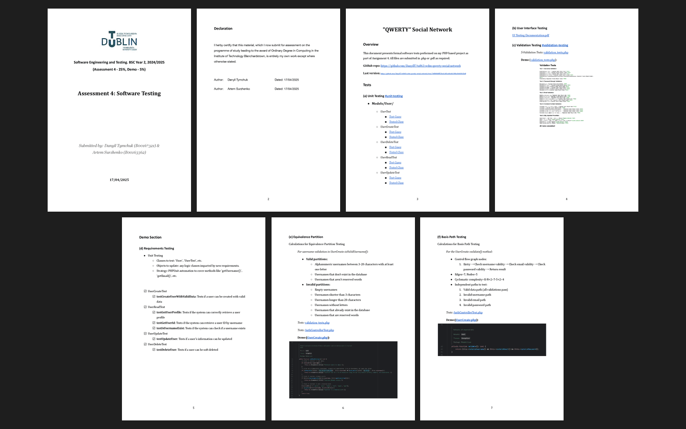

# Assessment 4: Software testing

**Module:** Software Engineering and Testing (`COMP H2027`)  
**Semester:** 4 (Year 2), folder `sem04`  
**Type:** report, code and demonstration, group  
**Weight:** 25% and a 5% demo  
**Deadline:** 28 April 2025 at 9am (the demo in the labs of the week of 28 April 2025)  
**Result:** —  
**On main:** [`sem04/software_engineering_and_testing/assessment/04/`](https://github.com/DanyilT/projects-in-university/tree/main/sem04/software_engineering_and_testing/assessment/04) (the brief, the rubric, the submitted testing documents, the PHP test files and this README)  
**Branch:** —  
**Repository:** [tu863-wdss-qwerty-social-network](https://github.com/DanyilT/tu863-wdss-qwerty-social-network) (the project, with the tests)

[Module README](../../README.md)

## What this assessment is for

The brief (2 pages) asks for five unit tests on five core classes (10 marks, five PHP files), user interface tests of five design principles (10 marks, a PDF with screenshots) and validation tests (5 marks), and a demo of requirements testing (3 marks), equivalence partition testing (1 mark) and basis path testing (1 mark).

The submission is the testing document, Assessment 4: Software Testing (7 pages), the user interface testing documentation (17 pages) and the PHP test files of the QWERTY Social Network project, which is in the repository tu863-wdss-qwerty-social-network.

*The testing document: all 7 pages.*

## Files

| File | What it contains |
|---|---|
| [`README.md`](README.md) | This README. |
| [`software_engineering_and_testing_assessment.pdf`](software_engineering_and_testing_assessment.pdf) | Assignment 4, software testing (2 pages, 25% and a 5% demo, due 28 April 2025 at 9am): five unit tests on five core classes (10 marks, five PHP files), user interface tests of five design principles (10 marks, a PDF with screenshots), validation tests (5 marks), and the demo of requirements testing (3 marks), equivalence partition testing (1 mark) and basis path testing (1 mark). |
| [`resources/software_engineering_and_testing_assessment_grades.pdf`](resources/software_engineering_and_testing_assessment_grades.pdf) | The rubric of assessment 4 (2 pages). |
| [`submission/software_testing.pdf`](submission/software_testing.pdf) | The submitted testing document, Assessment 4: Software Testing (7 pages). |
| [`submission/ui_testing_documentation.pdf`](submission/ui_testing_documentation.pdf) | The user interface testing documentation (17 pages): the five principles tested with screenshots. |
| [`submission/project_link.txt`](submission/project_link.txt) | One line: the GitHub link to the project repository, tu863-wdss-qwerty-social-network. |
| [`submission/code/validation_tests.php`](submission/code/validation_tests.php) | Validation tests: five tests of data validation beyond HTML5 validation, such as the format of a username (it starts with @). |
| [`submission/code/AuthControllerTest.php`](submission/code/AuthControllerTest.php) | PHPUnit tests of the authentication controller (registration with valid data and with an invalid username, email and password). |
| [`submission/code/unit_testing/UserTest.php`](submission/code/unit_testing/UserTest.php) | PHPUnit tests of the User class: the getters. |
| [`submission/code/unit_testing/UserCreateTest.php`](submission/code/unit_testing/UserCreateTest.php) | PHPUnit tests of UserCreate: creating a user with valid data, checking that a user name exists, and an invalid username, email and password. |
| [`submission/code/unit_testing/UserReadTest.php`](submission/code/unit_testing/UserReadTest.php) | PHPUnit tests of UserRead (reading users). |
| [`submission/code/unit_testing/UserUpdateTest.php`](submission/code/unit_testing/UserUpdateTest.php) | PHPUnit tests of UserUpdate (updating users). |
| [`submission/code/unit_testing/UserDeleteTest.php`](submission/code/unit_testing/UserDeleteTest.php) | PHPUnit tests of UserDelete (deleting users). |
