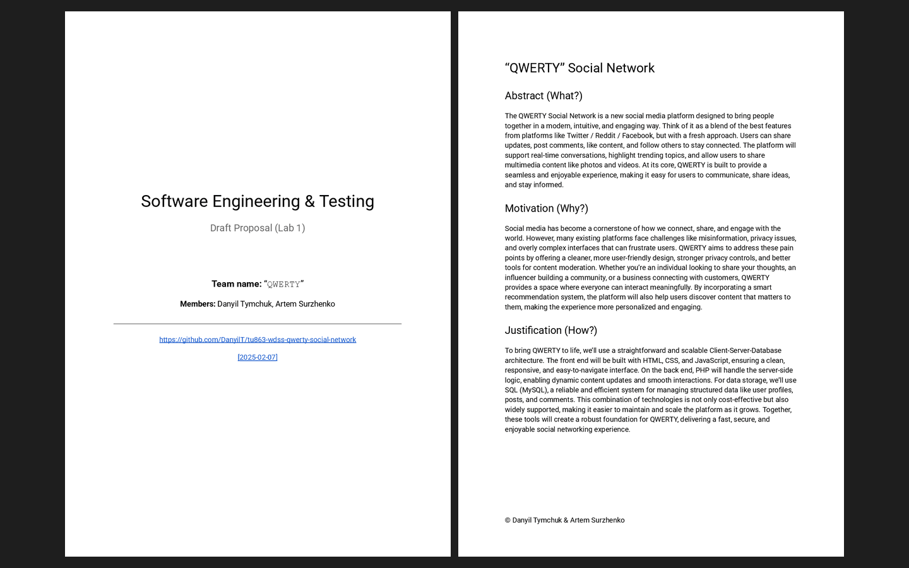

# Week 01 — Lab 1: group formation, project theme and diary entry

**Module:** Software Engineering and Testing (`COMP H2027`)  
**Semester:** 4 (Year 2), folder `sem04`

[Module README](../README.md)

## What this week is for

Lab 1 forms the team (three members is recommended) and sets its name and the project theme (an interactive website with a database, with at least 3 tables and the matching classes), then writes a draft proposal (an abstract, a motivation and a justification, answering what, why and how) and the first diary entry. The solution is the draft proposal for QWERTY, a social network, and the first diary entry (7 February 2025).

*The draft proposal: both pages (the title page; the abstract, the motivation and the justification of QWERTY Social Network).*

## Files

| File | What it contains |
|---|---|
| [`README.md`](README.md) | This README. |
| [`lab/software_engineering_and_testing_week01_lab.pdf`](lab/software_engineering_and_testing_week01_lab.pdf) | The lab sheet (1 page): group formation, project theme, the draft proposal and the first diary entry. |
| [`lab/resources/project_diary_template.docx`](lab/resources/project_diary_template.docx) | The project diary template (a Word file): the weekly team update (who is present and absent, what each member completed, the roles for the week and so on); weeks 2 to 7 use the same file, which is only here. |
| [`lab/solution/draft_proposal.pdf`](lab/solution/draft_proposal.pdf) | The draft proposal (2 pages): the title page (the team and the links to the GitHub repository and to its version of 7 February 2025), then the abstract, the motivation and the justification of the project. |
| [`lab/solution/project_diary.pdf`](lab/solution/project_diary.pdf) | The first project diary entry (1 page, 7 February 2025). |
