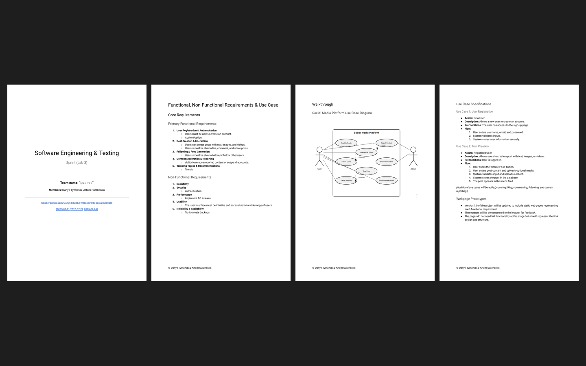

# Week 03 — Lab 3: requirements and use cases (version 2.0)

**Module:** Software Engineering and Testing (`COMP H2027`)  
**Semester:** 4 (Year 2), folder `sem04`

[Module README](../README.md)

## What this week is for

Lab 3 outlines at least 5 primary functional requirements and 5 non-functional requirements, adds a web page for each functional requirement to the website (version 2.0, which need not work yet), and creates a use case diagram and use case specifications. The solution lists the functional requirements of QWERTY (user registration and authentication, post creation and interaction, following and feed generation, content moderation and reporting, and trending topics and recommendations) and the non-functional requirements (scalability, security, performance, usability, and reliability and availability), with the use case diagram.

*The sprint document: all 4 pages (the title page, the functional and non-functional requirements, the use case diagram and the use case specifications).*

## Files

| File | What it contains |
|---|---|
| [`README.md`](README.md) | This README. |
| [`lab/software_engineering_and_testing_week03_lab.pdf`](lab/software_engineering_and_testing_week03_lab.pdf) | The lab sheet (1 page): requirements, the walkthrough with use cases and version 2.0. |
| [`../week01/lab/resources/project_diary_template.docx`](../week01/lab/resources/project_diary_template.docx) | The project diary template (a Word file), given again for this lab; the file is only in week 1. |
| [`lab/solution/project_diary.pdf`](lab/solution/project_diary.pdf) | The team's project diary entry for lab 3 (1 page). |
| [`lab/solution/sprint.pdf`](lab/solution/sprint.pdf) | The sprint document of lab 3 (4 pages): the title page (the team and the links to the GitHub repository and to its versions of 21, 22 and 24 February 2025), then the functional and non-functional requirements and the use cases. |
