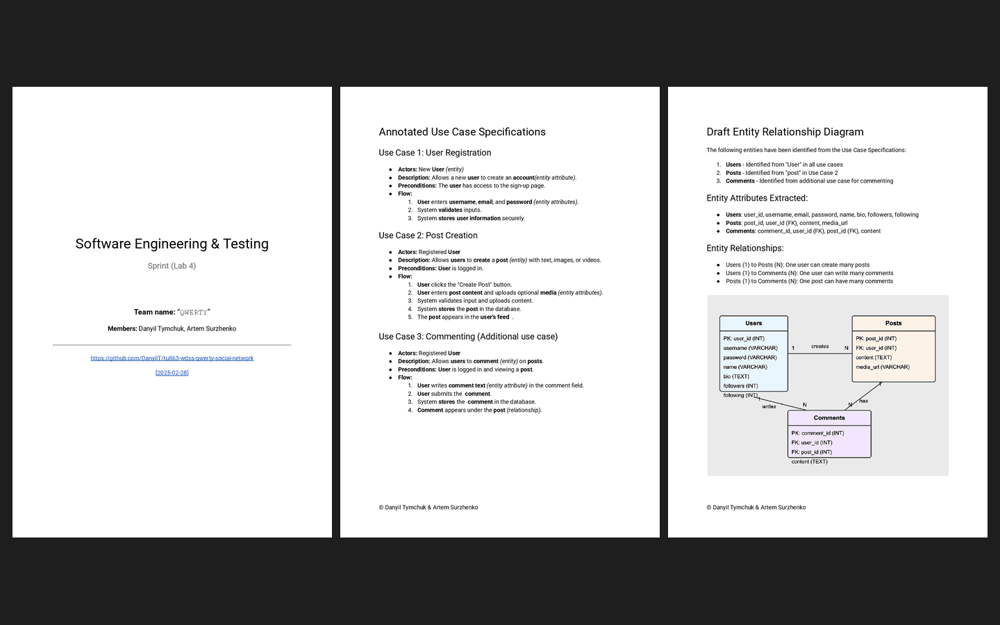

# Week 04 — Lab 4: database connection and draft ERD

**Module:** Software Engineering and Testing (`COMP H2027`)  
**Semester:** 4 (Year 2), folder `sem04`

[Module README](../README.md)

## What this week is for

Lab 4 makes a draft entity relationship diagram (at least 3 tables, not yet related) from the use case specification of the second assessment, underlining and annotating the nouns and verbs that give the entities and their attributes, and creates a database as shown in the lecture with a connection to it. The solution is the annotated use case specifications (user registration, post creation and commenting) and the draft ERD with the entities, their attributes and relationships. The resources are the lecture code files: PHP samples that connect to a MySQL database, as an include, with a form, and to query, insert and delete cars.

*The lab 4 sprint document: all 3 pages (the title page, the annotated use case specifications and the draft entity relationship diagram).*

## Files

| File | What it contains |
|---|---|
| [`README.md`](README.md) | This README. |
| [`lab/software_engineering_and_testing_week04_lab.pdf`](lab/software_engineering_and_testing_week04_lab.pdf) | The lab sheet (1 page): the daily scrum, the draft ERD and the database connection. |
| [`../week01/lab/resources/project_diary_template.docx`](../week01/lab/resources/project_diary_template.docx) | The project diary template (a Word file), given again for this lab; the file is only in week 1. |
| [`lab/solution/project_diary.pdf`](lab/solution/project_diary.pdf) | The team's project diary entry for lab 4 (1 page). |
| [`lab/solution/sprint.pdf`](lab/solution/sprint.pdf) | The sprint document of lab 4 (3 pages): the title page (the team and the links to the GitHub repository and to its version of 28 February 2025), then the annotated use case specifications and the draft ERD. |
| [`resources/lecture_code_files/databaseConfig.php`](resources/lecture_code_files/databaseConfig.php) | Lecture code: the database settings (server, user, password and database name). |
| [`resources/lecture_code_files/Sample1_DBConnection.php`](resources/lecture_code_files/Sample1_DBConnection.php) | Lecture code: connecting to the database in one page. |
| [`resources/lecture_code_files/Sample2_DBConnection_As_Include.php`](resources/lecture_code_files/Sample2_DBConnection_As_Include.php) | Lecture code: the connection as an include file. |
| [`resources/lecture_code_files/Sample3_DBConnection_As_Include_Advanced.php`](resources/lecture_code_files/Sample3_DBConnection_As_Include_Advanced.php) | Lecture code: the connection as an include, advanced version. |
| [`resources/lecture_code_files/Sample4_DBConnection_QueryExpensiveCars.php`](resources/lecture_code_files/Sample4_DBConnection_QueryExpensiveCars.php) | Lecture code: a query for the expensive cars. |
| [`resources/lecture_code_files/Sample5_DBConnection_InsertCar.php`](resources/lecture_code_files/Sample5_DBConnection_InsertCar.php) | Lecture code: inserting a car. |
| [`resources/lecture_code_files/Sample6_DBConnection_DeleteCar.php`](resources/lecture_code_files/Sample6_DBConnection_DeleteCar.php) | Lecture code: deleting a car. |
| [`resources/lecture_code_files/Sample7_DBConnection_InsertRandomCar.php`](resources/lecture_code_files/Sample7_DBConnection_InsertRandomCar.php) | Lecture code: inserting a random car. |
| [`resources/lecture_code_files/DBConnection_UNAME_PWORD_FORM.php`](resources/lecture_code_files/DBConnection_UNAME_PWORD_FORM.php) | Lecture code: a form for the user name and password of the database connection. |
