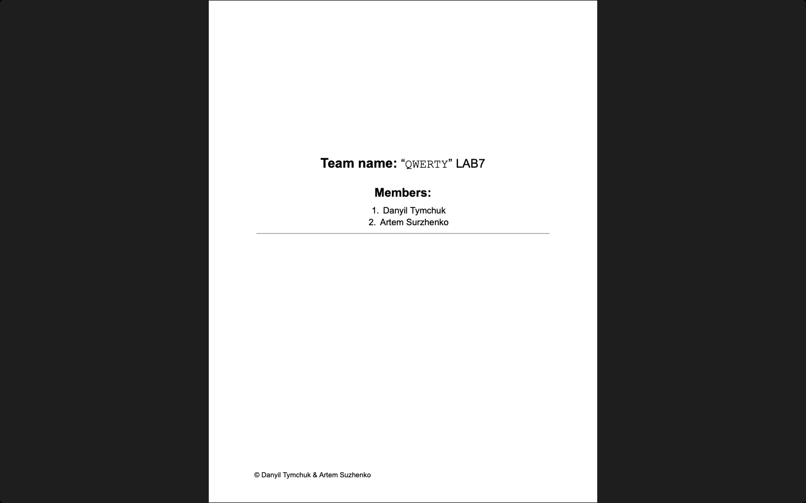

# Week 07 — Lab 7: putting it all together (version 6.0)

**Module:** Software Engineering and Testing (`COMP H2027`)  
**Semester:** 4 (Year 2), folder `sem04`

[Module README](../README.md)

## What this week is for

Lab 7 puts the whole system together as a shippable draft implementation, using the checklist and marking scheme of the third assessment, so that it runs and performs all the CRUD functions; it is archived as version 6.0. The solution is the sprint document with the source code and the link to this version on GitHub. The resources are the lecture code files of versions 5.0 and 6.0 (zips of PHP classes).

## Screenshots

*The title page of the lab 7 sprint document.*

## Files

| File | What it contains |
|---|---|
| [`README.md`](README.md) | This README. |
| [`lab/software_engineering_and_testing_week07_lab.pdf`](lab/software_engineering_and_testing_week07_lab.pdf) | The lab sheet (1 page): the draft implementation and version 6.0. |
| [`lab/resources/project_diary_template.docx`](lab/resources/project_diary_template.docx) | The project diary template (a Word file): the weekly team update (who is present and absent, what each member completed, the roles for the week and so on). |
| [`lab/solution/project_diary.pdf`](lab/solution/project_diary.pdf) | The team's project diary entry for lab 7 (1 page). |
| [`lab/solution/sprint.pdf`](lab/solution/sprint.pdf) | The sprint document of lab 7 (2 pages): the source code and the GitHub version. |
| [`resources/lecture_code_files/Version 5.0.zip`](resources/lecture_code_files/Version%205.0.zip) | Lecture code: version 5.0 (a zip of 4 PHP files: Customer, Fruit, RunFruit and UserBackUp). |
| [`resources/lecture_code_files/Version 6.0.zip`](resources/lecture_code_files/Version%206.0.zip) | Lecture code: version 6.0 (a zip of 5 PHP files: Admin, Cust, Login, Sale and User). |
