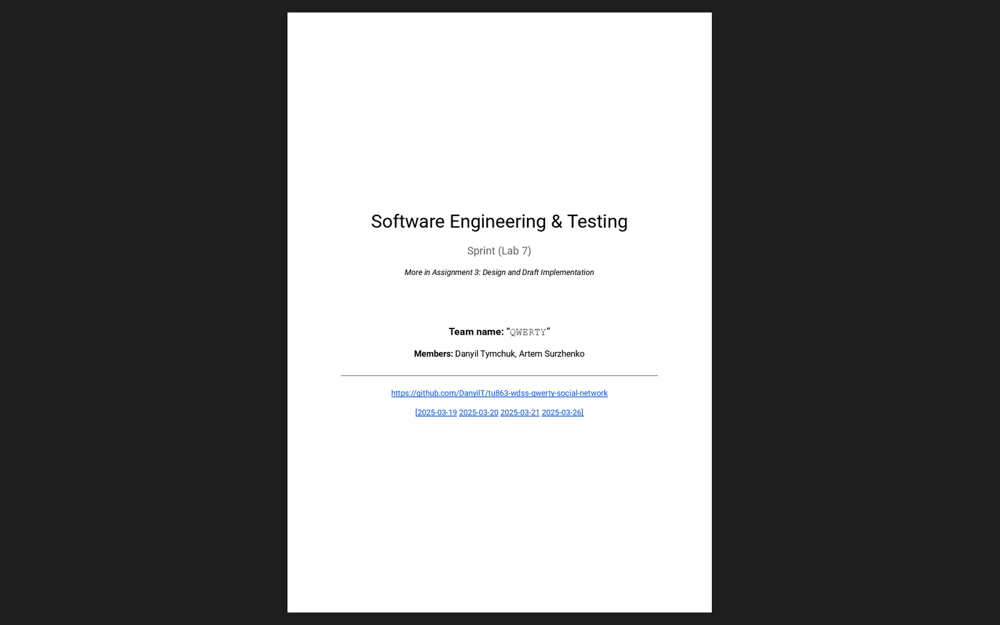

# Week 07 — Lab 7: putting it all together (version 6.0)

**Module:** Software Engineering and Testing (`COMP H2027`)  
**Semester:** 4 (Year 2), folder `sem04`

[Module README](../README.md)

## What this week is for

Lab 7 puts the whole system together as a shippable draft implementation, using the checklist and marking scheme of the third assessment, so that it runs and performs all the CRUD functions; it is archived as version 6.0. The solution is the sprint document: a title page with the links to the GitHub repository and to its versions of 19, 20, 21 and 26 March 2025, which refers to the third assessment for more. The resources are the lecture code files of versions 5.0 and 6.0 (zips of PHP classes).

*The lab 7 sprint document: its one page, the title page.*

## Files

| File | What it contains |
|---|---|
| [`README.md`](README.md) | This README. |
| [`lab/software_engineering_and_testing_week07_lab.pdf`](lab/software_engineering_and_testing_week07_lab.pdf) | The lab sheet (1 page): the draft implementation and version 6.0. |
| [`../week01/lab/resources/project_diary_template.docx`](../week01/lab/resources/project_diary_template.docx) | The project diary template (a Word file), given again for this lab; the file is only in week 1. |
| [`lab/solution/project_diary.pdf`](lab/solution/project_diary.pdf) | The team's project diary entry for lab 7 (1 page). |
| [`lab/solution/sprint.pdf`](lab/solution/sprint.pdf) | The sprint document of lab 7 (1 page): the title page (the team and the links to the GitHub repository and to its versions of 19, 20, 21 and 26 March 2025) with the note "More in Assignment 3: Design and Draft Implementation". |
| [`resources/lecture_code_files/Version 5.0.zip`](resources/lecture_code_files/Version%205.0.zip) | Lecture code: version 5.0 (a zip of 4 PHP files: Customer, Fruit, RunFruit and UserBackUp). |
| [`resources/lecture_code_files/Version 6.0.zip`](resources/lecture_code_files/Version%206.0.zip) | Lecture code: version 6.0 (a zip of 5 PHP files: Admin, Cust, Login, Sale and User). |
