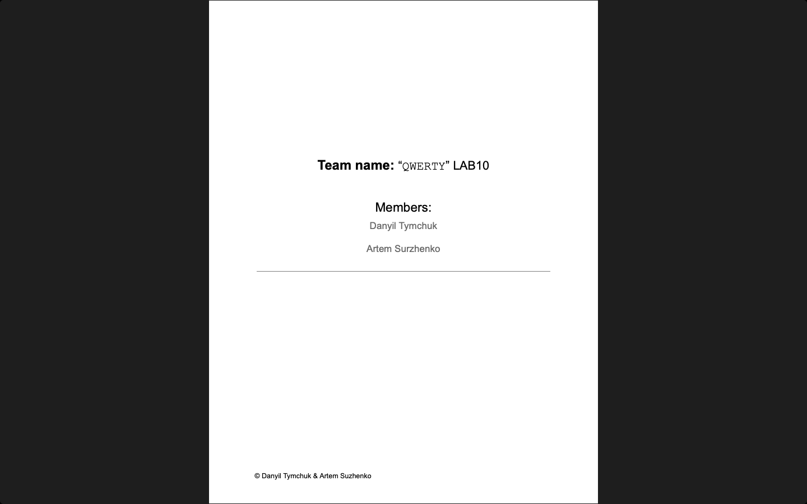

# Week 10 — Lab 10: test execution

**Module:** Software Engineering and Testing (`COMP H2027`)  
**Semester:** 4 (Year 2), folder `sem04`

[Module README](../README.md)

## What this week is for

Lab 10 demonstrates the sprint and the execution of all the tests that can be run now, and uploads a PDF that outlines the working test cases (unit, UI, requirements, basis path and equivalence partition calculations and validation tests) with a diary entry on which parts of the implementation need to be changed. The solution lists the unit tests that were implemented for the User classes (create, read, update and delete), the diary entry on the changes needed, and the calculations for basis path testing and equivalence partition testing.

## Screenshots

*The title page of the lab 10 sprint document.*

## Files

| File | What it contains |
|---|---|
| [`README.md`](README.md) | This README. |
| [`lab/software_engineering_and_testing_week10_lab.pdf`](lab/software_engineering_and_testing_week10_lab.pdf) | The lab sheet (1 page): test execution. |
| [`lab/solution/sprint.pdf`](lab/solution/sprint.pdf) | The sprint document of lab 10 (9 pages): the executable tests, the diary entry on the modifications needed, and the basis path and equivalence partition calculations. |
