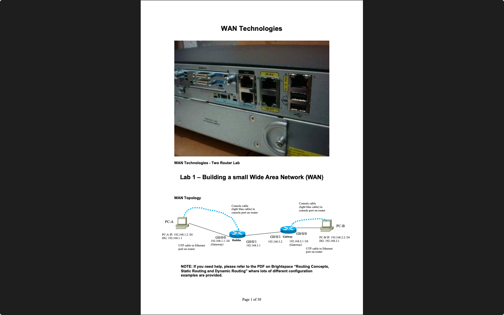
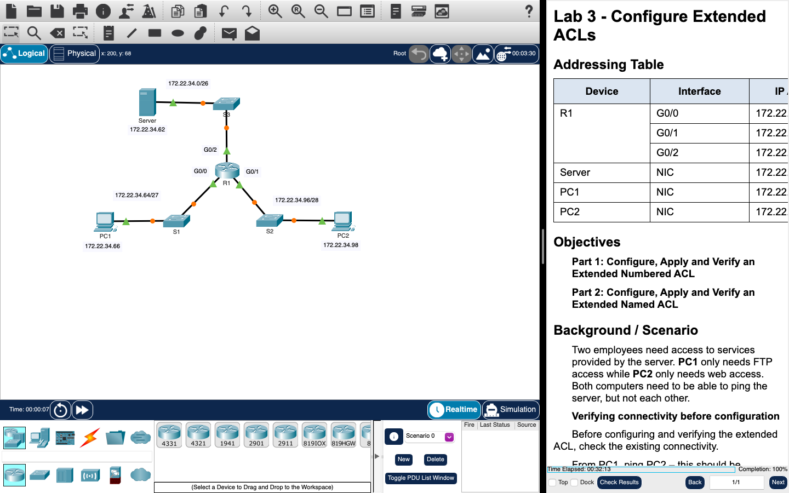
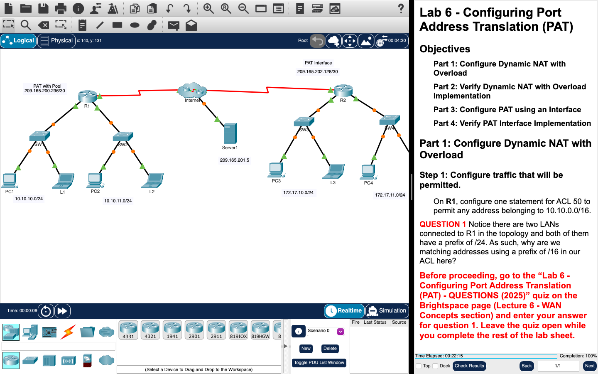
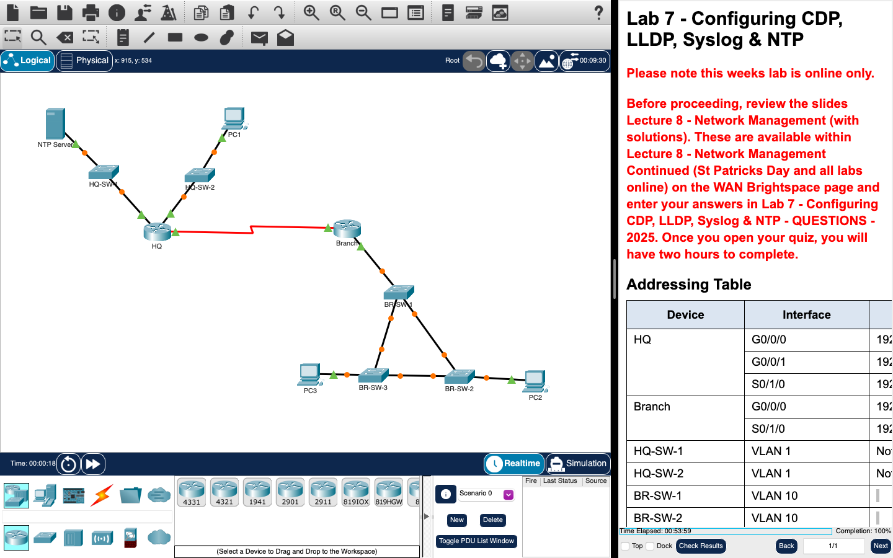
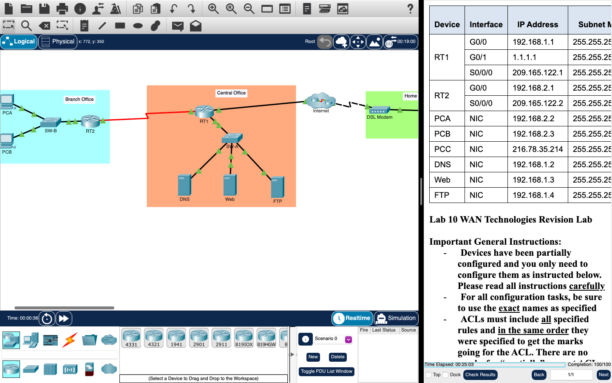

# WAN Technologies

**Module:** WAN Technologies (`COMP H2032`)  
**Semester:** 4 (Year 2), folder `sem04`  
**Lecturer:** Greg South  
**Date:** January - May 2025  
**Credits:** 5 ECTS  
**Matching project branch:** none

## What this module is for

WAN Technologies is the second-year Cisco networking module about what happens at the boundary of the LANs and how they are connected securely (Cisco NetAcad, Enterprise Networking, Security and Automation). It covers network security concepts, standard and extended access control lists (ACLs), VPNs, network address translation (NAT and PAT), WAN concepts, quality of service and network management, network troubleshooting, network design and software defined networking. Each week has a lecture and a lab, and each lab is either a Cisco Packet Tracer activity or a hands-on lab on real routers and switches (labs 1, 3a, 4 and 9). This folder has the lab sheets as PDFs, the Packet Tracer files (the starting activity and, for labs 2, 3, 5, 6, 7, 8, 9 and 10, the file after the lab), the Wireshark material and capture files of lab 4, and the learning plan. Packet Tracer saves files in an encrypted format, so the .pka files open only in Packet Tracer. The folders are numbered by lab and lecture: in the learning plan lab 1 is in the second week of the semester, after a first week of revision labs. The module is 100% continuous assessment: lab work (30%), engagement and participation in the lectures through weekly lecture quizzes (10%), two closed-book theory tests (15% each, in weeks 7 and 12) and a practical skills assessment on 14 May 2025 (30%); the tests and the skills assessment are not in the repository.

## Grades Breakdown

| Assessment Type | Weighting |
|---|---|
| Lab work (labs 1 to 10) | 30% |
| Engagement and participation in the lectures (lecture quizzes) | 10% |
| CA 1: theory test, closed book (week 7) | 15% |
| CA 2: theory test, closed book (week 12) | 15% |
| Practical skills assessment (14 May 2025) | 30% |

## All weeks

| Week | Title | Files | Screenshot |
|---|---|---|---|
| [Week 1](week01/) | Lab 1: building a small WAN (hardware) | [`lab/wan_technologies_week01_lab_building_a_small_wan.pdf`](week01/lab/wan_technologies_week01_lab_building_a_small_wan.pdf) |  |
| [Week 2](week02/) | Lab 2: configure standard IPv4 ACLs (Packet Tracer) | [`lab/wan_technologies_week02_lab_configure_standard_ipv4_acls.pdf`](week02/lab/wan_technologies_week02_lab_configure_standard_ipv4_acls.pdf) [`lab/wan_technologies_week02_lab_configure_standard_ipv4_acls.pka`](week02/lab/wan_technologies_week02_lab_configure_standard_ipv4_acls.pka) [`lab/solution/wan_technologies_week02_lab_configure_standard_ipv4_acls_solution.pka`](week02/lab/solution/wan_technologies_week02_lab_configure_standard_ipv4_acls_solution.pka) |  |
| [Week 3](week03/) | Lab 3: password recovery (hardware) and extended ACLs (Packet Tracer) | [`lab/wan_technologies_week03_lab_configure_extended_acls.pdf`](week03/lab/wan_technologies_week03_lab_configure_extended_acls.pdf) [`lab/wan_technologies_week03_lab_configure_extended_acls.pka`](week03/lab/wan_technologies_week03_lab_configure_extended_acls.pka) [`lab/solution/wan_technologies_week03_lab_configure_extended_acls_solution.pka`](week03/lab/solution/wan_technologies_week03_lab_configure_extended_acls_solution.pka) [`lab/wan_technologies_week03_lab_password_recovery_on_a_cisco_router.pdf`](week03/lab/wan_technologies_week03_lab_password_recovery_on_a_cisco_router.pdf) |  |
| [Week 4](week04/) | Lab 4: ACLs over a small WAN and Wireshark (hardware) | [`lab/wan_technologies_week04_lab_configuring_acls_over_a_small_wan_and_utilizing_wireshark_to_observe_clear_text_and_encrypted_packets.pdf`](week04/lab/wan_technologies_week04_lab_configuring_acls_over_a_small_wan_and_utilizing_wireshark_to_observe_clear_text_and_encrypted_packets.pdf) [`lab/wireshark/install_wireshark_part_1.pdf`](week04/lab/wireshark/install_wireshark_part_1.pdf) [`lab/wireshark/wireshark_exercise_part_2.pdf`](week04/lab/wireshark/wireshark_exercise_part_2.pdf) [`lab/wireshark/wireshark_cheat_sheet.pdf`](week04/lab/wireshark/wireshark_cheat_sheet.pdf) [`lab/wireshark/telnet_capture_file.pcap`](week04/lab/wireshark/telnet_capture_file.pcap) [`lab/wireshark/ftp_capture_file.pcap`](week04/lab/wireshark/ftp_capture_file.pcap) [`lab/wireshark/dhcp_capture_file.pcap`](week04/lab/wireshark/dhcp_capture_file.pcap) [`lab/wireshark/smtp_capture_file.pcap`](week04/lab/wireshark/smtp_capture_file.pcap) |  |
| [Week 5](week05/) | Lab 5: static NAT and dynamic NAT (Packet Tracer) | [`lab/wan_technologies_week05_lab_configure_static_nat_and_dynamic_nat.pdf`](week05/lab/wan_technologies_week05_lab_configure_static_nat_and_dynamic_nat.pdf) [`lab/wan_technologies_week05_lab_configure_static_nat_and_dynamic_nat.pka`](week05/lab/wan_technologies_week05_lab_configure_static_nat_and_dynamic_nat.pka) [`lab/solution/wan_technologies_week05_lab_configure_static_nat_and_dynamic_nat_solution.pka`](week05/lab/solution/wan_technologies_week05_lab_configure_static_nat_and_dynamic_nat_solution.pka) |  |
| [Week 6](week06/) | Lab 6: port address translation (Packet Tracer) | [`lab/wan_technologies_week06_lab_configuring_port_address_translation_(pat).pdf`](week06/lab/wan_technologies_week06_lab_configuring_port_address_translation_%28pat%29.pdf) [`lab/wan_technologies_week06_lab_configuring_port_address_translation_(pat).pka`](week06/lab/wan_technologies_week06_lab_configuring_port_address_translation_%28pat%29.pka) [`lab/solution/wan_technologies_week06_lab_configuring_port_address_translation_(pat)_solution.pka`](week06/lab/solution/wan_technologies_week06_lab_configuring_port_address_translation_%28pat%29_solution.pka) |  |
| [Week 7](week07/) | Lab 7: CDP, LLDP, Syslog and NTP (Packet Tracer) | [`lab/wan_technologies_week07_lab_configuring_cdp_lldp_syslog_ntp.pdf`](week07/lab/wan_technologies_week07_lab_configuring_cdp_lldp_syslog_ntp.pdf) [`lab/wan_technologies_week07_lab_configuring_cdp_lldp_syslog_ntp.pka`](week07/lab/wan_technologies_week07_lab_configuring_cdp_lldp_syslog_ntp.pka) [`lab/solution/wan_technologies_week07_lab_configuring_cdp_lldp_syslog_ntp_solution.pka`](week07/lab/solution/wan_technologies_week07_lab_configuring_cdp_lldp_syslog_ntp_solution.pka) |  |
| [Week 8](week08/) | Lab 8: troubleshooting the network (Packet Tracer) | [`lab/wan_technologies_week08_lab_troubleshooting_the_network.pdf`](week08/lab/wan_technologies_week08_lab_troubleshooting_the_network.pdf) [`lab/wan_technologies_week08_lab_troubleshooting_the_network.pka`](week08/lab/wan_technologies_week08_lab_troubleshooting_the_network.pka) [`lab/solution/wan_technologies_week08_lab_troubleshooting_the_network_solution.pka`](week08/lab/solution/wan_technologies_week08_lab_troubleshooting_the_network_solution.pka) |  |
| [Week 9](week09/) | Lab 9: backing up and upgrading network devices (hardware and Packet Tracer) | [`lab/wan_technologies_week09_lab_backing_up_&_upgrading_network_devices.pdf`](week09/lab/wan_technologies_week09_lab_backing_up_%26_upgrading_network_devices.pdf) [`lab/wan_technologies_week09_lab_backing_up_&_upgrading_network_devices.pka`](week09/lab/wan_technologies_week09_lab_backing_up_%26_upgrading_network_devices.pka) [`lab/solution/wan_technologies_week09_lab_backing_up_&_upgrading_network_devices_solution.pka`](week09/lab/solution/wan_technologies_week09_lab_backing_up_%26_upgrading_network_devices_solution.pka) [`lab/wan_technologies_week09_lab_hardware_lab_configure_cdp_lldp_ntp_and_create_a_backup_and_create_a_backup_configuration_file_topology.pdf`](week09/lab/wan_technologies_week09_lab_hardware_lab_configure_cdp_lldp_ntp_and_create_a_backup_and_create_a_backup_configuration_file_topology.pdf) |  |
| [Week 10](week10/) | Lab 10: WAN technologies revision lab (Packet Tracer) | [`lab/wan_technologies_week10_lab_wan_technologies_revision_lab.pdf`](week10/lab/wan_technologies_week10_lab_wan_technologies_revision_lab.pdf) [`lab/wan_technologies_week10_lab_wan_technologies_revision_lab.pka`](week10/lab/wan_technologies_week10_lab_wan_technologies_revision_lab.pka) [`lab/solution/wan_technologies_week10_lab_wan_technologies_revision_lab_solution.pka`](week10/lab/solution/wan_technologies_week10_lab_wan_technologies_revision_lab_solution.pka) |  |
| Week 11 | Lab 11: practice skills assessment (Packet Tracer) | None. Practice for the practical skills assessment. | — |

## Assessments and other files

There are no assessment files: the lecture quizzes, the theory tests and the practical skills assessment are not in the repository. CA 1 was an individual, closed-book multiple-choice test (15%): 25 questions in 30 minutes, with marks that range per question (for example 0.5 and 1), no talking or communication with others and no resources or devices other than Brightspace access for the test; a breach scored 0%. CA 2 was a second individual, closed-book multiple-choice test (15%). The practical skills assessment was on 14 May 2025 (30%).

| File | What it contains |
|---|---|
| [`resources/wan_technologies_learning_plan.pdf`](resources/wan_technologies_learning_plan.pdf) | The learning plan, Semester 2 - 2025 (1 page): for each of the 13 teaching weeks the lecture topic, the lab (Packet Tracer or hardware) and the CA details: engagement and participation 10%, lab work 30% (labs 1 to 10), the theory tests of 15% in weeks 7 and 12 and the 30% skills assessment in the examination period. |

---

## Module descriptor

Module Title: WAN Technologies (mandatory), module code COMP H2032, 5 credits, lecturer Greg South.

**Module aims.**

- To give students practical skills with implementing WAN protocols.
- To give students a theoretical understanding of network management and WAN technologies.
- To provide students with an understanding and ability to apply theories for security and management associated with internetworking.

**You will do the following** (the NetAcad module outcomes).

- Explain how vulnerabilities, threats and exploits can be mitigated to enhance network security.
- Implement standard and extended ACLs to filter traffic and secure admin access.
- Explain how VPNs secure site-to-site and remote access connectivity.
- Configure NAT services to provide IPv4 address scalability.
- Explain how WAN access technologies can be used to satisfy business requirements.
- Explain how networking devices implement QoS.
- Implement protocols to manage the network.
- Explain the characteristics of scalable network architectures.
- Troubleshoot enterprise networks.
- Explain the purpose and characteristics of network virtualisation.
- Explain how network automation is enabled through RESTful APIs and configuration management tools.

**Indicative syllabus.**

- WAN Technologies
- Access Control Lists (ACLs)
- Network Evolution
- VPN Solutions
- Broadband Solutions
- NAT Services
- Monitoring Tools
- Troubleshooting

**Assessment.** Assessment is 100% continuous assessment: 30% for the continuous assessment of lab skills, 10% for engagement and participation in lectures, 30% for a lab-based practical test and 30% for theory. The repeat assessment is 100% coursework: 60% for a skills test and 40% for a theory test.

**Supplementary reading.**

- Enterprise Networking, Security, and Automation Companion Guide (Cisco Press): https://www.ciscopress.com/store/enterprise-networking-security-and-automation-companion-9780136634324
- NetAcad, Enterprise Networking, Security, and Automation courseware: https://www.netacad.com/launch?id=3f6a52c7-cf64-46ba-8208-a2d77d65e0b2
