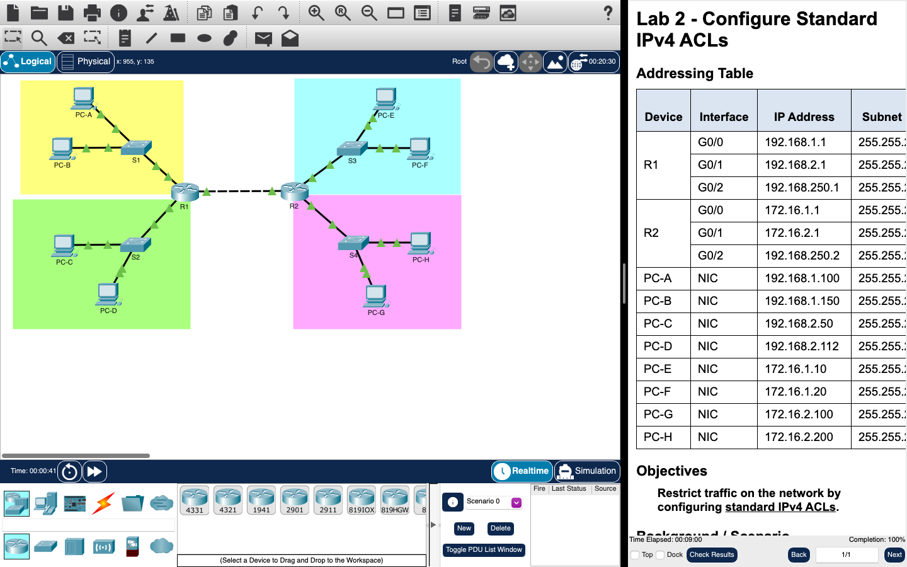

# Week 02 — Lab 2: configure standard IPv4 ACLs (Packet Tracer)

**Module:** WAN Technologies (`COMP H2032`)  
**Semester:** 4 (Year 2), folder `sem04`

[Module README](../README.md)

## What this week is for

Lecture 2 was access control lists. Lab 2 is a Packet Tracer activity on four coloured LANs behind two routers: a standard IPv4 ACL (number 10) to restrict access to the pink LAN, a standard IPv4 ACL (number 20) to restrict access to the blue LAN, and a named standard IPv4 ACL.

## Screenshots

*Packet Tracer with the Lab 2 network and its instructions.*

## Files

| File | What it contains |
|---|---|
| [`README.md`](README.md) | This README. |
| [`lab/wan_technologies_week02_lab_configure_standard_ipv4_acls.pdf`](lab/wan_technologies_week02_lab_configure_standard_ipv4_acls.pdf) | The lab sheet (3 pages): Lab 2 - Configure Standard IPv4 ACLs, three parts. |
| [`lab/wan_technologies_week02_lab_configure_standard_ipv4_acls.pka`](lab/wan_technologies_week02_lab_configure_standard_ipv4_acls.pka) | The Packet Tracer activity for this lab: the starting network. Packet Tracer saves files in an encrypted format, so this file opens only in Cisco Packet Tracer and its contents are not shown in the repository. |
| [`lab/solution/wan_technologies_week02_lab_configure_standard_ipv4_acls_solution.pka`](lab/solution/wan_technologies_week02_lab_configure_standard_ipv4_acls_solution.pka) | The Packet Tracer file after the lab: the same network with the ACLs configured. Packet Tracer saves files in an encrypted format, so this file opens only in Cisco Packet Tracer and its contents are not shown in the repository. |
