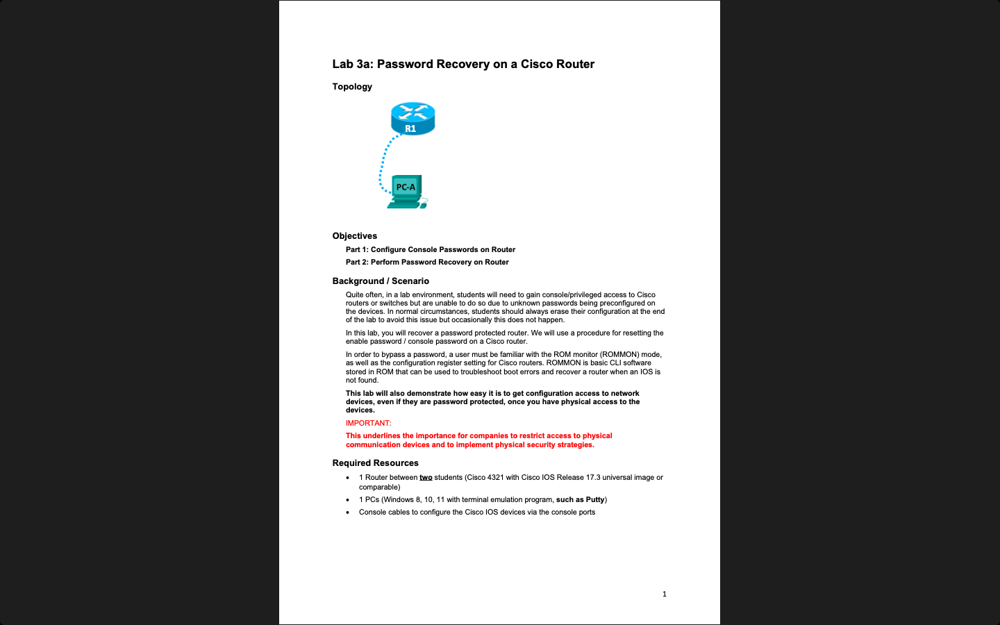

# Week 03 — Lab 3: password recovery (hardware) and extended ACLs (Packet Tracer)

**Module:** WAN Technologies (`COMP H2032`)  
**Semester:** 4 (Year 2), folder `sem04`

[Module README](../README.md)

## What this week is for

Lecture 3 was extended ACLs for IPv4. Lab 3 has two parts. Lab 3a is a hardware group activity in pairs: configure the console and enable passwords on a router and then perform password recovery on it. Lab 3b is a Packet Tracer activity on a network with a server: configure, apply and verify an extended numbered ACL and an extended named ACL, so that PC1 reaches the server only by FTP and ping, and PC2 only by web access and ping, and the two PCs cannot reach each other. The sheet of lab 3a is a large PDF (9 pages of images, about 43 MB).

## Screenshots

*Packet Tracer with the Lab 3b network and its instructions.*

*The first page of the Lab 3a sheet: password recovery on a Cisco router.*

## Files

| File | What it contains |
|---|---|
| [`README.md`](README.md) | This README. |
| [`lab/wan_technologies_week03_lab_configure_extended_acls.pdf`](lab/wan_technologies_week03_lab_configure_extended_acls.pdf) | The lab sheet of lab 3b (5 pages): Lab 3 - Configure Extended ACLs, two parts. |
| [`lab/wan_technologies_week03_lab_configure_extended_acls.pka`](lab/wan_technologies_week03_lab_configure_extended_acls.pka) | The Packet Tracer activity of lab 3b: the starting network. Packet Tracer saves files in an encrypted format, so this file opens only in Cisco Packet Tracer and its contents are not shown in the repository. |
| [`lab/solution/wan_technologies_week03_lab_configure_extended_acls_solution.pka`](lab/solution/wan_technologies_week03_lab_configure_extended_acls_solution.pka) | The Packet Tracer file after lab 3b: the same network with the ACLs configured. Packet Tracer saves files in an encrypted format, so this file opens only in Cisco Packet Tracer and its contents are not shown in the repository. |
| [`lab/wan_technologies_week03_lab_password_recovery_on_a_cisco_router.pdf`](lab/wan_technologies_week03_lab_password_recovery_on_a_cisco_router.pdf) | The lab sheet of lab 3a (9 pages): Password Recovery on a Cisco Router, two parts. The pages are images. |
