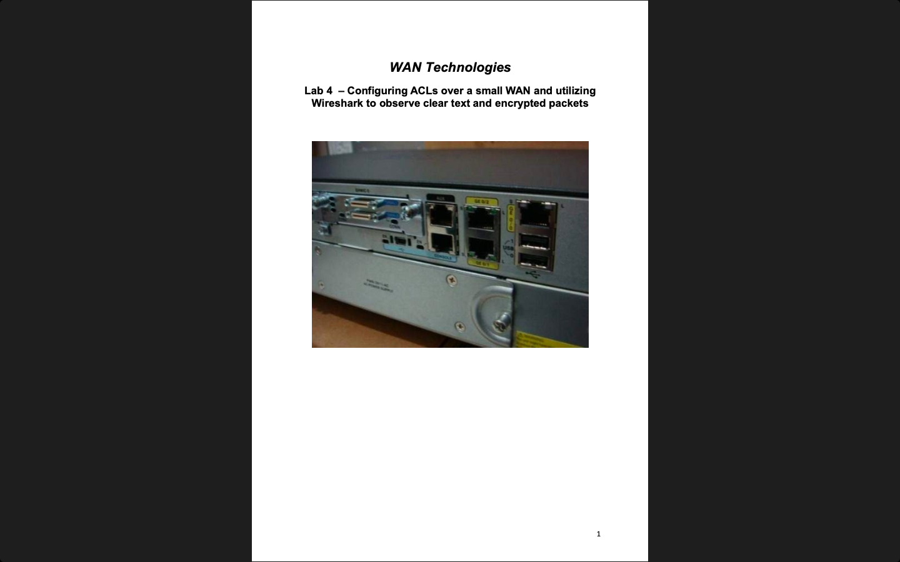
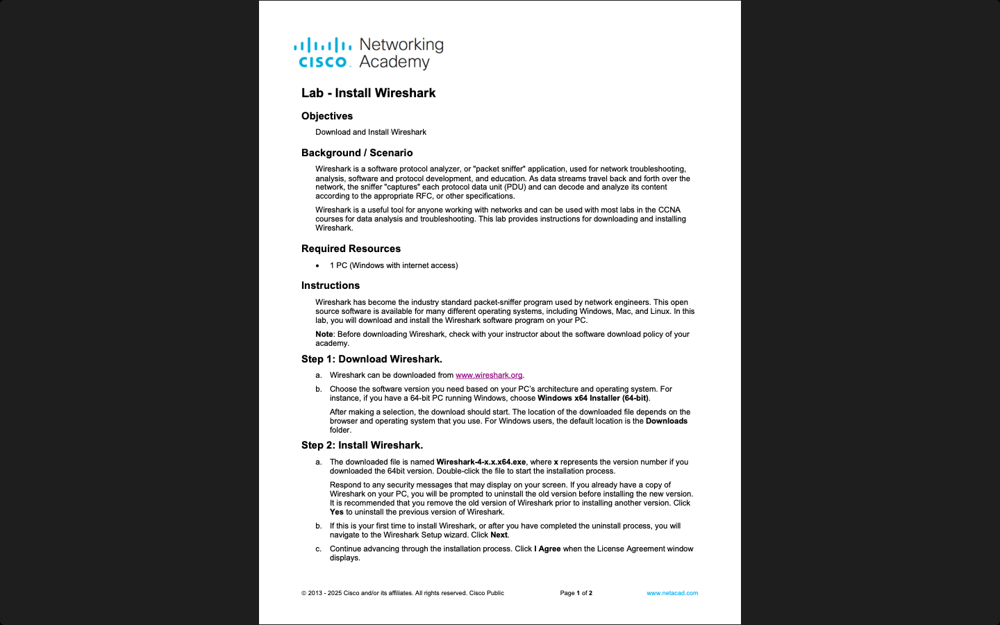
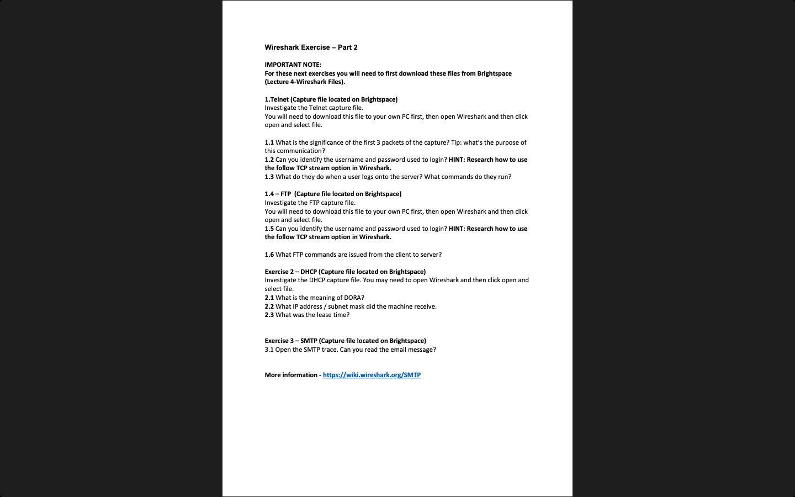

# Week 04 — Lab 4: ACLs over a small WAN and Wireshark (hardware)

**Module:** WAN Technologies (`COMP H2032`)  
**Semester:** 4 (Year 2), folder `sem04`

[Module README](../README.md)

## What this week is for

Lecture 4 was VPNs. Lab 4 is a hardware lab on a small WAN: set up the topology and initialise the devices, configure ACLs, and use Wireshark to identify ICMP traffic and to observe clear text and encrypted traffic such as Telnet. The additional Wireshark lab has the Wireshark installation sheet (part 1), an exercise on four capture files (part 2: Telnet, FTP, DHCP and SMTP) and a Wireshark cheat sheet. The file smtp_capture_file.pcap holds an SMTP session (an email conversation), the capture for the SMTP exercise.

## Screenshots

*The title page of the Lab 4 sheet.*

*The Install Wireshark sheet.*

*The Wireshark Exercise - Part 2 sheet.*

## Files

| File | What it contains |
|---|---|
| [`README.md`](README.md) | This README. |
| [`lab/wan_technologies_week04_lab_configuring_acls_over_a_small_wan_and_utilizing_wireshark_to_observe_clear_text_and_encrypted_packets.pdf`](lab/wan_technologies_week04_lab_configuring_acls_over_a_small_wan_and_utilizing_wireshark_to_observe_clear_text_and_encrypted_packets.pdf) | The lab sheet (19 pages, about 48 MB): Lab 4 - Configuring ACLs over a small WAN and utilizing Wireshark to observe clear text and encrypted packets. |
| [`lab/wireshark/install_wireshark_part_1.pdf`](lab/wireshark/install_wireshark_part_1.pdf) | Lab - Install Wireshark (2 pages): download and install Wireshark, the protocol analyser. |
| [`lab/wireshark/wireshark_exercise_part_2.pdf`](lab/wireshark/wireshark_exercise_part_2.pdf) | Wireshark Exercise - Part 2 (1 page): questions on the Telnet, FTP, DHCP and SMTP capture files. |
| [`lab/wireshark/wireshark_cheat_sheet.pdf`](lab/wireshark/wireshark_cheat_sheet.pdf) | A Wireshark cheat sheet (2 pages): capture modes and display filters. |
| [`lab/wireshark/telnet_capture_file.pcap`](lab/wireshark/telnet_capture_file.pcap) | A capture of a Telnet session (272 packets). |
| [`lab/wireshark/ftp_capture_file.pcap`](lab/wireshark/ftp_capture_file.pcap) | A capture of an FTP session (105 packets). |
| [`lab/wireshark/dhcp_capture_file.pcap`](lab/wireshark/dhcp_capture_file.pcap) | A capture of a DHCP exchange (4 packets). |
| [`lab/wireshark/smtp_capture_file.pcap`](lab/wireshark/smtp_capture_file.pcap) | A capture of an SMTP session (60 packets). |
