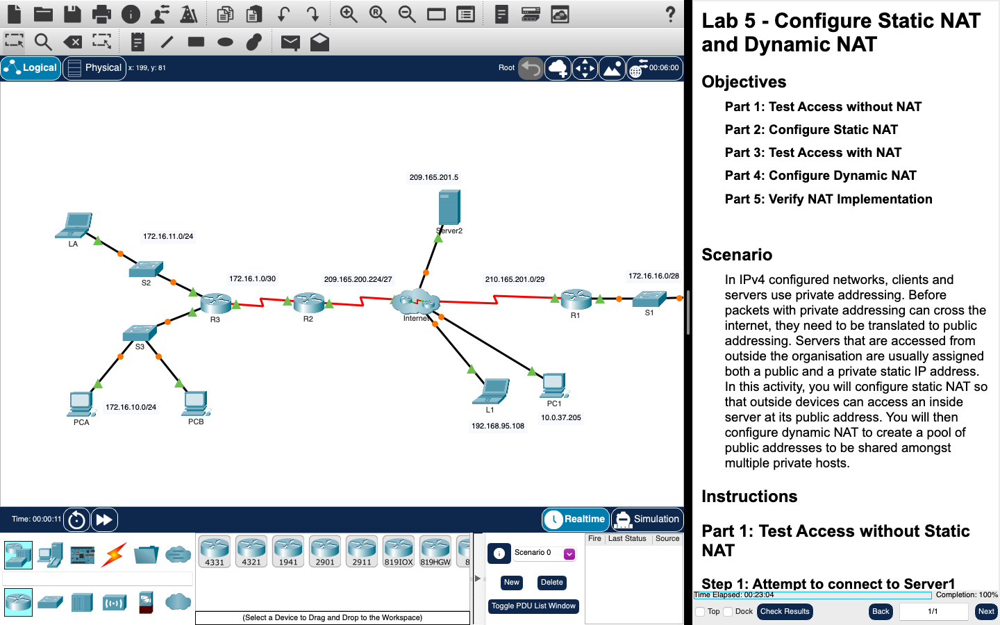

# Week 05 — Lab 5: static NAT and dynamic NAT (Packet Tracer)

**Module:** WAN Technologies (`COMP H2032`)  
**Semester:** 4 (Year 2), folder `sem04`

[Module README](../README.md)

## What this week is for

Lecture 5 was network address translation. Lab 5 is a Packet Tracer activity: test access to a server without NAT, configure static NAT, test access with NAT, configure dynamic NAT and verify the NAT implementation.

## Screenshots

*Packet Tracer with the Lab 5 network: LANs, an ISP and a server.*

## Files

| File | What it contains |
|---|---|
| [`README.md`](README.md) | This README. |
| [`lab/wan_technologies_week05_lab_configure_static_nat_and_dynamic_nat.pdf`](lab/wan_technologies_week05_lab_configure_static_nat_and_dynamic_nat.pdf) | The lab sheet (3 pages): Lab 5 - Configure Static NAT and Dynamic NAT, five parts. |
| [`lab/wan_technologies_week05_lab_configure_static_nat_and_dynamic_nat.pka`](lab/wan_technologies_week05_lab_configure_static_nat_and_dynamic_nat.pka) | The Packet Tracer activity for this lab: the starting network. Packet Tracer saves files in an encrypted format, so this file opens only in Cisco Packet Tracer and its contents are not shown in the repository. |
| [`lab/solution/wan_technologies_week05_lab_configure_static_nat_and_dynamic_nat_solution.pka`](lab/solution/wan_technologies_week05_lab_configure_static_nat_and_dynamic_nat_solution.pka) | The Packet Tracer file after the lab: the same network with NAT configured. Packet Tracer saves files in an encrypted format, so this file opens only in Cisco Packet Tracer and its contents are not shown in the repository. |
