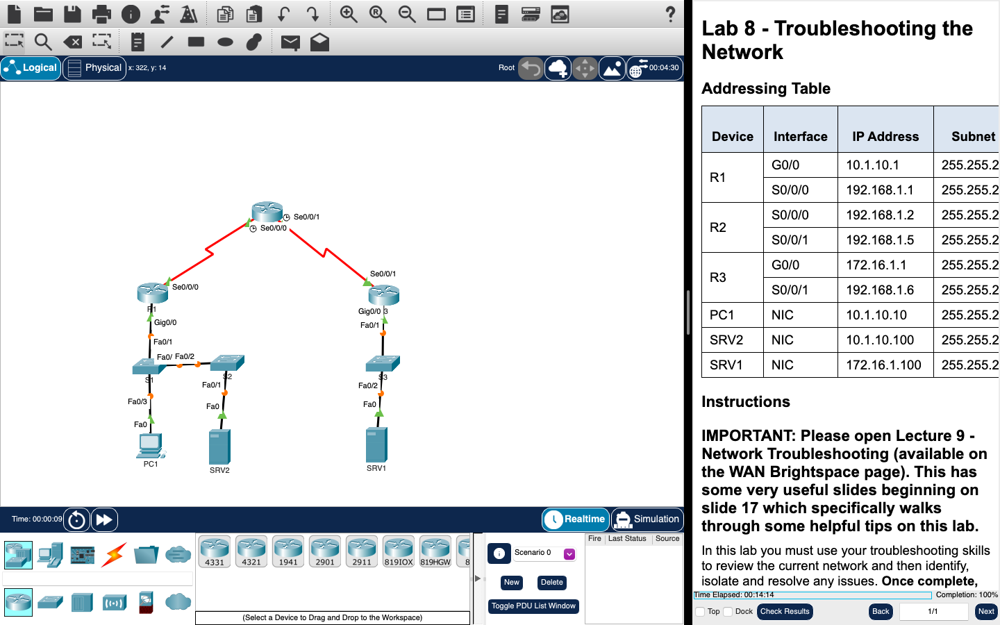

# Week 08 — Lab 8: troubleshooting the network (Packet Tracer)

**Module:** WAN Technologies (`COMP H2032`)  
**Semester:** 4 (Year 2), folder `sem04`

[Module README](../README.md)

## What this week is for

Lecture 8 was network troubleshooting. Lab 8 is a Packet Tracer activity in which the troubleshooting skills are used to review a network that has faults, to identify and isolate the issues and to repair them. The sheet points to slide 17 of the troubleshooting lecture for helpful tips.

## Screenshots

*Packet Tracer with the Lab 8 network and its addressing table.*

## Files

| File | What it contains |
|---|---|
| [`README.md`](README.md) | This README. |
| [`lab/wan_technologies_week08_lab_troubleshooting_the_network.pdf`](lab/wan_technologies_week08_lab_troubleshooting_the_network.pdf) | The lab sheet (3 pages): Lab 8 - Troubleshooting the Network. |
| [`lab/wan_technologies_week08_lab_troubleshooting_the_network.pka`](lab/wan_technologies_week08_lab_troubleshooting_the_network.pka) | The Packet Tracer activity for this lab: the network with the faults. Packet Tracer saves files in an encrypted format, so this file opens only in Cisco Packet Tracer and its contents are not shown in the repository. |
| [`lab/solution/wan_technologies_week08_lab_troubleshooting_the_network_solution.pka`](lab/solution/wan_technologies_week08_lab_troubleshooting_the_network_solution.pka) | The Packet Tracer file after the lab: the network with the faults repaired. Packet Tracer saves files in an encrypted format, so this file opens only in Cisco Packet Tracer and its contents are not shown in the repository. |
