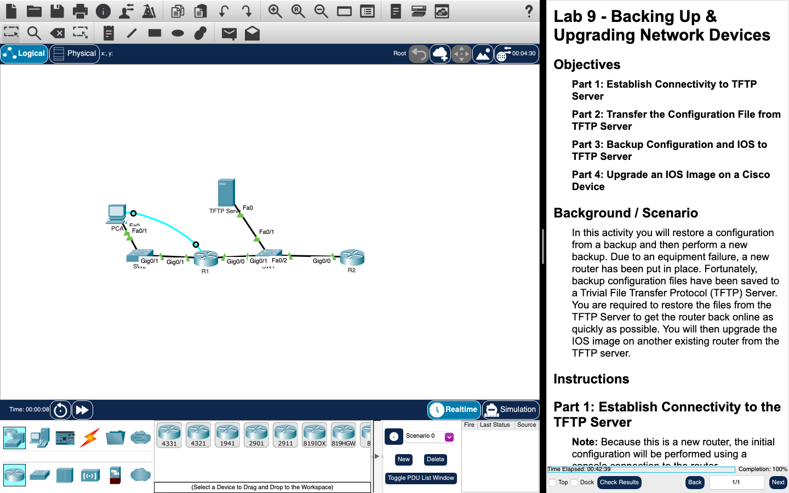
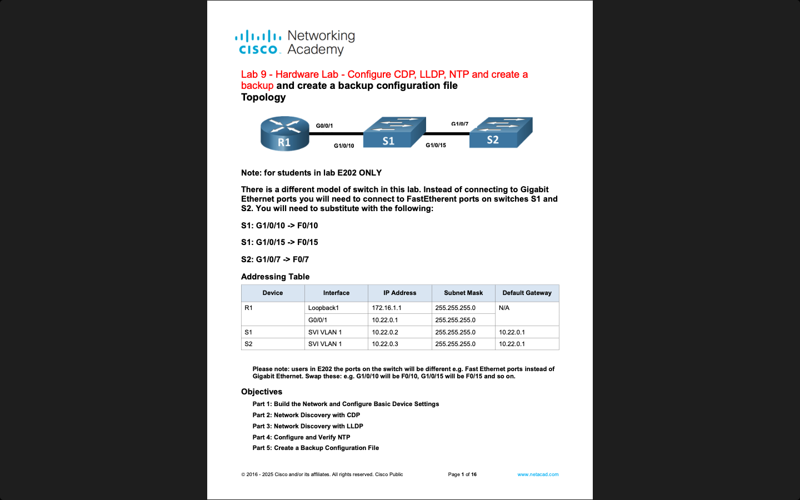

# Week 09 — Lab 9: backing up and upgrading network devices (hardware and Packet Tracer)

**Module:** WAN Technologies (`COMP H2032`)  
**Semester:** 4 (Year 2), folder `sem04`

[Module README](../README.md)

## What this week is for

Lecture 9 was network design. Lab 9 has a hardware part (1%) and a Packet Tracer part (2%). The Packet Tracer activity restores a configuration after an equipment failure: establish connectivity to a TFTP server, transfer the configuration file from the TFTP server, back up the configuration and the IOS to the TFTP server, and upgrade an IOS image on a Cisco device. The hardware lab has five parts: build the network and configure the basic device settings, network discovery with CDP, network discovery with LLDP, configure and verify NTP, and create a backup configuration file. The hardware sheet has a note for students in lab E202, where the switch has Fast Ethernet ports.

## Screenshots

*Packet Tracer with the Lab 9 network: the routers and the TFTP server.*

*The first page of the hardware lab sheet: two switches and a router.*

## Files

| File | What it contains |
|---|---|
| [`README.md`](README.md) | This README. |
| [`lab/wan_technologies_week09_lab_backing_up_&_upgrading_network_devices.pdf`](lab/wan_technologies_week09_lab_backing_up_%26_upgrading_network_devices.pdf) | The lab sheet of the Packet Tracer part (2 pages): Lab 9 - Backing Up & Upgrading Network Devices, four parts. |
| [`lab/wan_technologies_week09_lab_backing_up_&_upgrading_network_devices.pka`](lab/wan_technologies_week09_lab_backing_up_%26_upgrading_network_devices.pka) | The Packet Tracer activity for this lab: the starting network. Packet Tracer saves files in an encrypted format, so this file opens only in Cisco Packet Tracer and its contents are not shown in the repository. |
| [`lab/solution/wan_technologies_week09_lab_backing_up_&_upgrading_network_devices_solution.pka`](lab/solution/wan_technologies_week09_lab_backing_up_%26_upgrading_network_devices_solution.pka) | The Packet Tracer file after the lab: the backup and the upgrade done. Packet Tracer saves files in an encrypted format, so this file opens only in Cisco Packet Tracer and its contents are not shown in the repository. |
| [`lab/wan_technologies_week09_lab_hardware_lab_configure_cdp_lldp_ntp_and_create_a_backup_and_create_a_backup_configuration_file_topology.pdf`](lab/wan_technologies_week09_lab_hardware_lab_configure_cdp_lldp_ntp_and_create_a_backup_and_create_a_backup_configuration_file_topology.pdf) | The lab sheet of the hardware part (16 pages): Lab 9 - Hardware Lab - Configure CDP, LLDP, NTP and create a backup configuration file. |
