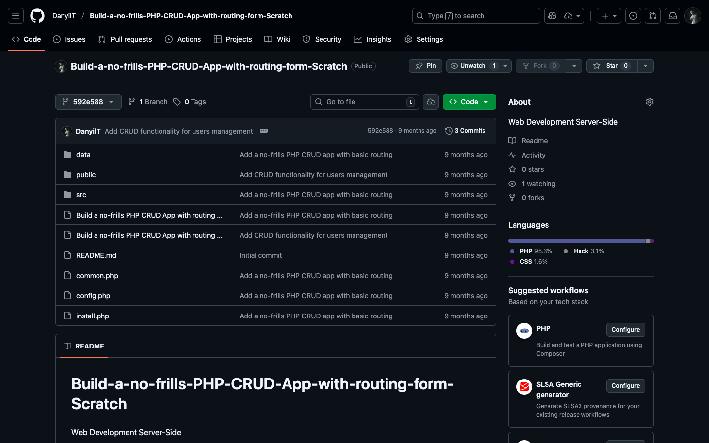
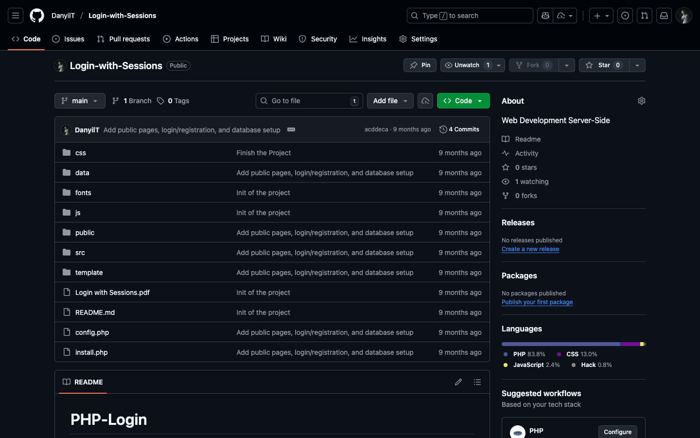
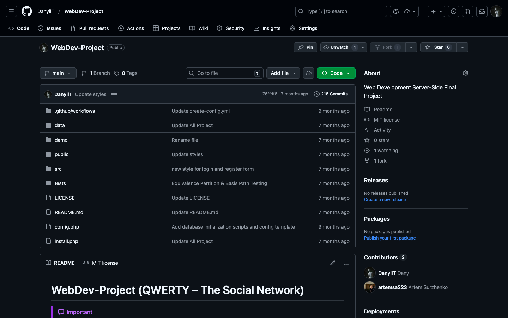

# Web Development Server-Side

**Module:** Web Development Server-Side (`COMP H2029`)  
**Semester:** 4 (Year 2), folder `sem04`  
**Lecturer:** Robert Smith  
**Date:** January - May 2025  
**Credits:** 5 ECTS  
**Matching project branch:** none

## What this module is for

Web Development Server-Side teaches PHP for database-driven web applications: forms and form validation, the 3-tier model, PDO and MySQL, a simple Model-View-Controller file structure, cookies and sessions, login authentication and automated testing. The practical work is divided into three blocks of 10% each: the SymfonyCasts PHP track (three courses with certificates of completion, labs 1 to 3), the no-frills PHP CRUD app with routing (labs 4 and 5, from a tutorial by Tania Rascia adapted by the lecturer) and Login with Sessions (lab 6). The other 70% is a project, an interactive website, which is one joint assignment with the modules Software Engineering and Testing and IT Business Management. The week folders are numbered by lab: labs 1 to 3 are the SymfonyCasts courses, which have no folder, and labs 4 to 6 are the folders week04 to week06 (the calendar weeks of the labs are in the module schedule below). The lab solutions and the project are in separate GitHub repositories, linked in the files below. This folder has the lab sheets, the start files of the login lab, links to the solution repositories, the SymfonyCasts notes, the project brief with its grading rubric, the module schedule and screenshots.

## Grades Breakdown

| Assessment Type | Weighting |
|---|---|
| SymfonyCasts PHP track (3 courses, certificates 1 to 3) | 10% |
| CRUD app, parts 1 and 2 (labs 4 and 5) | 10% |
| Login with Sessions (lab 6) | 10% |
| Project (interactive website, demos in week 13) | 70% |

## All weeks

| Week | Title | Files | Screenshot |
|---|---|---|---|
| Week 1 | Lab 1: SymfonyCasts PHP course 1 (basics) | None. Module introduction. The notes and the certificate link are in [`SymfonyCastsPHPTrack.md`](SymfonyCastsPHPTrack.md). | — |
| Week 2 | Lab 2: SymfonyCasts PHP course 2 (forms and HTTP requests) | None. Lecture: how the web works. The certificate link is in [`SymfonyCastsPHPTrack.md`](SymfonyCastsPHPTrack.md). | — |
| Week 3 | Lab 3: SymfonyCasts PHP course 3 (database with PDO) | None. The notes and the certificate link are in [`SymfonyCastsPHPTrack.md`](SymfonyCastsPHPTrack.md). | — |
| [Week 4](week04/) | Lab 4: build a no-frills PHP CRUD app with routing, part 1 | [`lab/build_a_no_frills_php_crud_app_with_routing_from_scratch_part1.pdf`](week04/lab/build_a_no_frills_php_crud_app_with_routing_from_scratch_part1.pdf) [`lab/solution/project_link.txt`](week04/lab/solution/project_link.txt) |  |
| [Week 5](week05/) | Lab 5: build a no-frills PHP CRUD app with routing, part 2 | [`lab/build_a_no_frills_php_crud_app_with_routing_from_scratch_part2.pdf`](week05/lab/build_a_no_frills_php_crud_app_with_routing_from_scratch_part2.pdf) [`lab/solution/project_link.txt`](week05/lab/solution/project_link.txt) |  |
| [Week 6](week06/) | Lab 6: login with sessions | [`lab/login_with_sessions.pdf`](week06/lab/login_with_sessions.pdf) [`lab/resources/php_login_master_start.zip`](week06/lab/resources/php_login_master_start.zip) [`lab/solution/project_link.txt`](week06/lab/solution/project_link.txt) |  |
| Week 11 | Project work (weeks 11 to 13) and project demos (70%) | None. The project is in [`assessment/01/`](assessment/01/). | — |

## Assessments and other files

| File | What it contains |
|---|---|
| [`SymfonyCastsPHPTrack.md`](SymfonyCastsPHPTrack.md) | Notes for labs 1 to 3: the commands for running the first course's example and for connecting to MySQL, and for each lab the links to the SymfonyCasts PHP track, the course and the certificate of completion. |
| [`resources/web_development_server_side_schedule.jpg`](resources/web_development_server_side_schedule.jpg) | The module schedule (an image): the lecture and the lab of each of the 13 weeks, with the due dates (the SymfonyCasts certificates in week 4, the CRUD app in week 9 and the session lab in week 10, 10% each) and the project demos in week 13 (70%). |
| [`assessment/01/web_development_server_side_assessment.pdf`](assessment/01/web_development_server_side_assessment.pdf) | The project brief (9 pages, due before 9:00 on 5 May 2025): a joint assignment with Software Engineering and Testing and IT Business Management to build an e-commerce website (an online store). It requires a 3-tier architecture with MVC, HTML5 and CSS, PHP for all logic, PDO for all CRUD functions (no MySQLi), a MySQL database, sessions for login and the shopping cart, user registration and authentication, and validated and sanitised input, with no third-party code. It also describes the demo, the submission, the penalties and the grading rubric. |
| [`assessment/01/resources/web_development_server_side_assessment_rubric.pdf`](assessment/01/resources/web_development_server_side_assessment_rubric.pdf) | The grading rubric (4 pages): Web CRUD with Session project, with levels and points for the criteria (for example structure with MVC and templates). |
| [`assessment/01/submission/project_link.txt`](assessment/01/submission/project_link.txt) | One line: the GitHub link to the project repository, WebDev-Project. |

The module descriptor below lists the PHP documentation, the SymfonyCasts PHP track and the GitHub Student Developer Pack as internet resources. The module page adds that the SymfonyCasts tutorials are free for 3 months with a GitHub student account, activated at https://symfonycasts.com/github-student, and that the progress is committed to a GitHub repository.

### Screenshots

*The WebDev-Project repository on GitHub (titled QWERTY - The Social Network): the folders data, demo, public, src and tests, with config.php and install.php.*

---

## Module descriptor

Module Title: Web Development Server Side (mandatory), module code COMP H2029, 5 credits, lecturer Robert Smith.

**Module aims.** The aim of this module is to reinforce and extend the existing skills in web development, computer programming and databases. Learners develop the skills and knowledge to design, create and evaluate dynamic database-driven web applications, using a server-side scripting language, and learn modern software architectures for server-side applications.

**Indicative syllabus.**

- Introduction to PHP
- The 3-tier model for database-driven web applications
- PHP form data processing
- PHP and databases
- Introduction to Model-View-Controller (MVC) software architectures
- Introduction to software testing
- Introduction to version control

**Assessment.** The descriptor gives continuous assessment 100% (50% course work and 50% project), and the repeat assessment is a 100% project. The 2024-25 schedule gives 30% for the weekly work and 70% for the project.

**Internet based resources.**

- The PHP official documentation site: https://www.php.net/docs.php
- The SymfonyCasts PHP tutorials, free with the GitHub Student Developer Pack: https://symfonycasts.com/tracks/php
- The GitHub Student Developer Pack: https://education.github.com/pack#offers
