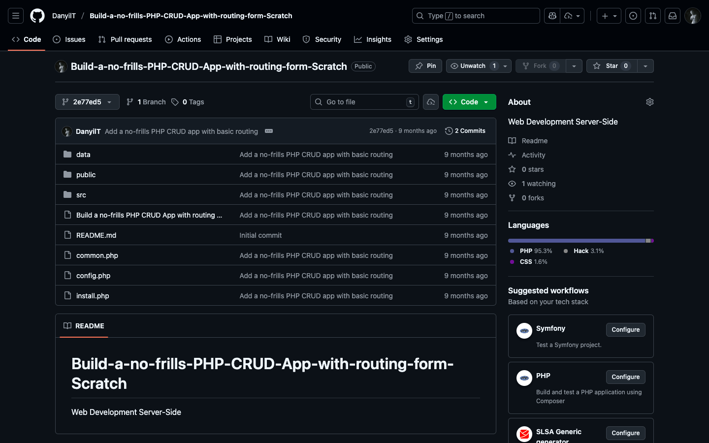
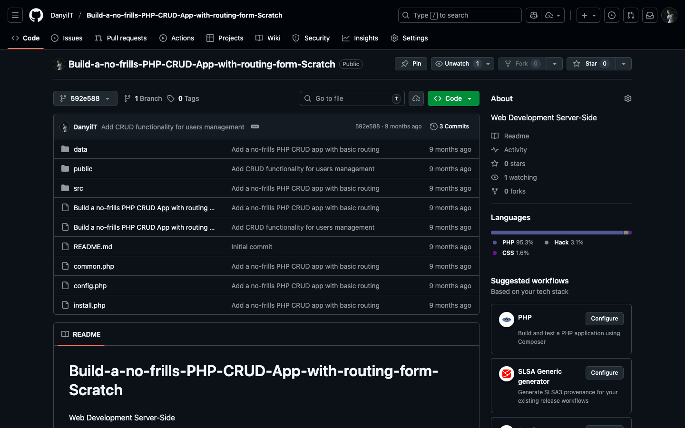
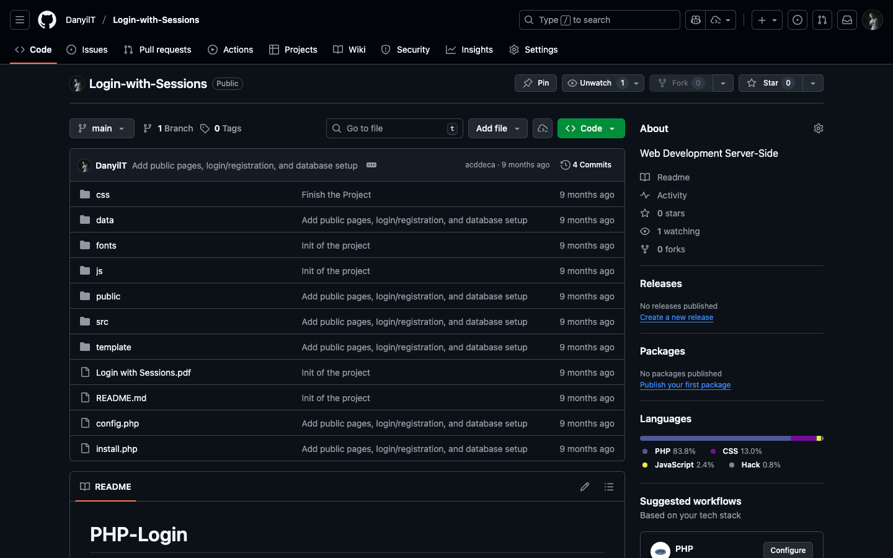

# Web Development Server-Side

**Module:** Web Development Server-Side (`COMP H2029`)  
**Semester:** 4 (Year 2), folder `sem04`  
**Lecturer:** Robert Smith  
**Date:** January - May 2025  
**Credits:** 5 ECTS  
**Matching project branches:** [`assessment/year02/module-web_development_server_side/no-frills-php-crud-app`](https://github.com/DanyilT/projects-in-university/tree/assessment/year02/module-web_development_server_side/no-frills-php-crud-app) (labs 4 and 5, the no-frills PHP CRUD app), [`assessment/year02/module-web_development_server_side/login-with-sessions`](https://github.com/DanyilT/projects-in-university/tree/assessment/year02/module-web_development_server_side/login-with-sessions) (lab 6, Login with Sessions)
**Matching project repo:** [tu863-wdss-qwerty-social-network](https://github.com/DanyilT/tu863-wdss-qwerty-social-network) (the project of the module, QWERTY - The Social Network, shared with Software Engineering and Testing and IT Business Management)

## What this module is for

Web Development Server-Side teaches PHP for database-driven web applications: forms and form validation, the 3-tier model, PDO and MySQL, a simple Model-View-Controller file structure, cookies and sessions, login authentication and automated testing. The practical work is divided into three blocks of 10% each: the SymfonyCasts PHP track (three courses with certificates of completion, labs 1 to 3), the no-frills PHP CRUD app with routing (labs 4 and 5, from a tutorial by Tania Rascia adapted by the lecturer) and Login with Sessions (lab 6). The other 70% is a project, an interactive website, which is one joint assignment with the modules Software Engineering and Testing and IT Business Management. The week folders are numbered by lab: labs 1 to 3 are the SymfonyCasts courses, which have no folder, and labs 4 to 6 are the folders week04 to week06 (the calendar weeks of the labs are in the module schedule below). The lab solutions are the two matching branches (the no-frills PHP CRUD app of labs 4 and 5, and Login with Sessions of lab 6); the project is in the GitHub repository tu863-wdss-qwerty-social-network. The branches and the repository are linked in the files below. This folder has the lab sheets, the start files of the login lab, links to the solution repositories, the SymfonyCasts notes, the project brief with its grading rubric and screenshots.

The notes for labs 1 to 3 are in [`SymfonyCastsPHPTrack.md`](SymfonyCastsPHPTrack.md): the commands for running the first course's example and for connecting to MySQL, and for each lab the links to the SymfonyCasts PHP track, the course and the certificate of completion.

## Grades Breakdown

| Assessment Type | Weighting |
|---|---|
| SymfonyCasts PHP track (3 courses, certificates 1 to 3) | 10% |
| CRUD app, parts 1 and 2 (labs 4 and 5) | 10% |
| Login with Sessions (lab 6) | 10% |
| Project (interactive website, demos in week 13) | 70% |

## Assessments

| File | What it contains |
|---|---|
| [`assessment/01/README.md`](assessment/01/README.md) | The README of Assessment 1: the e-commerce website project (70%), the rubric and the repository of the submitted project. |
| [`assessment/01/web_development_server_side_assessment.pdf`](assessment/01/web_development_server_side_assessment.pdf) | The project brief (9 pages, due before 9:00 on 5 May 2025): a joint assignment with Software Engineering and Testing and IT Business Management to build an e-commerce website (an online store). It requires a 3-tier architecture with MVC, HTML5 and CSS, PHP for all logic, PDO for all CRUD functions (no MySQLi), a MySQL database, sessions for login and the shopping cart, user registration and authentication, and validated and sanitised input, with no third-party code. It also describes the demo, the submission, the penalties and the grading rubric. |
| [`assessment/01/resources/web_development_server_side_assessment_rubric.pdf`](assessment/01/resources/web_development_server_side_assessment_rubric.pdf) | The grading rubric (4 pages): Web CRUD with Session project, with levels and points for the criteria (for example structure with MVC and templates). |
| [`assessment/01/submission/project_link.txt`](assessment/01/submission/project_link.txt) | One line: the GitHub link to the project repository, tu863-wdss-qwerty-social-network. |

## All weeks

| Week | Title | Files | Screenshot |
|---|---|---|---|
| Week 1 | Lab 1: SymfonyCasts PHP course 1 (basics) | None. Module introduction. The notes and the certificate link are in [`SymfonyCastsPHPTrack.md`](SymfonyCastsPHPTrack.md). | — |
| Week 2 | Lab 2: SymfonyCasts PHP course 2 (forms and HTTP requests) | None. Lecture: how the web works. The certificate link is in [`SymfonyCastsPHPTrack.md`](SymfonyCastsPHPTrack.md). | — |
| Week 3 | Lab 3: SymfonyCasts PHP course 3 (database with PDO) | None. The notes and the certificate link are in [`SymfonyCastsPHPTrack.md`](SymfonyCastsPHPTrack.md). | — |
| [Week 4](week04/) | Lab 4: build a no-frills PHP CRUD app with routing, part 1 | [`lab/build_a_no_frills_php_crud_app_with_routing_from_scratch_part1.pdf`](week04/lab/build_a_no_frills_php_crud_app_with_routing_from_scratch_part1.pdf) |  |
| [Week 5](week05/) | Lab 5: build a no-frills PHP CRUD app with routing, part 2 | [`lab/build_a_no_frills_php_crud_app_with_routing_from_scratch_part2.pdf`](week05/lab/build_a_no_frills_php_crud_app_with_routing_from_scratch_part2.pdf) |  |
| [Week 6](week06/) | Lab 6: login with sessions | [`lab/login_with_sessions.pdf`](week06/lab/login_with_sessions.pdf) [`lab/resources/php_login_master_start.zip`](week06/lab/resources/php_login_master_start.zip) |  |
| Week 11 | Project work (weeks 11 to 13) and project demos (70%) | None. The project is in [`assessment/01/`](assessment/01/). | — |

> [!WARNING]
> Lab 6 (Login with Sessions) was marked 9 out of 10. The feedback: the solution deviates from the learning materials of the lab sheet (for example `if ($_SERVER["REQUEST_METHOD"] == "POST")` in [`register.php`](https://github.com/DanyilT/projects-in-university/blob/assessment/year02/module-web_development_server_side/login-with-sessions/public/register.php), where the sheet uses `if(isset($_POST['Submit']))`), the user input from the `$_POST` array is not cleaned with the method from the lecture, and JavaScript, which the solution uses for the client-side validation, is not to be used in this module. The details are in [`week06/README.md`](week06/README.md).

## Resources

### Schedule

The module schedule for Spring 2025 (12 teaching weeks), by week: the lecture, the lab and the assignment that is due. The schedule has the months and no dates; the dates are the Mondays of the weeks of the [semester 2 calendar](../README.md#semester-schedule), with week 1 starting on 27 January 2025. The week folders are numbered by lab (labs 4 to 6 are the folders week04 to week06), so the Week column is not linked and the labs are linked by their number. The two rows without a week number are the weeks of 14 and 21 April, the spring break of the semester calendar; the schedule has project work in them. It has the no-frills CRUD app, part 1, as the lab of weeks 6 and 7 and part 2 as the lab of weeks 8 and 9.

| Week | Session | Week Date |
|---|---|---|
| 1 | Lecture 1: module intro [Lab 1](SymfonyCastsPHPTrack.md): SymfonyCasts PHP course 1 (basics) | 27 January 2025 |
| 2 | Lecture 2: how the web works [Lab 2](SymfonyCastsPHPTrack.md): SymfonyCasts PHP course 2 (forms and HTTP requests) | 3 February 2025 |
| 3 | Lecture 3: DVCs [Lab 3](SymfonyCastsPHPTrack.md): SymfonyCasts PHP course 3 (database with PDO) | 10 February 2025 |
| 4 | Lecture 4: files structure, MVCs SymfonyCasts pickup week Due: certificates 1, 2 and 3 (10%) | 17 February 2025 |
| 5 | Lecture 5: form processing Setting up a dev stack | 24 February 2025 |
| 6 | Lecture 6: build a no-frills CRUD app, part 1 [Lab 4](week04/): build a no-frills CRUD app, part 1 | 3 March 2025 |
| 7 | Lecture 7: build a no-frills CRUD app, part 2 [Lab 4](week04/): build a no-frills CRUD app, part 1 | 10 March 2025 |
| 8 | Lecture 8: sessions (theory) [Lab 5](week05/): build a no-frills CRUD app, part 2 | 17 March 2025 |
| 9 | Lecture 9: sessions (practical) [Lab 5](week05/): build a no-frills CRUD app, part 2 Due: CRUD app, parts 1 and 2 (10%) | 24 March 2025 |
| 10 | Lecture 10: automated testing [Lab 6](week06/): adding sessions (for secure login) Due: session lab (10%) | 31 March 2025 |
| 11 | [Project work](assessment/01/) | 7 April 2025 |
| No week | [Project work](assessment/01/) | 14 and 21 April 2025 |
| 12 | [Project work](assessment/01/) | 28 April 2025 |
| 13 | Project demos Project in (70%) | 5 May 2025 |

### Links

The module descriptor below lists the PHP documentation, the SymfonyCasts PHP track and the GitHub Student Developer Pack as internet resources. The module page adds that the SymfonyCasts tutorials are free for 3 months with a GitHub student account, activated at https://symfonycasts.com/github-student, and that the progress is committed to a GitHub repository.

### Module descriptor

**Module aims.** The aim of this module is to reinforce and extend the existing skills in web development, computer programming and databases. Learners develop the skills and knowledge to design, create and evaluate dynamic database-driven web applications, using a server-side scripting language, and learn modern software architectures for server-side applications.

**Indicative syllabus.**

- Introduction to PHP
- The 3-tier model for database-driven web applications
- PHP form data processing
- PHP and databases
- Introduction to Model-View-Controller (MVC) software architectures
- Introduction to software testing
- Introduction to version control

**Internet based resources.**

- The PHP official documentation site: https://www.php.net/docs.php
- The SymfonyCasts PHP tutorials, free with the GitHub Student Developer Pack: https://symfonycasts.com/tracks/php
- The GitHub Student Developer Pack: https://education.github.com/pack#offers
