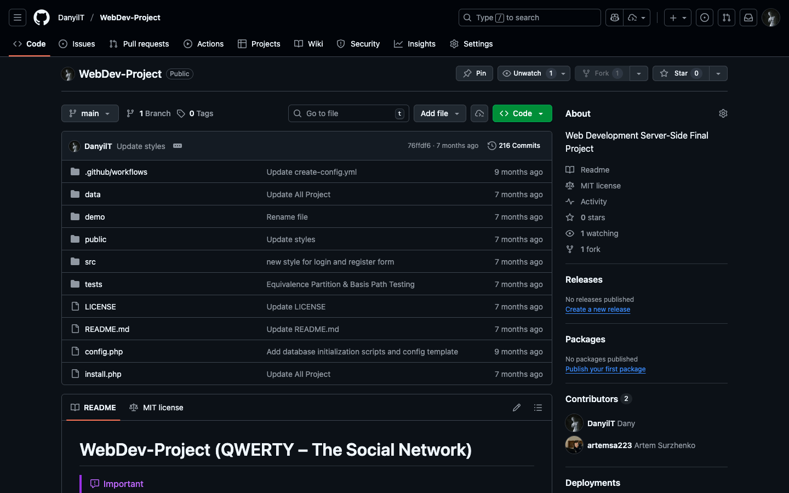

# Assessment 1: Project: an e-commerce website

**Module:** Web Development Server-Side (`COMP H2029`)  
**Semester:** 4 (Year 2), folder `sem04`  
**Type:** project, group  
**Weight:** 70%  
**Deadline:** before 9:00 on 5 May 2025 (the demonstration in week 13)  
**Result:** —  
**On main:** [`sem04/web_development_server_side/assessment/01/`](https://github.com/DanyilT/projects-in-university/tree/main/sem04/web_development_server_side/assessment/01) (the brief, the rubric, the link file and this README)  
**Branch:** —  
**Repository:** [tu863-wdss-qwerty-social-network](https://github.com/DanyilT/tu863-wdss-qwerty-social-network) (the project, QWERTY - The Social Network)

[Module README](../../README.md)

## What this assessment is for

The brief (9 pages) is a joint assignment with Software Engineering and Testing and IT Business Management to build an e-commerce website (an online store) with a 3-tier architecture and MVC, HTML5 and CSS, PHP for all logic, PDO for all CRUD functions (no MySQLi), a MySQL database, sessions for login and the shopping cart, and user registration and authentication. The project is demonstrated on campus in week 13; a group that does not demonstrate receives 0%. The rubric (4 pages) gives the levels and points of the criteria.

The submission is the project in the repository tu863-wdss-qwerty-social-network (then named WebDev-Project), titled QWERTY - The Social Network.

*The repository on GitHub, then named WebDev-Project (titled QWERTY - The Social Network): the folders data, demo, public, src and tests, with config.php and install.php.*

## Files

| File | What it contains |
|---|---|
| [`README.md`](README.md) | This README. |
| [`web_development_server_side_assessment.pdf`](web_development_server_side_assessment.pdf) | The project brief (9 pages, due before 9:00 on 5 May 2025): a joint assignment with Software Engineering and Testing and IT Business Management to build an e-commerce website (an online store). It requires a 3-tier architecture with MVC, HTML5 and CSS, PHP for all logic, PDO for all CRUD functions (no MySQLi), a MySQL database, sessions for login and the shopping cart, user registration and authentication, and validated and sanitised input, with no third-party code. It also describes the demo, the submission, the penalties and the grading rubric. |
| [`resources/web_development_server_side_assessment_rubric.pdf`](resources/web_development_server_side_assessment_rubric.pdf) | The grading rubric (4 pages): Web CRUD with Session project, with levels and points for the criteria (for example structure with MVC and templates). |
| [`submission/project_link.txt`](submission/project_link.txt) | One line: the GitHub link to the project repository, tu863-wdss-qwerty-social-network. |
