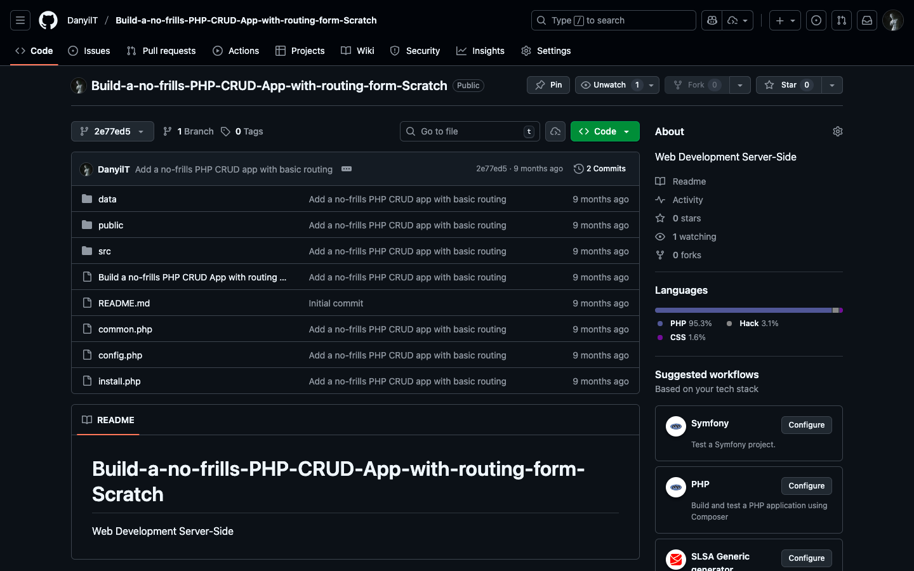

# Week 04 — Lab 4: build a no-frills PHP CRUD app with routing, part 1

**Module:** Web Development Server-Side (`COMP H2029`)  
**Semester:** 4 (Year 2), folder `sem04`

[Module README](../README.md)

## What this week is for

Lab 4 is part 1 of a tutorial (by Tania Rascia, adapted for the module by the lecturer) that builds a small PHP and MySQL database app: building the front end (an index page with templating, an add-a-user page and a query-users page), initialising the database and connecting to it with PDO, adding a new user (Create), with the connection script in its own file and sanitised form input, and viewing and filtering users (Read). In the module schedule the lab runs in weeks 6 and 7. The result is a commit of the Build-a-no-frills-PHP-CRUD-App-with-routing-form-Scratch repository on GitHub, which adds a simple PHP CRUD app that creates and reads users, with basic routing and templates, the database setup, the connection configuration and initial styles.

## Screenshots

*The GitHub repository at the part 1 commit: the folders data, public and src and the files common.php, config.php and install.php.*

## Files

| File | What it contains |
|---|---|
| [`README.md`](README.md) | This README. |
| [`lab/build_a_no_frills_php_crud_app_with_routing_from_scratch_part1.pdf`](lab/build_a_no_frills_php_crud_app_with_routing_from_scratch_part1.pdf) | The lab sheet (32 pages): Building a no-frills PHP CRUD App with Routing from Scratch, part 1: the front end, the database, adding a user and viewing and filtering users. |
| [`lab/solution/project_link.txt`](lab/solution/project_link.txt) | One line: the GitHub link to the part 1 commit of the CRUD app repository. |
