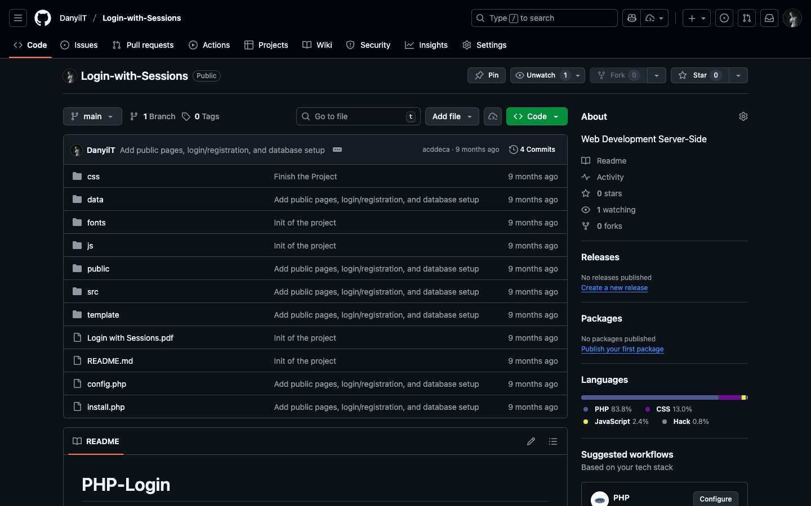

# Week 06 — Lab 6: login with sessions

**Module:** Web Development Server-Side (`COMP H2029`)  
**Semester:** 4 (Year 2), folder `sem04`

[Module README](../README.md)

## What this week is for

Lab 6 (Workshop 2) implements a username and password login with PHP sessions in six parts: setting the scene with HTML (the start project has the pages index, about and contacts, a login page, a header and footer template and a config file with a username and a password), setting up the login logic, setting up the sessions, redirecting the user, logging out and what to do next. The lectures on sessions (theory and practical) are in weeks 8 and 9 of the module schedule, and the lab runs in week 10, when the session lab is due. The solution is the matching branch [`assessment/year02/module-web_development_server_side/login-with-sessions`](https://github.com/DanyilT/projects-in-university/tree/assessment/year02/module-web_development_server_side/login-with-sessions), with four commits. The third commit goes beyond the sheet: it adds public pages that need no login, login and registration with client-side and server-side validation, safe password storage with hashing, and a database schema for the users. The lab was marked 9 out of 10; the feedback was that the form check deviates from the learning materials of the lab sheet (`if ($_SERVER["REQUEST_METHOD"] == "POST")` where the sheet uses `if(isset($_POST['Submit']))`), that the user input from the `$_POST` array is not cleaned with the method from the lecture, and that JavaScript, which the validation of the forms used, is not to be used in this module. The fourth commit applies it: `register.php` checks the form with `isset($_POST['Submit'])`, `login.php` and `register.php` clean the input with the `escape` function of the lecture (the new `src/common.php`, the function of labs 4 and 5) and replace the JavaScript validation with the client-side validation that part 6 of the lab sheet asks for (client and server side validation), done with the HTML attributes `required`, `minlength`, `maxlength` and `pattern` (a username of 3 to 50 letters, numbers, dots, dashes or underscores and a password of 4 to 72 characters on the registration form, `required` and `maxlength` on the login form), and the server checks the same rules.

**Lab solution:** [login-with-sessions](https://github.com/DanyilT/projects-in-university/tree/assessment/year02/module-web_development_server_side/login-with-sessions)

*The Login-with-Sessions repository on GitHub, with the commit that adds the public pages, login and registration and the database setup.*

## Files

| File | What it contains |
|---|---|
| [`README.md`](README.md) | This README. |
| [`lab/login_with_sessions.pdf`](lab/login_with_sessions.pdf) | The lab sheet (11 pages): Login with Sessions, six parts. |
| [`lab/resources/php_login_master_start.zip`](lab/resources/php_login_master_start.zip) | The start project of the lab (a zip): the PHP pages, the templates, the config file, the Bootstrap files and a README. |
