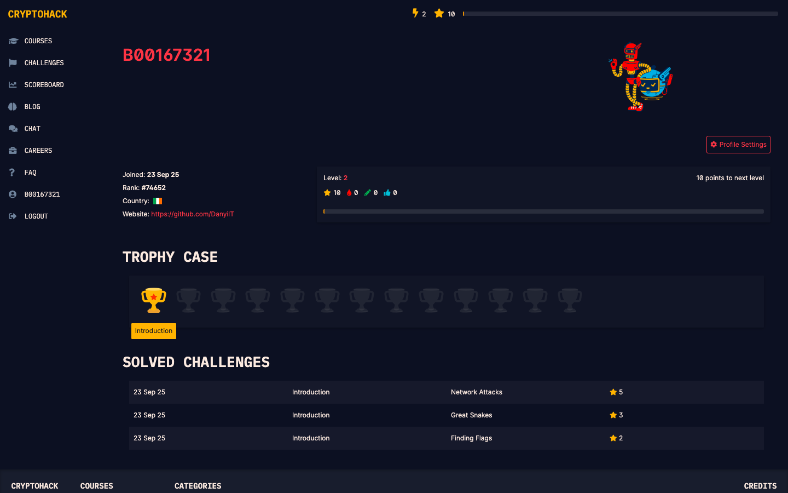

# Week 02 — Lab environment and CryptoHack introduction

**Module:** Secure Communications (`DFCS H3013`)  
**Semester:** 5 (Year 3), folder `sem05`

[Module README](../README.md)

## What this week is for

The lecture of week 2 was encoding, hashing and passwords. The lab sets up the working environment (a GitHub account and a development environment; Visual Studio Code is recommended for the Python code) and introduces CryptoHack (cryptohack.org): an account is created and the three Introduction challenges are solved. The deliverable is a screenshot of the CryptoHack profile that shows the username and the three solved Introduction challenges, saved as screenshot.png and uploaded to a GitHub Classroom repository by Sunday 28 September 2025, 23:59. The lab is marked out of 2 (0 for no submission, 1 for an incomplete or incorrect one, 2 for all tasks); late submissions get 0%.

## Files

| File | What it contains | Screenshot |
|---|---|---|
| [`README.md`](README.md) | This README. | — |
| [`lab/README.md`](lab/README.md) | The README of the GitHub Classroom repository for this lab: the task, the screenshot.png submission and the deadline. | — |
| [`lab/solution/screenshot.png`](lab/solution/screenshot.png) | The submitted screenshot: the CryptoHack profile with the three solved Introduction challenges. |  *The CryptoHack profile: Level 2 with the Introduction challenges Network Attacks, Great Snakes and Finding Flags solved.* |
