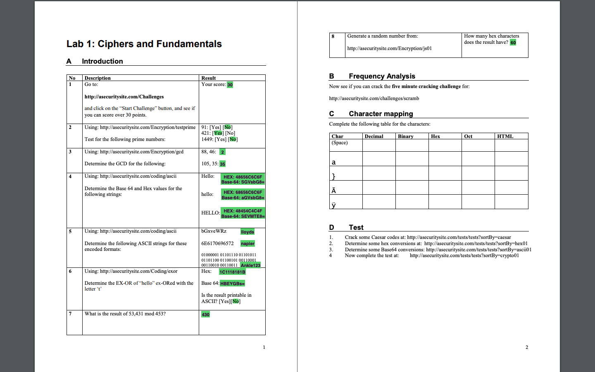
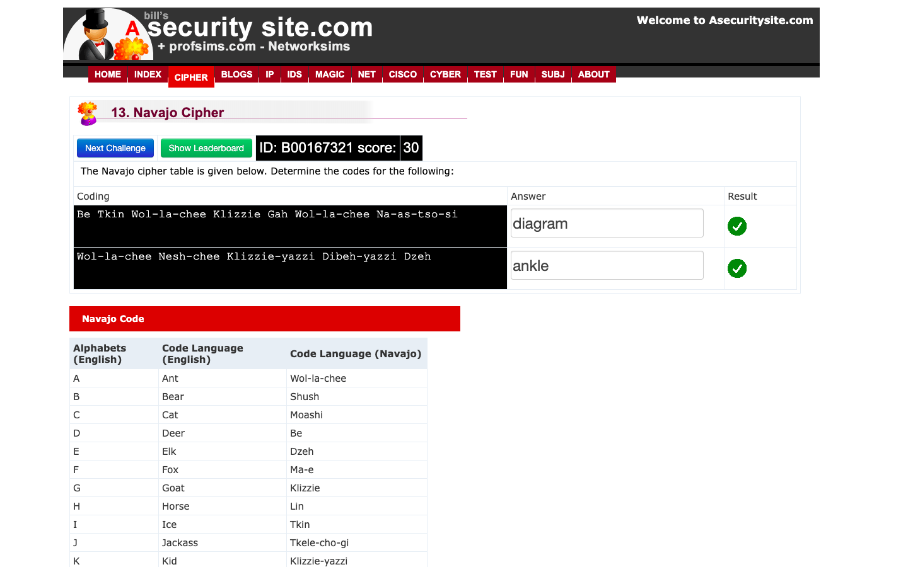
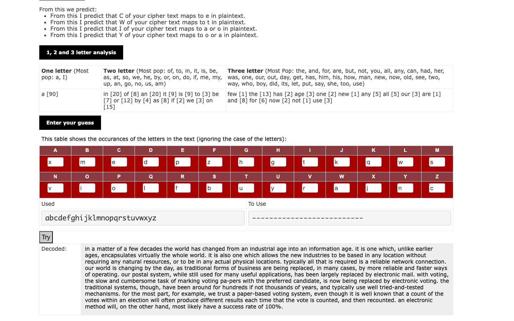

# Week 03 — Lab 1 part 1: ciphers and fundamentals (sections A and B)

**Module:** Secure Communications (`DFCS H3013`)  
**Semester:** 5 (Year 3), folder `sem05`

[Module README](../README.md)

## What this week is for

The lecture of week 3 was keys, symmetric and asymmetric encryption. Lab 1 (Ciphers and Fundamentals) starts with section A, Introduction, a set of online exercises on asecuritysite.com: the challenge test (a score over 30 points), prime tests, the greatest common divisor, Base64 and hexadecimal values of strings and ASCII strings from encoded values. Section B is frequency analysis. The lab is marked out of 2: section A (1 mark) needs a screenshot of the online exercise with a score close to 30 and a screenshot or typed answers to the written questions, and section B (1 mark) needs a screenshot of the online exercise. The screenshots are submitted as image files or one PDF to a GitHub Classroom repository by 5 October 2025, 23:59. The submitted repository has three images: the lab sheet with the answers of the first part filled in, a screenshot of the online exercise of section A (the Navajo cipher challenge with the score 30) and a screenshot of the frequency analysis challenge of section B with the decoded text.

## Files

| File | What it contains | Screenshot |
|---|---|---|
| [`README.md`](README.md) | This README. | — |
| [`lab/README.md`](lab/README.md) | The README of the GitHub Classroom repository for this lab: the requirements, the submission and the deadline. | — |
| [`lab/secure_communications_week03_lab.pdf`](lab/secure_communications_week03_lab.pdf) | The lab sheet (2 pages), Week 3-4 Lab Instruction: Lab 1, Ciphers and Fundamentals, sections A to D. | — |
| [`lab/solution/secure_communications_week03_lab_filled.pdf`](lab/solution/secure_communications_week03_lab_filled.pdf) | The lab sheet filled in (2 pages). | — |
| [`lab/solution/secure_communications_week03_lab_report.pdf`](lab/solution/secure_communications_week03_lab_report.pdf) | The submitted report (2 pages): the score of the online challenge and the sections A (Introduction) and B (Frequency Analysis). | — |
| [`lab/solution/section_a.png`](lab/solution/section_a.png) | The lab sheet as an image: the two pages of Lab 1 with the answers filled in (highlighted in green). |  *The filled lab sheet, sections A to D.* |
| [`lab/solution/screenshot_a.png`](lab/solution/screenshot_a.png) | A screenshot of the online exercise of section A: the asecuritysite.com Navajo cipher challenge, with the score 30. |  *The Navajo cipher challenge solved, with the score 30.* |
| [`lab/solution/screenshot_b.png`](lab/solution/screenshot_b.png) | A screenshot of section B, frequency analysis: the letter mapping and the decoded text. |  *The frequency analysis challenge with the decoded text.* |
