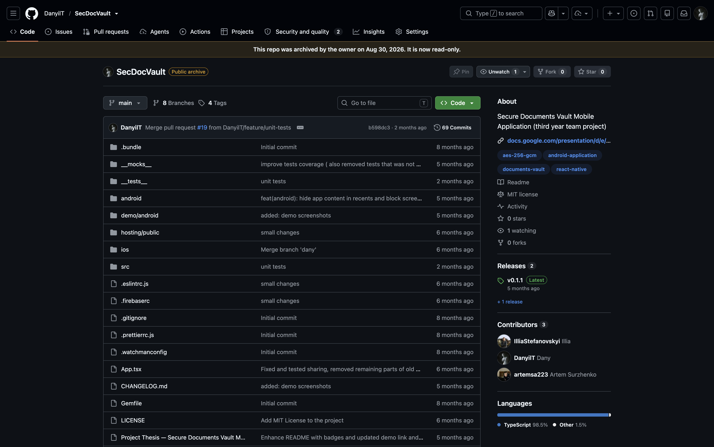

# Group Project

**Module:** Group Project (`DFCS H3018`)  
**Semester:** 6 (Year 3), folder `sem06`  
**Supervisors:** Dr. Stephen O'Shaughnessy, Mark Lane, Dr. Bahareh Pahlevanzadeh, Greg South, Dr. Assem Abdel Hak, Mark O'Neill and Dr. Vanessa Ayala-Rivera (the supervisors of the term)  
**Date:** January - May 2026  
**Credits:** 10 ECTS  
**Matching project branch:** [`project/year03/module-group_project/secdocvault`](https://github.com/DanyilT/projects-in-university/tree/project/year03/module-group_project/secdocvault) (the group project SecDocVault: the proposal, thesis and demo of May 2026, and the extension to the project, the repeat of July-August 2026)

## What this module is for

The Group Project is the final project of Year 3 of the BSc in Computing in Digital Forensics and Cyber Security (TU863, TU765 and TU758; the course is the Year 3 coordination course): a major project done in a group of 2 to 3 students under a supervisor, written up as a thesis-style report and shown in a presentation and demo. The module has no weekly labs and no weekly folders. The course page has the project thesis template and the thesis outline chapter by chapter, the marking grid, a collection of past sample projects (12 reports from 2022 to 2025, not all of B+ or A quality, shown for different approaches), the recordings of two project workshops, and lists of old project ideas from 2011 to 2019 (mostly general computing projects, plus some quick ideas such as a hackable city cyber range and a custom CTF framework). This folder holds the marking scheme, the demo rubric, the thesis outline and the thesis template. The report is uploaded to Brightspace by one member of the group before 23:59 on Sunday 10 May 2026 (the report as a Word document or PDF, with an additional files upload), and the project presentations and demos are on Thursday 14 May 2026 in two slots (10:30 and 13:00) in rooms A10, A11 and A12: each group has 12 minutes to present and demo, followed by 4 to 5 minutes of questions, in front of two or more lecturers (the supervisor and at least one other), the time limit is strictly enforced (marks are lost for going over or finishing too early), and every member of the group is expected to contribute to the demo and to be able to answer questions on all of the project work. The course page warns that the project cannot be repeated over the summer (failing means returning next year to repeat most of Year 3); it also has autumn repeat upload links for the report and the additional files, due on 30 August 2026.

*DanyilT/SecDocVault repo on GitHub*

## Grades Breakdown

| Assessment Type | Weighting |
|---|---|
| Introduction: abstract, research questions, objectives | 5% |
| Literature review: scope and quality of the background research and use of the literature | 10% |
| Methodology | 10% |
| Implementation and experimentation: technical quality and depth | 30% |
| Analysis: critical evaluation, testing, discussion of the findings | 25% |
| Overall thesis quality: structure, style, figures, referencing | 10% |
| Presentation (see the demo rubric) | 10% |

The weights are from the group project marking scheme in [`assessment/01/resources/group_project_assessment_marking_scheme.pdf`](assessment/01/resources/group_project_assessment_marking_scheme.pdf).

## Assessments

Assessment 1 is the major group project. The marking scheme grades the thesis on the seven sections above at four levels (distinction, merit, pass and fail); the demo rubric grades the presentation on subject knowledge, organisation, the demonstration, testing and evaluation, and complexity (excellent, good, pass and fail). The project is expected to give a security theme within forensics, security or circumvention and ethical hacking, with experimentation to answer the research question, evaluation and conclusions supported by evidence.

The project of this folder is SecDocVault (Secure Documents Vault), a mobile application that keeps sensitive documents encrypted on the phone and in the cloud, done in a group of three under Dr. Assem Abdel Hak. The original submission (the proposal of 26 December 2025, the thesis of 5 May 2026 and the presentation and demo of 14 May 2026) was marked 26% and not passed. The Group Project cannot normally be repeated over the summer (the next regular sitting is January 2027), but an exception was approved for the repeat: about nine weeks for the work instead of the about 15 weeks of the semester, the report due at 23:59 on Sunday 30 August 2026 and the demo on campus on Friday 4 September 2026 between 9:30 and 11:00. The repeat was an extension to the project, SecDocVault: Privacy & Security Research (a security assessment of the application, supervised by Peter Alexander, July-August 2026), and was marked 83%. The files, the links to the Google Docs and Google Slides versions and the demo recordings are on the branch linked above, and the source code is in the repository [DanyilT/SecDocVault](https://github.com/DanyilT/SecDocVault): the releases [v0.1.0](https://github.com/DanyilT/SecDocVault/releases/tag/v0.1.0) and [v0.1.1](https://github.com/DanyilT/SecDocVault/releases/tag/v0.1.1) are the original project, and the last changes of the extension are in the commit [b598dc3](https://github.com/DanyilT/SecDocVault/commit/b598dc397f56882d51e6a8a8d62acf15964fb612).

> [!WARNING]
> The original project was not passed (26%). The main reason was the documentation: the application worked well, but the thesis documented it weakly. Most of the application and the first thesis were written by one member of the group, and the amount of work was small for a project of three people.

| File | What it contains |
|---|---|
| [`assessment/01/submission/project_link.txt`](assessment/01/submission/project_link.txt) | Two lines: the GitHub link to the project on its branch and the branch name. The branch has the proposal, the diagrams, the thesis and the demo of the original project, and the draft idea, the work plan, the thesis and the demo of the extension (the repeat); its README names the group, and links to the Google versions and to the demo recordings in the SecDocVault repository. |
| [`assessment/01/resources/group_project_assessment_marking_scheme.pdf`](assessment/01/resources/group_project_assessment_marking_scheme.pdf) | Guidelines for Grades: Group Project Marking Scheme, BSc Digital Forensics & Cyber Security (1 page): the sections of the thesis, their weightings and the criteria for distinction, merit, pass and fail, with a grade line. |
| [`assessment/01/resources/group_project_assessment_demo_rubric.pdf`](assessment/01/resources/group_project_assessment_demo_rubric.pdf) | The Project Demonstration Rubric (1 page): subject knowledge, organisation, demonstration, testing and evaluation, and complexity, each at four levels. |
| [`assessment/01/resources/group_project_assessment_thesis_outline.pdf`](assessment/01/resources/group_project_assessment_thesis_outline.pdf) | Thesis Outline (5 pages): a suggested structure, chapter by chapter: the abstract (under 300 words, no references), the introduction (background, problem definition, aims, objectives, hypothesis, research questions, contributions, chapter overview, terminology), the literature review, the methodology, the experimental analysis, results and interpretation, conclusions, further work, the references (Harvard or IEEE) and the appendices (code goes to a repository such as GitHub, not into an appendix). |
| [`assessment/01/resources/group_project_assessment_thesis_template.docx`](assessment/01/resources/group_project_assessment_thesis_template.docx) | The project thesis template (Word): a sample report, A Computer-Based Computer Music Tool, with the title page, declaration, abstract, contents, the chapters (introduction, literature review, method, system requirements and specification, system design, implementation of the prototype, testing and evaluation, conclusions and further work), the list of references and appendices A to C (project planning, program listings), each with guidance text. |

---

### Dates

| Date | What |
|---|---|
| Sunday 10 May 2026, 23:59 | Final version of the project (report and additional files) uploaded to the course coordination page on Brightspace, one submission per group |
| Thursday 14 May 2026 | Project presentations and demos in two slots (10:30 and 13:00), rooms A10, A11 and A12: 12 minutes plus 4 to 5 minutes of questions |
| Sunday 30 August 2026, 23:59 | Autumn repeat uploads of the report and the additional files (the deadline of the repeat project) |
| Friday 4 September 2026, 9:30 to 11:00 | Demo of the extension to the project (the repeat), on campus |
