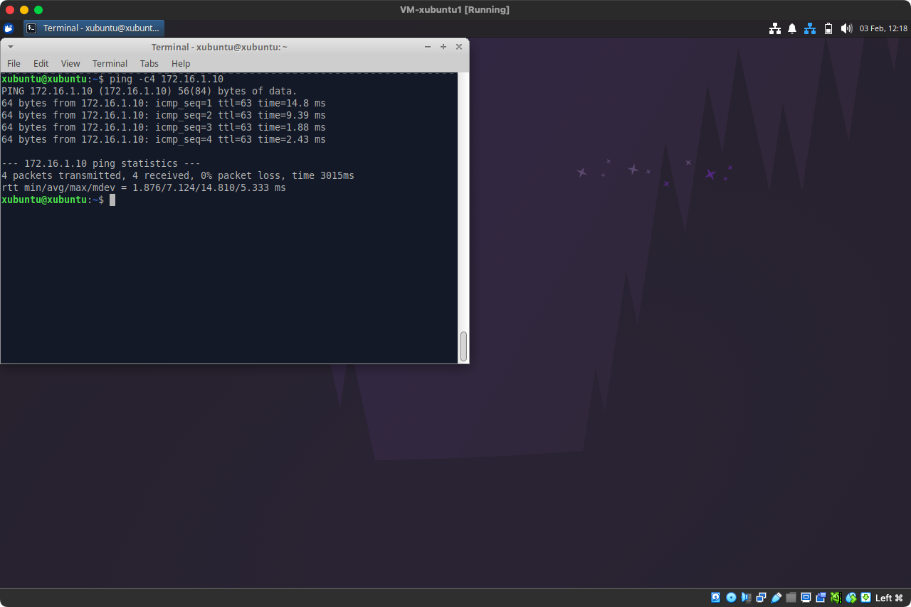
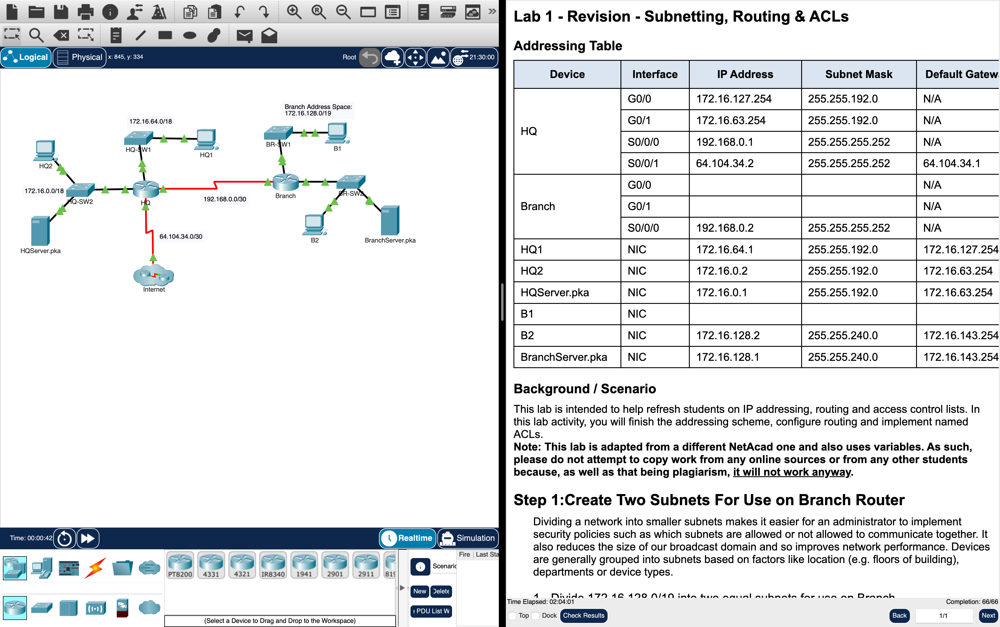
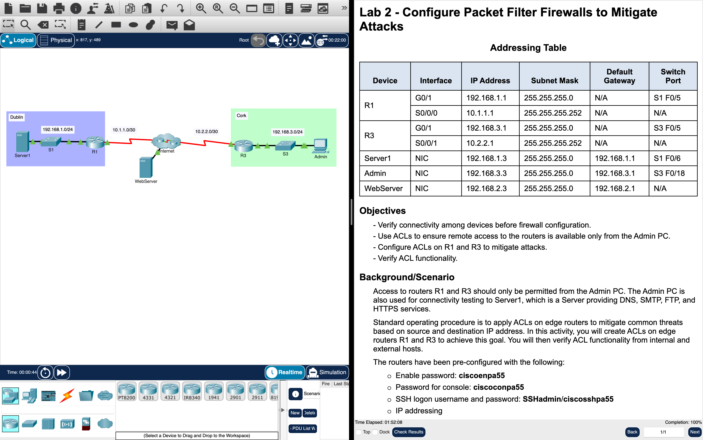
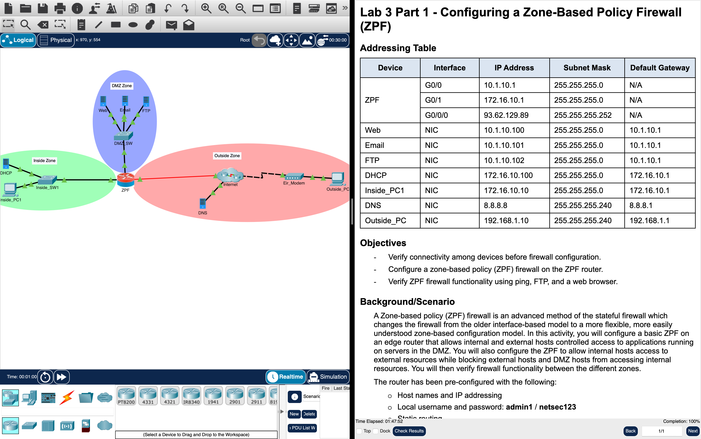
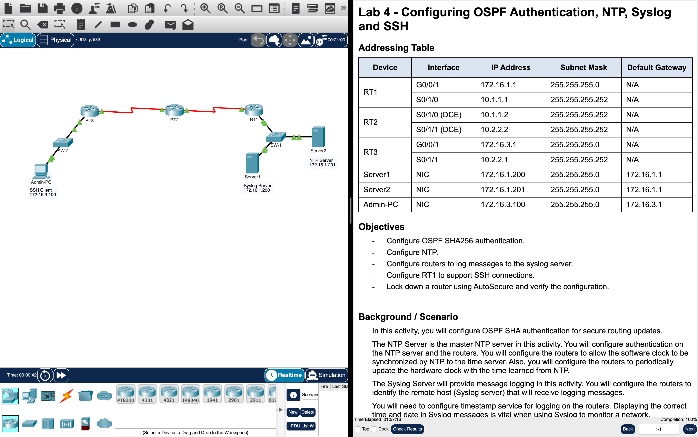
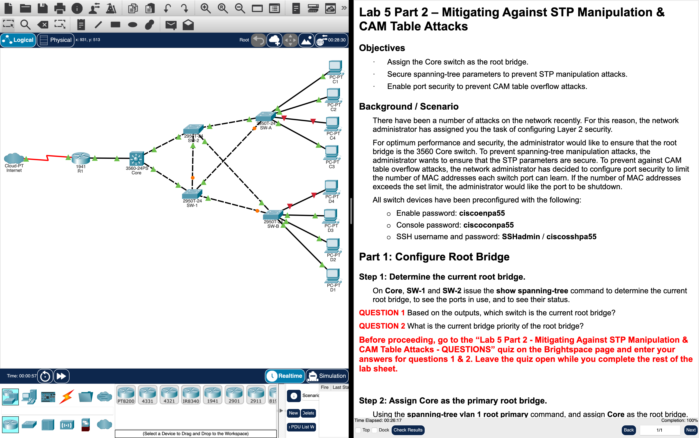
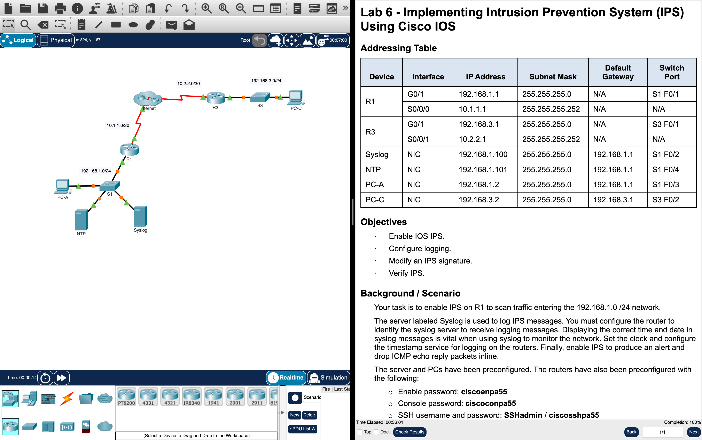
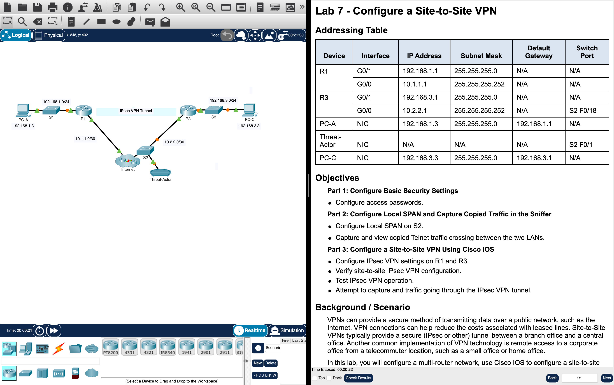
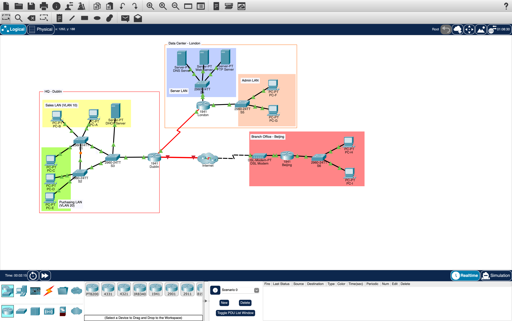

# Network Security

**Module:** Network Security (`DFCS H3015`)  
**Semester:** 6 (Year 3), folder `sem06`  
**Lecturer:** Peter Alexander  
**Date:** January - May 2026  
**Credits:** 10 ECTS  
**Matching project branch:** [`project/year03/module-network_security/open-source-firewalls`](https://github.com/DanyilT/projects-in-university/tree/project/year03/module-network_security/open-source-firewalls) (CA 1, the open source firewalls assignment: the report and the presentation and demo)

## What this module is for

Network Security is the third-year module that introduces the core network security technologies and shows how to develop security policies and mitigate risks: securing routers and switches and their networks, with the installation, troubleshooting and monitoring of network devices to maintain the integrity, confidentiality and availability of data and devices, and the technologies that underpin a secure network. The eleven lectures go through the introduction to network security, network threats and mitigation, firewall technologies, authentication, authorisation and accounting (AAA), device monitoring and management, secure device access (administrative roles), securing the local area network, intrusion prevention, cryptographic systems, virtual private networks and network security testing. The labs are Cisco Packet Tracer activities (labs 1 to 4, 5 part 2, 6 and 7), two hardware labs on real switches and routers (lab 5 in room E124 and lab 7 in room E125) and, first, a lab on virtual networking with VirtualBox virtual machines (lab 0). The week folders follow the lecture numbers: lecture N was in week N. This folder holds the lab instruction files (Word, with a PDF of each Packet Tracer lab, and PDFs for lab 0 and the lab 2 FAQ), the Packet Tracer starting activities and the files after the labs, the solution of lab 0 with its screenshots, a screenshot of the finished activity of each Packet Tracer lab, the CA 1 brief with the submission coversheet, the report writing checklist, the research guide, a screenshot of the network of the repeat version of CA 3 ([`assessment/03/`](assessment/03/)), the handouts of the weeks (the access lists workbook of week 3, the zone-based firewall cheat sheet of week 5 and the VLAN command reference of week 7) and the resources of the module [`resources/`](resources/) folder (a firewall test methodology, a common ports sheet, two Cisco IOS command guides and Packet Tracer revision labs). Packet Tracer saves files in an encrypted format, so the .pka files open only in Packet Tracer. The module is continuous assessment: labs 15% and lectures 5%, CA 1 (the open source firewalls assignment, 35% of the CA), CA 2 (a theory test, 20%) and CA 3 (a lab test, 25%). The challenges of CA 3 are outlined in [CA 3: lab test](#ca-3-lab-test).

## Grades Breakdown

| Assessment Type | Weighting |
|---|---|
| Labs (labs 0 to 7) | 15% |
| Lectures | 5% |
| CA 1: open source firewalls assignment (group of 2 to 3, report due 28 February 2026, presentations and demonstrations on 2 and 3 March 2026) | 35% |
| CA 2: theory test (week 10) | 20% |
| CA 3: lab test (week 12) | 25% |

## All weeks

| Week | Title | Files | Screenshot |
|---|---|---|---|
| Week 1 | Introduction to the module (lecture 1) | None. No lab. | — |
| [Week 2](week02/) | Lab 0: networking VMs (VirtualBox) | [`lab/network_security_week02_lab.pdf`](week02/lab/network_security_week02_lab.pdf) [`lab/solution/network_security_week02_lab_solution.pdf`](week02/lab/solution/network_security_week02_lab_solution.pdf) [`lab/solution/resources/network_security_week02_lab_solution_vm1_ping_vm3.png`](week02/lab/solution/resources/network_security_week02_lab_solution_vm1_ping_vm3.png) [`lab/solution/resources/network_security_week02_lab_solution_vm1_ping_vm3_window.png`](week02/lab/solution/resources/network_security_week02_lab_solution_vm1_ping_vm3_window.png) [`lab/solution/resources/network_security_week02_lab_solution_vm3_ping_vm1.png`](week02/lab/solution/resources/network_security_week02_lab_solution_vm3_ping_vm1.png) [`lab/solution/resources/network_security_week02_lab_solution_vm3_ping_vm1_window.png`](week02/lab/solution/resources/network_security_week02_lab_solution_vm3_ping_vm1_window.png) |  |
| [Week 3](week03/) | Lab 1: revision of subnetting, routing and ACLs (Packet Tracer) | [`lab/network_security_week03_lab_revision_subnetting_routing_and_acls.pdf`](week03/lab/network_security_week03_lab_revision_subnetting_routing_and_acls.pdf) [`lab/network_security_week03_lab_revision_subnetting_routing_and_acls.pka`](week03/lab/network_security_week03_lab_revision_subnetting_routing_and_acls.pka) [`lab/solution/network_security_week03_lab_revision_subnetting_routing_and_acls_solution.pka`](week03/lab/solution/network_security_week03_lab_revision_subnetting_routing_and_acls_solution.pka) [`resources/acl.pdf`](week03/resources/acl.pdf) [`resources/acl_solution.pdf`](week03/resources/acl_solution.pdf) |  |
| [Week 4](week04/) | Lab 2: configure packet filter firewalls to mitigate attacks (Packet Tracer) | [`lab/network_security_week04_lab_configure_packet_filter_firewalls_to_mitigate_attacks.docx`](week04/lab/network_security_week04_lab_configure_packet_filter_firewalls_to_mitigate_attacks.docx) [`lab/network_security_week04_lab_configure_packet_filter_firewalls_to_mitigate_attacks.pdf`](week04/lab/network_security_week04_lab_configure_packet_filter_firewalls_to_mitigate_attacks.pdf) [`lab/network_security_week04_lab_configure_packet_filter_firewalls_to_mitigate_attacks.pka`](week04/lab/network_security_week04_lab_configure_packet_filter_firewalls_to_mitigate_attacks.pka) [`lab/solution/network_security_week04_lab_configure_packet_filter_firewalls_to_mitigate_attacks_solution.pka`](week04/lab/solution/network_security_week04_lab_configure_packet_filter_firewalls_to_mitigate_attacks_solution.pka) [`lab/resources/network_security_week04_lab_faq.pdf`](week04/lab/resources/network_security_week04_lab_faq.pdf) |  |
| [Week 5](week05/) | Lab 3: zone-based firewalls and AAA authentication on routers (Packet Tracer) | [`lab/network_security_week05_lab_configuring_a_zone_based_policy_firewall_zpf.docx`](week05/lab/network_security_week05_lab_configuring_a_zone_based_policy_firewall_zpf.docx) [`lab/network_security_week05_lab_configuring_a_zone_based_policy_firewall_zpf.pdf`](week05/lab/network_security_week05_lab_configuring_a_zone_based_policy_firewall_zpf.pdf) [`lab/network_security_week05_lab_configuring_a_zone_based_policy_firewall_zpf.pka`](week05/lab/network_security_week05_lab_configuring_a_zone_based_policy_firewall_zpf.pka) [`lab/solution/network_security_week05_lab_configuring_a_zone_based_policy_firewall_zpf_solution.pka`](week05/lab/solution/network_security_week05_lab_configuring_a_zone_based_policy_firewall_zpf_solution.pka) [`lab/network_security_week05_lab_configuring_aaa_authentication_on_routers.docx`](week05/lab/network_security_week05_lab_configuring_aaa_authentication_on_routers.docx) [`lab/network_security_week05_lab_configuring_aaa_authentication_on_routers.pdf`](week05/lab/network_security_week05_lab_configuring_aaa_authentication_on_routers.pdf) [`lab/network_security_week05_lab_configuring_aaa_authentication_on_routers.pka`](week05/lab/network_security_week05_lab_configuring_aaa_authentication_on_routers.pka) [`lab/solution/network_security_week05_lab_configuring_aaa_authentication_on_routers_solution.pka`](week05/lab/solution/network_security_week05_lab_configuring_aaa_authentication_on_routers_solution.pka) [`resources/ios_zone_based_firewall.pdf`](week05/resources/ios_zone_based_firewall.pdf) |  |
| Week 6 | Secure device access (lecture 6) and CA 1 presentations and demonstrations | None. See CA 1 below. | — |
| [Week 7](week07/) | Lab 4: OSPF authentication, NTP, syslog and SSH (Packet Tracer) | [`lab/network_security_week07_lab_configuring_ospf_authentication_ntp_syslog_and_ssh.docx`](week07/lab/network_security_week07_lab_configuring_ospf_authentication_ntp_syslog_and_ssh.docx) [`lab/network_security_week07_lab_configuring_ospf_authentication_ntp_syslog_and_ssh.pdf`](week07/lab/network_security_week07_lab_configuring_ospf_authentication_ntp_syslog_and_ssh.pdf) [`lab/network_security_week07_lab_configuring_ospf_authentication_ntp_syslog_and_ssh.pka`](week07/lab/network_security_week07_lab_configuring_ospf_authentication_ntp_syslog_and_ssh.pka) [`lab/solution/network_security_week07_lab_configuring_ospf_authentication_ntp_syslog_and_ssh_solution.pka`](week07/lab/solution/network_security_week07_lab_configuring_ospf_authentication_ntp_syslog_and_ssh_solution.pka) [`resources/vlan_command_reference.pdf`](week07/resources/vlan_command_reference.pdf) |  |
| [Week 8](week08/) | Lab 5: LAN security (hardware) and STP and CAM table attacks (Packet Tracer) | [`lab/network_security_week08_lab_configure_lan_security_hardware_lab.docx`](week08/lab/network_security_week08_lab_configure_lan_security_hardware_lab.docx) [`lab/network_security_week08_lab_mitigating_against_stp_manipulation_and_cam_table_attacks.docx`](week08/lab/network_security_week08_lab_mitigating_against_stp_manipulation_and_cam_table_attacks.docx) [`lab/network_security_week08_lab_mitigating_against_stp_manipulation_and_cam_table_attacks.pdf`](week08/lab/network_security_week08_lab_mitigating_against_stp_manipulation_and_cam_table_attacks.pdf) [`lab/network_security_week08_lab_mitigating_against_stp_manipulation_and_cam_table_attacks.pka`](week08/lab/network_security_week08_lab_mitigating_against_stp_manipulation_and_cam_table_attacks.pka) [`lab/solution/network_security_week08_lab_mitigating_against_stp_manipulation_and_cam_table_attacks_solution.pka`](week08/lab/solution/network_security_week08_lab_mitigating_against_stp_manipulation_and_cam_table_attacks_solution.pka) |  |
| [Week 9](week09/) | Lab 6: intrusion prevention system using Cisco IOS (Packet Tracer) | [`lab/network_security_week09_lab_implementing_intrusion_prevention_system_ips_using_cisco_ios.docx`](week09/lab/network_security_week09_lab_implementing_intrusion_prevention_system_ips_using_cisco_ios.docx) [`lab/network_security_week09_lab_implementing_intrusion_prevention_system_ips_using_cisco_ios.pdf`](week09/lab/network_security_week09_lab_implementing_intrusion_prevention_system_ips_using_cisco_ios.pdf) [`lab/network_security_week09_lab_implementing_intrusion_prevention_system_ips_using_cisco_ios.pka`](week09/lab/network_security_week09_lab_implementing_intrusion_prevention_system_ips_using_cisco_ios.pka) [`lab/solution/network_security_week09_lab_implementing_intrusion_prevention_system_ips_using_cisco_ios_solution.pka`](week09/lab/solution/network_security_week09_lab_implementing_intrusion_prevention_system_ips_using_cisco_ios_solution.pka) |  |
| Week 10 | Virtual private networks (lecture 10) and CA 2, the theory test | None. | — |
| [Week 11](week11/) | Lab 7: site-to-site VPN (hardware and Packet Tracer) | [`lab/network_security_week11_lab_configure_a_site_to_site_vpn_hardware_lab.docx`](week11/lab/network_security_week11_lab_configure_a_site_to_site_vpn_hardware_lab.docx) [`lab/network_security_week11_lab_configure_a_site_to_site_vpn.docx`](week11/lab/network_security_week11_lab_configure_a_site_to_site_vpn.docx) [`lab/network_security_week11_lab_configure_a_site_to_site_vpn.pdf`](week11/lab/network_security_week11_lab_configure_a_site_to_site_vpn.pdf) [`lab/network_security_week11_lab_configure_a_site_to_site_vpn.pka`](week11/lab/network_security_week11_lab_configure_a_site_to_site_vpn.pka) |  |
| Week 12 | Revision (no lecture) and CA 3, the lab test | None. | — |
| Week 13 | Revision week | None. | — |

## Assessments

CA 1 is the Open Source Firewalls Assignment (35% of the CA, a group of 2 to 3, given out on 30 January 2026, report due at 23:59 on Saturday 28 February 2026 on Brightspace, presentations and demonstrations in the assigned lab session on Monday and Tuesday 2 and 3 March 2026): research and test two open source firewalls (three in a group of three), one of which must be nftables (iptables, UFW and firewalld are not accepted, nor any other front end of them), implement and configure them in a realistic testbed, design tests of their effectiveness, compare them and analyse the results. The deliverables are a report (at most 2,500 words for a group of two and 3,000 for a group of three, Harvard referencing), a presentation of 5 minutes and a demonstration of 7 minutes in the lab (possibly 5), and the three components are all mandatory. The marking scheme is background research 10%, effective configuration of the firewall rules and demonstration of tests 15%, analysis of the results 15%, extra relevant research 10%, references and overall quality of the report 10%, the presentation 20% and the demonstration 20%. AI is not allowed (level 1, not even to generate tests or firewall rules or for the background research). The assignment lists nftables, pfSense, OPNsense, Smoothwall, Endian, IPCop and IPFire as open source firewalls, and the module page links six guides on nftables, iptables and firewall policy for the research (see [Links](#links)). The project of this folder was done in a group of three with three firewalls, nftables, pfSense and OPNsense, in a testbed of four virtual machines (a WAN machine, the firewall, a DMZ server and a LAN client): a report of 63 pages and a presentation and demo of 32 slides, marked 29.5 out of 35 (the weight of CA 1). They are on the branch linked above, whose README also links to their Google Docs and Google Slides versions. CA 2, the theory test (week 10, 20%), and CA 3, the lab test (week 12, 25%), are not in the repository.

| File | What it contains |
|---|---|
| [`assessment/01/network_security_assessment.pdf`](assessment/01/network_security_assessment.pdf) | The brief (4 pages): the School of Informatics & Cybersecurity assessment brief coversheet (module, assessment title, type, weighting, deadline, submission mechanism, late penalty and the use of AI level) and the CA1 Open Source Firewalls Assignment Specification (the outline, the deliverables, the marking scheme and the common pitfalls). |
| [`assessment/01/submission/project_link.txt`](assessment/01/submission/project_link.txt) | Two lines: the GitHub link to the project on its branch and the branch name. The branch has the report (63 pages) and the presentation and demo (32 slides) of CA 1. |
| [`assessment/01/resources/network_security_assessment_report_writing_checklist.pdf`](assessment/01/resources/network_security_assessment_report_writing_checklist.pdf) | The report writing checklist (2 pages) for the written reports of the BSc in Digital Forensics and Cyber Security, 13 points: the AI rules of the brief, the report template, the spell checker, the cover page and the signed declaration, the table of contents, the sections, the required content, the writing style (no run-on sentences, logical paragraphs, no "I", "we" or "you", no redundant words), plagiarism and references. |
| [`assessment/01/resources/network_security_assessment_submission_cover_page.docx`](assessment/01/resources/network_security_assessment_submission_cover_page.docx) | The School of Informatics & Cybersecurity assessment submission coversheet (Word, 1 page), blank: the personal details (number and name), the module title and code, the assessment title, a declaration with four boxes to tick (the Academic Integrity Policy, the TU Dublin AI Driving License theory test, the submission is the author's own work, and the AI traffic light level of the brief), the signature and the date. The CA 1 brief requires it to be included with each assignment. |
| [`assessment/01/resources/network_security_assessment_research_guide.pdf`](assessment/01/resources/network_security_assessment_research_guide.pdf) | The research guide (6 pages): the module expects bachelors-level engagement with the scientific literature (identify key developments, analyse them critically and devise ways of improving on prior results). It covers the use of concepts, finding papers (peer-reviewed journals and conferences, the TU Dublin library databases, recent papers, Harvard referencing), the analytical styles and techniques (compare and contrast, critical summary, description and narration, evaluation, explanation, interpretation and synthesis), evaluating and critically summarising a paper, argument, and citations. |

### CA 3: lab test

The challenges and the labs that practised them:

| Challenge | Practised in |
|---|---|
| Hardening of all the routers and switches | [Lab 2](week04/) (access to the VTY lines), [Lab 4](week07/) (SSH, AutoSecure) and [Lab 5](week08/) (basic switch settings, unused ports) |
| Access control: AAA authentication against a server and SSH on the Dublin and London routers, local accounts and role-based access (a senior and a junior admin) on the Beijing router | [Lab 3](week05/) (local, TACACS+ and RADIUS authentication), [Lab 4](week07/) (SSH) and lecture 6 (administrative roles) |
| Device monitoring: all the devices log to one server, with consistent timestamps | [Lab 4](week07/) (syslog and NTP) |
| Confidentiality: an encrypted tunnel between Dublin and Beijing | [Lab 7](week11/) (site-to-site IPsec VPN) |
| Control plane: authentication of the OSPF messages between Dublin and London | [Lab 4](week07/) (OSPF authentication) and [Lab 1](week03/) (OSPF) |
| Gateway security, Dublin: a packet filter with anti-spoofing | [Lab 1](week03/) and [Lab 2](week04/) (ACLs, valid source addresses) |
| Gateway security, London: a zone-based policy firewall | [Lab 3](week05/) |
| Gateway security, Beijing: an intrusion prevention system against ping-based DoS attacks | [Lab 6](week09/) (Cisco IOS IPS) |
| LAN security: protection of all the switches against layer 2 attacks | [Lab 5](week08/) (secure trunks, port security, STP and CAM table attacks) |

*Screenshot of the repeat version of CA 3, similar to the one that we had in the actual CA 3*

## Resources

| File | What it contains |
|---|---|
| [`resources/common_ports.pdf`](resources/common_ports.pdf) | The Common Ports cheat sheet (1 page, version 1.1, by Jeremy Stretch of packetlife.net): the TCP and UDP port numbers with their services (for example 22 SSH/SCP, 53 DNS, 80 HTTP, 443 HTTP over SSL, 500 ISAKMP and 514 syslog), marked as chat, encrypted, gaming, malicious, peer to peer or streaming, after the IANA port assignments. |
| [`resources/next_generation_firewall_test_methodology_v9_0.pdf`](resources/next_generation_firewall_test_methodology_v9_0.pdf) | The NSS Labs test methodology for next generation firewalls, version 9.0 of 3 December 2018 (25 pages): the product guidance, the security effectiveness tests (firewall policy enforcement with a baseline policy, intrusion prevention with the false positive and exploit coverage tests, and evasions), the performance tests (UDP throughput, latency, maximum capacity, HTTP capacity, SSL/TLS performance and single application flows), the stability and reliability tests (blocking under extended attack, the state engine under load, power fail, backup and restore, persistence of data), the total cost of ownership and value, and the change log. |
| [`resources/cisco_ios_revision_resources/basic_cli_commands.docx`](resources/cisco_ios_revision_resources/basic_cli_commands.docx) | A Cisco IOS command line guide for revision (Word, 16 pages) with example sessions: the troubleshooting tools (ping, traceroute, show ip route, show ip interface brief and show cdp neighbors detail), erasing and reloading a router, the basic configuration (hostname, no ip domain-lookup, enable secret, banner, console password and logging synchronous), the shortcut commands, configuring the serial and Fast Ethernet ports, saving the configuration to NVRAM, static and default routes, RIP (with show ip protocol and show ip rip database), CDP and show running-config. |
| [`resources/cisco_ios_revision_resources/ccna_command_summary.docx`](resources/cisco_ios_revision_resources/ccna_command_summary.docx) | A summary of some basic CCNA commands from semesters 1 and 2 (Word, 5 pages), a table of each command with its description: the router prompts and modes (user, privileged, global configuration, line console and interface configuration), erase, reload and copy run start, the show commands, hostname, banner and the enable password and secret, VLANs (creating them, the management VLAN, trunk and access ports and the VTP modes) and inter-VLAN routing with dot1q sub-interfaces. |
| [`resources/packet_tracer_labs/intro_to_networks_pta_files.zip`](resources/packet_tracer_labs/intro_to_networks_pta_files.zip) | A zip of nine Packet Tracer revision activities (.pka, February 2019) from the Introduction to Networks course: Navigating the IOS (2.1.4.6), Configuring Initial Switch Settings (2.2.3.4), Implementing Basic Connectivity (2.3.2.5), Configure Initial Router Settings (6.4.1.3), Connect a Router to a LAN (6.4.3.3), Configuring IPv6 Addressing (7.2.4.9), Subnetting Scenario (8.1.4.7), Configuring Secure Passwords and SSH (11.2.4.5) and Using Show Commands (11.3.3.3). Packet Tracer saves files in an encrypted format, so the activities open only in Cisco Packet Tracer and their contents are not shown in the repository. |
| [`resources/packet_tracer_labs/acl_labs.zip`](resources/packet_tracer_labs/acl_labs.zip) | A zip of six Packet Tracer activities (.pka, August 2016) on access control lists: Configuring Standard ACLs (9.2.1.10), Configuring Named Standard ACLs (9.2.1.11), Configuring an ACL on VTY Lines (9.2.3.3) and Configuring Extended ACLs, scenarios 1, 2 and 3 (9.3.2.10, 9.3.2.11 and 9.3.2.12). Packet Tracer saves files in an encrypted format, so the activities open only in Cisco Packet Tracer and their contents are not shown in the repository. |

### Schedule

| Week | Session | Week Date |
|---|---|---|
| Week 1 | Lecture 1: Introduction to Module | 26 January 2026 |
| [Week 2](week02/) | Lecture 2: Network Threats & Mitigation Lab 0: networking VMs (VirtualBox) CA 1: open source firewalls assignment, 35% of the CA, in weeks 2 to 5 (given out on 30 January) | 2 February 2026 |
| [Week 3](week03/) | Lecture 3: Firewall Technologies Lab 1: revision of subnetting, routing and ACLs (Packet Tracer) | 9 February 2026 |
| [Week 4](week04/) | Lecture 4: Authentication, Authorisation & Accounting (AAA) Lab 2: configure packet filter firewalls to mitigate attacks (Packet Tracer) | 16 February 2026 |
| [Week 5](week05/) | Lecture 5: Device Monitoring and Management Lab 3: zone-based firewalls and AAA authentication on routers (Packet Tracer) CA 1 report due at 23:59 on Saturday 28 February | 23 February 2026 |
| Week 6 | Lecture 6: Secure Device Access CA 1 presentations and demonstrations, 2 and 3 March (in the assigned lab session) | 2 March 2026 |
| [Week 7](week07/) | Lecture 7: Securing the Local Area Network Lab 4: OSPF authentication, NTP, syslog and SSH (Packet Tracer) | 9 March 2026 |
| [Week 8](week08/) | Lecture 8: Implementing Intrusion Prevention Lab 5: LAN security (hardware) and STP and CAM table attacks (Packet Tracer) | 16 March 2026 |
| [Week 9](week09/) | Lecture 9: Cryptographic Systems Lab 6: intrusion prevention system using Cisco IOS (Packet Tracer) | 23 March 2026 |
| No week | Project work, reading and spring break | 30 March and 6 April 2026 |
| Week 10 | Lecture 10: Implementing Virtual Private Networks CA 2: theory test, 20% of the CA | 13 April 2026 |
| [Week 11](week11/) | Lecture 11: Network Security Testing Lab 7: site-to-site VPN (hardware and Packet Tracer) | 20 April 2026 |
| Week 12 | Revision (no lecture) CA 3: lab test, 25% of the CA | 27 April 2026 |
| Week 13 | Revision week | 4 May 2026 |

### Links

- The VirtualBox and Xubuntu downloads of Lab 0: https://www.virtualbox.org and https://xubuntu.org/download/
- Useful links from the module page for CA 1 (the open source firewalls assignment), on nftables, iptables and firewalls:
  - https://linux-audit.com/networking/nftables/nftables-beginners-guide-to-traffic-filtering/ (Linux Audit: beginners guide to traffic filtering with nftables)
  - https://wiki.nftables.org/wiki-nftables/index.php/Main_Page (the nftables wiki)
  - https://www.linkedin.com/pulse/comprehensive-guide-nftables-leading-packet-filtering-arash-shirvar/ (a LinkedIn article: a comprehensive guide to nftables, a leading packet filtering framework for Linux)
  - https://www.digitalocean.com/community/tutorials/a-deep-dive-into-iptables-and-netfilter-architecture (DigitalOcean: a deep dive into iptables and Netfilter architecture)
  - https://www.digitalocean.com/community/tutorials/what-is-a-firewall-and-how-does-it-work (DigitalOcean: what is a firewall and how does it work)
  - https://www.digitalocean.com/community/tutorials/how-to-choose-an-effective-firewall-policy-to-secure-your-servers (DigitalOcean: how to choose an effective firewall policy to secure your servers)
