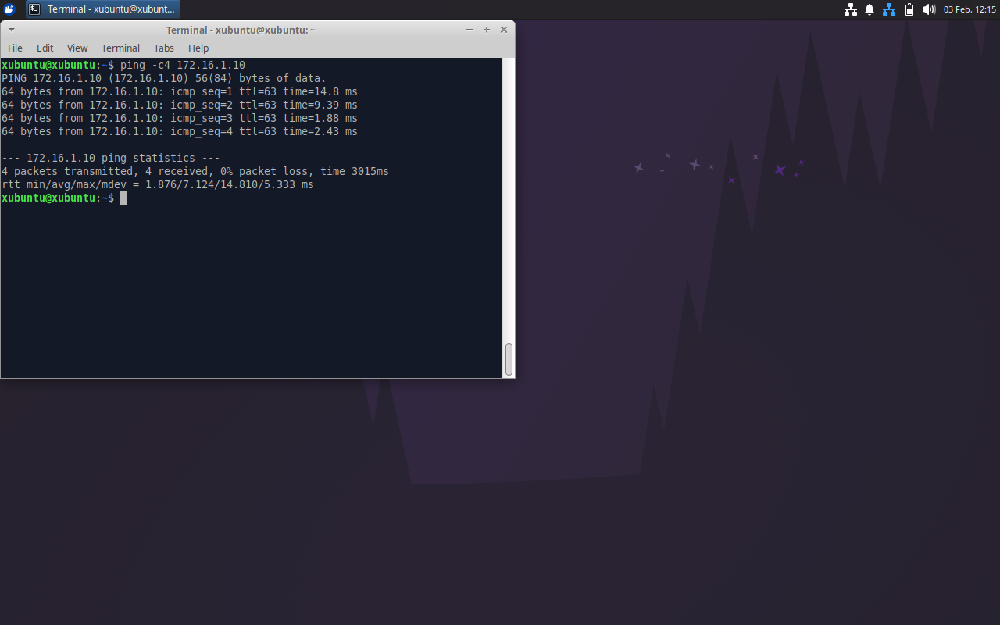
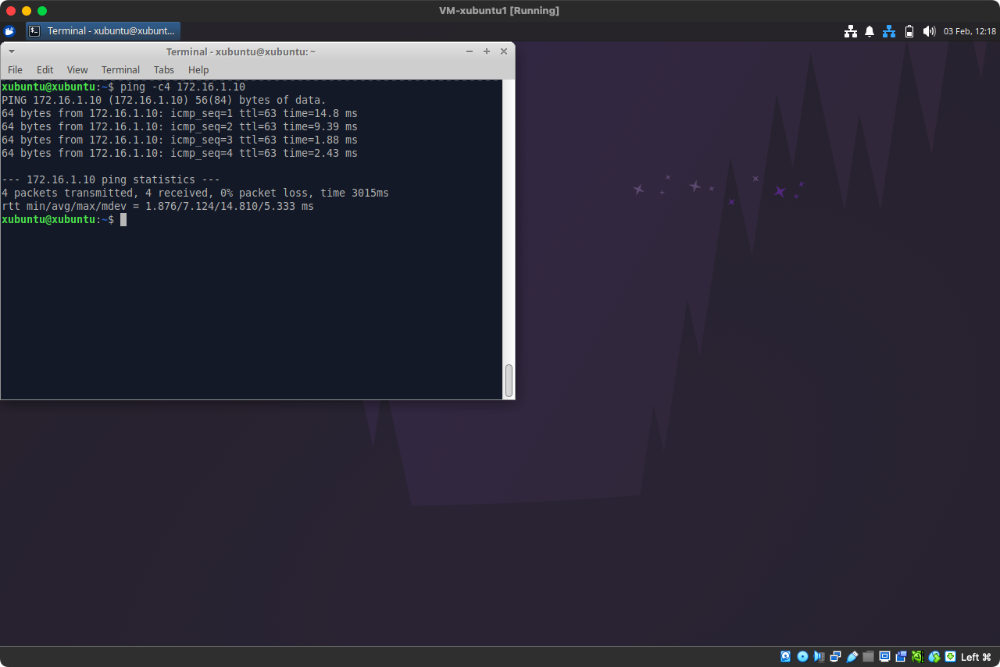
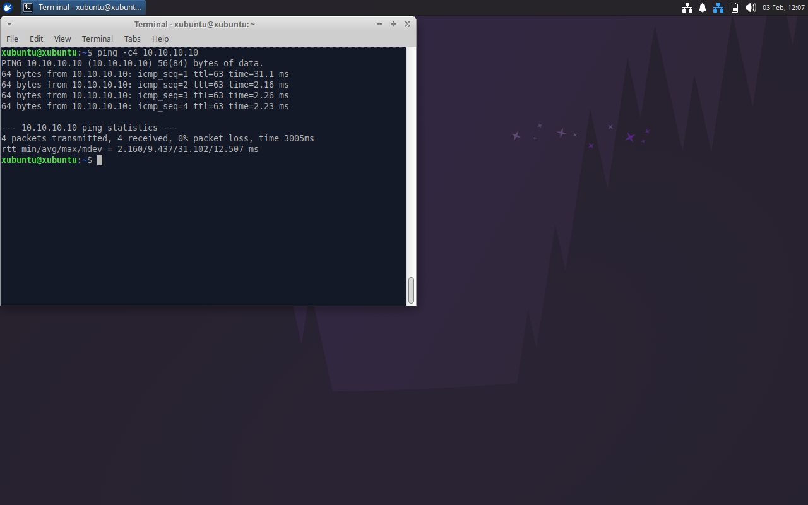

# Week 02 — Lab 0: networking VMs (VirtualBox)

**Module:** Network Security (`DFCS H3015`)  
**Semester:** 6 (Year 3), folder `sem06`

[Module README](../README.md)

## What this week is for

Lecture 2 was network threats and mitigation. Lab 0 creates virtual machines and networks them. Part 1 networks two VMs together: create a Xubuntu VM in VirtualBox and install the guest OS (2 GB of RAM, 1 CPU and a 20 GB disk), create a second VM by cloning the first one, and connect the two VMs to the same internal network in the 10.10.10.0/26 address range. Part 2 connects VMs through a gateway: create a third VM and connect it to a virtual network, add a second virtual adapter to the second VM and connect it to the third, and configure the second VM as a gateway between the two VMs. The course page has four VM tutorials for the same steps (creating a VM with a guest OS, attaching VMs to the same virtual network, connecting VMs to the Internet and downloading apps, and putting a VM between two other VMs). The solution is a page with two screenshots: VM1 pings VM3 (172.16.1.10) and VM3 pings VM1 (10.10.10.10) through the gateway VM2, with four replies each and TTL 63.

## Files

| File | What it contains | Screenshot |
|---|---|---|
| [`README.md`](README.md) | This README. | — |
| [`lab/network_security_week02_lab.pdf`](lab/network_security_week02_lab.pdf) | The lab sheet (19 pages): Lab 0 - Networking VMs, parts 1 and 2. | — |
| [`lab/solution/network_security_week02_lab_solution.pdf`](lab/solution/network_security_week02_lab_solution.pdf) | The lab solution (1 page): two screenshots of the VirtualBox windows, VM1 pinging VM3 and VM3 pinging VM1 through the gateway VM2. | — |
| [`lab/solution/resources/network_security_week02_lab_solution_vm1_ping_vm3.png`](lab/solution/resources/network_security_week02_lab_solution_vm1_ping_vm3.png) | A screenshot of VM1 (the screen of the virtual machine): ping -c4 172.16.1.10, the address of VM3, with four replies and TTL 63, which shows that the packets pass through the gateway VM2. |  *VM1 pinging VM3 over VM2.* |
| [`lab/solution/resources/network_security_week02_lab_solution_vm1_ping_vm3_window.png`](lab/solution/resources/network_security_week02_lab_solution_vm1_ping_vm3_window.png) | The same screenshot in the VirtualBox window of VM1 (the image used in the solution PDF). |  *VM1 pinging VM3, in the VirtualBox window.* |
| [`lab/solution/resources/network_security_week02_lab_solution_vm3_ping_vm1.png`](lab/solution/resources/network_security_week02_lab_solution_vm3_ping_vm1.png) | A screenshot of VM3 (the screen of the virtual machine): ping -c4 10.10.10.10, the address of VM1, with four replies and TTL 63. |  *VM3 pinging VM1 over VM2.* |
| [`lab/solution/resources/network_security_week02_lab_solution_vm3_ping_vm1_window.png`](lab/solution/resources/network_security_week02_lab_solution_vm3_ping_vm1_window.png) | The same screenshot in the VirtualBox window of VM3 (the image used in the solution PDF). |  *VM3 pinging VM1, in the VirtualBox window.* |
