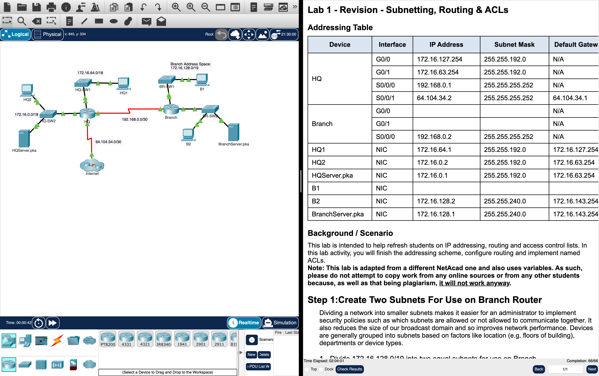

# Week 03 — Lab 1: revision of subnetting, routing and ACLs (Packet Tracer)

**Module:** Network Security (`DFCS H3015`)  
**Semester:** 6 (Year 3), folder `sem06`

[Module README](../README.md)

## What this week is for

Lecture 3 was firewall technologies. Lab 1 is a Packet Tracer revision activity on subnetting, routing and ACLs for a network with the routers HQ and Branch. Step 1 divides 172.16.128.0/19 into two subnets for Branch and finishes the addressing, step 2 configures OSPFv2 (process ID 10, passive interfaces and a default route on HQ that is redistributed to Branch), and step 3 configures the named standard ACLs HQServer and BranchServer that keep the computers of one router away from the server of the other. The lab has 16 questions that are answered in a quiz on Brightspace; the last one is the code of the activity's check results. The course files have no instruction sheet for this lab, the instructions are inside the Packet Tracer activity, and the PDF is an export of them. The folder [`resources/`](resources/) has the Access Lists Workbook (69 pages of exercises on ACLs) and its instructor's edition.

## Screenshots

*The Lab 1 activity in Packet Tracer: the network of HQ, Branch and the Internet next to the instructions with the addressing table, with the check results at 66 of 66.*

## Files

| File | What it contains |
|---|---|
| [`README.md`](README.md) | This README. |
| [`lab/network_security_week03_lab_revision_subnetting_routing_and_acls.pdf`](lab/network_security_week03_lab_revision_subnetting_routing_and_acls.pdf) | The lab instructions (3 pages), exported from the Packet Tracer activity: Lab 1 - Revision - Subnetting, Routing & ACLs, with the addressing table, the scenario and the three steps with 16 questions. |
| [`lab/network_security_week03_lab_revision_subnetting_routing_and_acls.pka`](lab/network_security_week03_lab_revision_subnetting_routing_and_acls.pka) | The Packet Tracer activity of Lab 1, Revision - Subnetting, Routing & ACLs: the starting network. Packet Tracer saves files in an encrypted format, so this file opens only in Cisco Packet Tracer and its contents are not shown in the repository. |
| [`lab/solution/network_security_week03_lab_revision_subnetting_routing_and_acls_solution.pka`](lab/solution/network_security_week03_lab_revision_subnetting_routing_and_acls_solution.pka) | The Packet Tracer file after the lab: the same network with the addressing, the OSPFv2 routing and the named ACLs configured. Packet Tracer saves files in an encrypted format, so this file opens only in Cisco Packet Tracer and its contents are not shown in the repository. |
| [`resources/acl.pdf`](resources/acl.pdf) | The Access Lists Workbook, version 1.0 (69 pages), produced by Robb Jones of the Frederick County Career & Technology Center (Cisco Networking Academy, Frederick, Maryland): the access-list numbers, how routers use ACLs, standard ACLs and where to place them, extended ACLs and their placement, filtering incoming or outgoing packets, the breakdown of an extended ACL statement, named ACLs, wildcard masks (the four uses, creating them and practice problems), writing standard and extended ACLs (worked samples and problems, each with a network diagram), optional ACL commands and other network security ideas, the index and a table of port numbers. The sample problems show their answers and the other problems are blank. |
| [`resources/acl_solution.pdf`](resources/acl_solution.pdf) | The instructor's edition of the same workbook (69 pages), with the answers to the problems filled in: the router, the interface and the number of each ACL and the ACL commands. |
